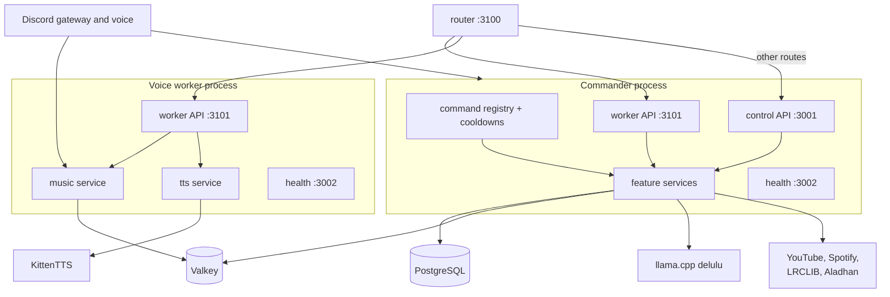

# Siela Bot

Single-guild Discord bot with music, social features, temporary voice channels, Tambola, and a bearer-token control API. Deployed with rootless Podman.

## Ground rules

- **One guild only.** The bot binds to `GUILD_ID` or auto-detects the only guild it is in and leaves others.
- **Only `DISCORD_TOKEN` is human-required.** `scripts/podman-init.sh` derives the client ID and generates the Postgres/control-API secrets.
- **Hybrid commands.** Most commands work as prefix, slash, and mention-prefix. Context-menu commands are not implemented.
- **Runtime authorization.** Admin checks use `Manage Guild`, server owner, `BOT_OWNER_ID`, or `ADMIN_ROLE_IDS`; never rely only on slash-command permissions.
- **Optional features degrade gracefully.** Missing Valkey, LLM, music binaries, TTS, or event audio must not take down the bot.
- **One interface, one writer.** The commander owns Discord commands, cards, and the public control API. Voice workers stay silent; the router is the only fleet entrypoint.
- **No secrets in the repo.** `deploy/podman/.env` is generated and must stay untracked.

## Architecture



`apps/router` is stateless: music and TTS route by `nodeId`, everything else proxies to the commander. See `docs/VOICE-FLEET.md`.

## Repository map

| Path | Purpose |
|---|---|
| `apps/bot/src/index.ts` | Process entrypoint: config, DB, logger, signals. |
| `apps/bot/src/bot.ts` | Bot lifecycle, event wiring, interaction routing, command registration, service composition. |
| `apps/bot/src/workerEntry.ts`, `workerNode.ts` | Slim voice-worker entrypoint (`dist/worker.js`) and its node class. Workers boot only voice, music, TTS, the internal API, health, and the fleet heartbeat. |
| `apps/bot/src/control/worker.ts` | Internal worker API (`/internal/music/*`, `/internal/tts/*`) on `:3101`. |
| `apps/router/` | Stateless fleet gateway: one HTTP entrypoint for N bots. |
| `apps/bot/src/commands/` | Command definitions grouped by category. Register every new command in `commands/index.ts`. |
| `apps/bot/src/framework/` | Command interface, registry, cooldowns, prefix/slash contexts, permissions. |
| `apps/bot/src/features/` | Feature services and UI builders. |
| `apps/bot/src/control/` | Control API and health/metrics servers. |
| `apps/bot/src/lib/` | Logger and error classes. |
| `apps/bot/assets/` | SFX and scheduled-event audio. Event audio is gitignored/server-only. |
| `packages/config` | Zod environment validation. |
| `packages/db` | Drizzle schema, Postgres client, migrations. |
| `packages/shared` | Shared types, Zod schemas, constants, utilities. |
| `deploy/podman` | Compose stack, Containerfiles, optional watchtower overlay. |
| `scripts/` | Podman init, stack wrapper, compose smoke test. |
| `docs/` | Architecture plan, runbook, threat model, UI audit, Tambola plan. |

## Command framework

`apps/bot/src/framework/types.ts` defines:

- `Command`: name, aliases, category, description, usage, examples, admin-only/NSFW flags, cooldowns, required permissions, optional slash builder, `execute`.
- `CommandContext`: unified prefix/slash context with `reply`, `edit`, `followUp`, `defer`.
- `Services`: all feature services, wired in `bot.ts`.

Flow:

1. Prefix messages are parsed in `onMessage`; slash commands in `onChatInput`.
2. Cooldowns and permissions run in `bot.guard`.
3. `command.execute(ctx)` runs.
4. Component interactions are routed by custom-ID prefix in `bot.onInteraction`.
5. Errors:
   - Prefix and slash commands use `handleCommandError`.
   - Use `UserError`/`ServiceUnavailableError` for friendly messages.
   - Unexpected errors get a request reference.

Categories: `music`, `social`, `voice`, `utility`, `admin`.

## Feature map

| Feature | Main files | Notes |
|---|---|---|
| Music | `features/music.ts`, `features/music-ui.ts`, `commands/music/music.ts` | yt-dlp + mpv (ffmpeg fallback), queue, filters, Spotify, cache, now-playing V2 card. Every voice channel is its own instance, sticky to a node. |
| Voice fleet | `features/fleetClient.ts`, `features/fleetHeartbeat.ts`, `apps/router/*` | Commander plus N workers act as one bot. Every VC routes to its own sticky node; text commands and cards follow the author's channel. Semaphore per guild from Valkey heartbeats; `429 all_nodes_busy` when full. See `docs/VOICE-FLEET.md`. |
| Voice SFX | `features/voiceSfx.ts` | Chat trigger `gay` joins the author's VC when the bot is idle, plays a cached 384 kbps clip once, then leaves. 60s guild cooldown. |
| Lyrics | `features/lyrics.ts`, `features/lyrics-ui.ts` | LRCLIB, `/lyrics` and now-playing button, in-memory cache, long lyrics attach `.txt`. |
| Tambola | `features/tambola/*`, `features/tambola-ui.ts`, `commands/social/tambola.ts` | 90-ball game, DM tickets, auto/manual marking, claims, KittenTTS calls with Edge TTS fallback, lobby settings. Ticket 25 SC, automark 10 SC. Rewards 5 SC participation, 10 SC per line, 40 SC Full House. |
| Welcome | `features/welcome.ts`, `features/welcomeCard.ts`, `commands/admin/welcome.ts` | Join/goodbye messages, optional image card/DM. |
| Auto-role | `features/autorole.ts`, `commands/admin/autorole.ts` | Safe role validation, hierarchy, sync preview/apply. |
| Temp VC | `features/tempvc.ts`, `commands/voice/vc.ts`, `commands/admin/tempvc.ts`, `commands/admin/jointocreate.ts` | Join-to-create, owner panel, lock/rename/limit/kick/transfer/delete, reconcile. |
| Social counters | `features/social.ts`, `features/counters.ts`, `commands/social/social.ts` | `slap`, `kiss`, `hug`, `chodu`, `wuzu`, opt-out-aware. |
| Love / bias | `features/love.ts`, `features/bias.ts`, `commands/social/love.ts`, `commands/social/bias.ts` | Stable pair score; BTS bias. |
| Friendship | `features/friendship.ts`, `commands/social/friendship.ts` | XP + co-presence seconds, Valkey buffer, 30s DB flush. |
| Family | `features/family.ts`, `features/familyCard.ts`, `commands/social/family.ts` | Marriages/children, editorial canvas family tree. |
| Confessions | `features/confession.ts`, `commands/social/confess.ts`, `commands/admin/confession.ts` | Anonymous wall, moderation. |
| Birthdays | `features/birthday.ts`, `commands/utility/birthday.ts` | Daily scheduler, optional wishes. |
| Activity | `features/activity.ts`, `commands/utility/activity.ts` | Message/command/reaction/voice stats, retention. |
| Delulu | `features/delulu.ts`, `commands/social/delulu.ts` | Local llama.cpp (`DeathSurfing/tinyTanLLM-delulu-gemma` Q4_K_M); surge-priced 5/15 SC base, doubling per daily use. SFW capped at 4/day, NSFW uncapped (coin-limited). No HF token required. |
| Random VC | `features/randomVc.ts` | Rare 2–6h drop, synthetic SFX, skips when voice is busy. |
| Economy | `features/economy.ts`, `features/stocks.ts`, `features/stocks-ui.ts`, economy/stocks commands | Siela Coins wallet, 50 SC starting balance, voice income, Tambola rewards, a six-stock bot market maker with a 1% fee, gambling sinks, shop, premium 2000 SC/30d. See `docs/ECONOMY.md`. |
| Relics | `features/relics/*`, `commands/social/relics.ts` | Daily 4–5 PM IST one-of-one card auction, escrowed SC bids, weekend rarity boost, vaults, yield, showcases, trades. See `docs/RELICS.md`. |
| TTS | `features/tts.ts`, `/tts on\|off` | Standalone TTS via local KittenTTS Nano ONNX (Bruno), Edge TTS fallback. Session is sticky to one node and ends after 30s with no texts. See `docs/TTS.md`. |
| Scheduled events | `features/scheduledEvents.ts`, `commands/utility/test.ts` | Aladhan Delhi prayer, phases for azan/anthem/hanuman-chalisa/church/monastery/gurudwara. Preempts the fleet session through the router. |
| Privacy/audit | `features/privacy.ts`, `features/audit.ts`, `commands/utility/privacy.ts` | Data deletion, audit log. |
| Control API | `control/server.ts` | Bearer `MCP_TOKEN`, typed routes, partial audit coverage. |
| Health | `control/health.ts` | `/healthz`, `/readyz`, `/metrics`. |

## Music

- Backend default `mpv`; `MUSIC_BACKEND=ffmpeg` supported.
- `yt-dlp` resolves searches/URLs. SoundCloud is the zero-token default; YouTube fallback exists.
- Spotify:
  - Track links use public oEmbed metadata + search.
  - Playlists/albums use Spotify's public embed `__NEXT_DATA__` (first 50 tracks), then YouTube search.
  - No Spotify credentials required.
- Queue is in-memory, persisted to Valkey per node and guild (`siela:music:queue:{node}:{guild}`).
  - `stop` clears the stored queue.
  - `disconnect` preserves it.
  - Current playback position is not resumed.
- Every voice channel is its own instance. `/play` resolves the VC→node binding, else the commander if its voice is free for that channel, else a free fleet node; the binding sticks.
- Every card button and control command carries the VC so two simultaneous streams stay independent.
- Workers auto-leave ~30s after their queue drains; new playback cancels it, and sticky TTS blocks it.
- Local cache keeps current/next/previous tracks under `/tmp/siela-music-cache` (cap ~250 MB), audio bitrate capped at 312 kbps.
- Filters apply live through mpv IPC without restarting the track.
- Now-playing V2 card buttons: pause/resume, lyrics, seek ±10s, skip, stop/disconnect, shuffle, loop, filter select.
- `/lyrics` fetches LRCLIB; `My ticket`-style long text uses a `.txt` attachment.

## Tambola

- 90-ball Tambola, **one active game per guild**, 2–20 players.
- 3×9 ticket, 15 numbers, 5 per row, 1–3 per column.
- Tickets are sent by **DM**; ephemeral fallback when DMs are closed.
- **Auto-marking is ON by default.** The host can turn it off in lobby settings.
- Claims: Top Line, Middle Line, Bottom Line, Full House. First valid claim wins; Full House ends the game.
- Lobby **Settings** button and `/tambola settings`:
  - Toggle auto-marking.
  - Pick the TTS voice channel or Text only.
  - Settings are lobby-only.
- Calls:
  - Default 12s; host can choose fast 8s or slow 15s.
  - Host can call manually (2s throttle), pause/resume, end.
- TTS:
  - Primary: local KittenTTS Nano ONNX service (`tts`, voice Bruno); Edge TTS (`en-IN-NeerjaNeural`, rate `-5%`) is the fallback.
  - `edge-tts==7.3.1` is installed in the bot image.
  - MP3s cached in `/tmp/siela-tambola-tts`, played via `@discordjs/voice` + ffmpeg.
  - Bingo classics + generic hype flavours; text-only fallback on failure.
- Voice coordination:
  - Tambola joins the selected voice channel when the lobby opens.
  - It stops music and locks the music voice (`MusicService.voiceLocks`).
  - Random VC and scheduled events skip while Tambola is using voice.
  - Music commands are blocked while the lock is active.
- Active games are in memory only; a restart cancels them and stale buttons report “no longer active.”
- Stats/leaderboards are deferred; there are no Tambola tables yet.

## Database

Postgres 17 + Drizzle. Schema: `packages/db/src/schema.ts`. Migrations: `packages/db/drizzle/`.

Tables:

- Settings: `guild_settings`, `welcome_settings`, `autorole_settings`, `tempvc_settings`, `music_settings`
- Social: `interaction_counters`, `interaction_optouts`, `user_birthdays`, `user_biases`, `friendship_levels`
- Voice/activity: `temp_voice_channels`, `member_activity`
- Content: `confessions`, `family_marriages`, `family_children`
- Operations: `audit_log`

Migration commands:

```bash
bun run db:generate   # generate a migration after schema changes
bun run db:migrate    # run migrations with DATABASE_URL
```

The compose stack also runs a one-shot `migrate` service before the bot starts.

## Configuration

Config is validated by `packages/config/src/index.ts`; `*_FILE` variants read secrets from files.

Required:

- `DISCORD_TOKEN`
- `DATABASE_URL`
- `MCP_TOKEN` (control API bearer, generated by init)

Common optional:

- `GUILD_ID`, `DISCORD_CLIENT_ID`
- `NODE_ROLE`, `NODE_ID`, `WORKER_INTERNAL_*` (fleet; see `docs/VOICE-FLEET.md`)
- `MUSIC_BACKEND`, `YTDLP_PATH`, `MPV_PATH`, `FFMPEG_PATH`
- `CONTROL_API_HOST/PORT`, `HEALTH_HOST/PORT`
- `DEFAULT_PREFIX`, `ADMIN_ROLE_IDS`, `BOT_OWNER_ID`
- `VALKEY_URL`, `LLM_URL`, `HF_TOKEN`
- `EVENT_SCHEDULE_ENABLED`, `EVENT_PRAYER`
- `LOG_LEVEL`, `AUDIT_RETENTION_DAYS`, `TZ`

Current deployed server uses `EVENT_SCHEDULE_ENABLED=true` and `EVENT_PRAYER=Dhuhr`; event audio lives only on the server.

Fleet env (commander and workers):

- `NODE_ROLE` (`commander` | `voice`), `NODE_ID` (default `commander`)
- `NODE_ADVERTISE_URL` — worker API URL published in the Valkey heartbeat
- `WORKER_INTERNAL_HOST` / `WORKER_INTERNAL_PORT` (default `:3101`)
- `ROUTER_URL` — lets `/play` fall back to the fleet and events preempt it
- Router: `NODES` (static fallback), `VALKEY_URL`, `GUILD_ID`, `COMMANDER_URL`, `ROUTER_PORT` (default `3100`)

Workers are generated: `scripts/make-voice-overlay.sh <N>` writes `deploy/podman/compose.voice.generated.yaml` from `.env.voice-1..N`. The wrapper auto-includes it. Never bind-mount host `dist` into workers, the server checkout has no local build and an empty mount shadows the image bundle.

## Development workflow

Bun 1.x (`packageManager bun@1.4.2`).

```bash
bun install
bun run typecheck
bun run test
bun run build
```

Useful:

```bash
bun run --filter @siela/bot test
bun run --cwd apps/bot dev
```

Conventions:

- ESM + TypeScript; imports use `.js` extensions.
- Prefer `UserError` for user-facing failures.
- Use `features/ui.ts` helpers and Components V2 (`MessageFlags.IsComponentsV2`) for cards.
- Keep custom IDs namespaced (`music:`, `tambola:`, `tempvc:`, `help:`) and route them in `bot.ts`.
- Add new services to `Services` and instantiate in `bot.ts`.
- Register commands in `commands/index.ts`.
- Add cleanup for timers, voice connections, and collectors on shutdown.
- Audit admin/control-API mutations with `AuditService`.
- Tests use Vitest; colocate `*.test.ts`.

## Deployment

### Standard first deploy

```bash
git clone https://github.com/DeathSurfing/siela-nogseuui-seobeo-bot.git
cd siela-nogseuui-seobeo-bot

export DISCORD_TOKEN="..."
./scripts/podman-init.sh          # derives client ID, generates secrets, writes deploy/podman/.env (600)
./scripts/podman-stack.sh up -d --build
podman ps --format '{{.Names}}\t{{.Status}}'
```

The init script prints the invite URL.

### Stack

`deploy/podman/compose.yaml`:

- `postgres` — Postgres 17, `pgdata` volume.
- `valkey` — Valkey 8, `valkeydata` volume.
- `llm` — llama.cpp server (`DeathSurfing/tinyTanLLM-delulu-gemma` Q4_K_M, ctx 1024) for delulu, `llmcache` volume.
- `tts` — KittenTTS Nano ONNX service (voice Bruno), Edge TTS fallback in bot.
- `migrate` — one-shot `node dist/scripts/migrate.js`.
- `bot` — Discord bot (commander: control API + health/metrics; every node: worker API).
- `router` — voice fleet gateway `:3100`. Music by `nodeId`, everything else proxied to the commander.
- voice workers — generated `bot-voice-<i>` services via `scripts/make-voice-overlay.sh <N>`. See `docs/VOICE-FLEET.md`.

Bot container is read-only with `/tmp` tmpfs, drops all caps, and includes ffmpeg, mpv, python3, yt-dlp, edge-tts, fonts, and canvas runtime. Voice workers reuse the bot image with `bun --smol dist/worker.js` and a 1 GB cap.

Optional overlays:

- `compose.watchtower.yaml` — auto-deploy sidecar. Rebuild its image by hand after watchtower changes; it never redeploys itself.

### Updates

Prefer the watchtower sidecar, or:

```bash
git pull --ff-only
podman build --network=host -f deploy/podman/Containerfile.bot -t localhost/siela-bot:latest .
podman build --network=host -f deploy/podman/Containerfile.router -t localhost/siela-router:latest .
./scripts/podman-stack.sh up -d --no-deps
```

`up -d --no-deps` avoids podman-compose hanging on the one-shot `migrate` container. Full deploys must not recreate `siela-watchtower`, or the deploy kills itself.

Migrations run when the `migrate` service runs. If needed:

```bash
podman compose -p siela -f deploy/podman/compose.yaml run --rm migrate
```

### Current maintainer server

The remote Podman host is documented in `docs/RUNBOOK.md`. On that host, image builds may need host networking because `/dev/net/tun` is unavailable:

```bash
cd /root/siela-nogseuui-seobeo-bot
git pull --ff-only
podman build --network=host -f deploy/podman/Containerfile.bot -t localhost/siela-bot:latest .
podman compose -p siela -f deploy/podman/compose.yaml up -d --force-recreate bot
podman logs --tail 20 siela-bot
podman ps --format '{{.Names}} {{.Status}}' | grep siela-bot
```

Verify:

- Logs show `guild commands registered` with the expected count.
- `podman ps` shows `siela-bot` as healthy.
- `podman healthcheck run siela-bot`.
- Health endpoints inside the container: `http://127.0.0.1:3002/healthz`, `/readyz`, `/metrics`.

### Scheduled-event audio

Server-only, gitignored under `apps/bot/assets/events/`:

- `azan.ogg` → `masjid`
- `anthem.ogg` → `parliament`
- `hanuman-chalisa.ogg` → `mandir`

Streamed from YouTube, no file needed:

- `church` (Dhuhr+3h) → `church`
- `monastery` (Dhuhr+4h) → `monastery`
- `gurudwara` (Dhuhr+5h) → `gurudwara`

Supported extensions: `.ogg`, `.mp3`, `.wav`, `.m4a`, `.flac`. See `apps/bot/assets/events/README.md`. The owner-only prefix command `!test azan|anthem|hanumanchalisa|church|monastery|gurudwara` runs the full workflow; `test` is restricted to user ID `197768227936403458`. With a fleet, each phase first calls `POST /v1/session/preempt` on the router (skipping TTS-active nodes), then plays.

## Control API

Control API (`apps/bot/src/control/server.ts`):

- Listens on `CONTROL_API_PORT` (default 3001), internal network, commander only.
- Requires `Authorization: Bearer <MCP_TOKEN>`.
- Routes include status, commands, prefix, welcome, autorole, tempvc, music, counters, audit, message send, privacy delete.
- Some mutations are audited.

Fleet router (`apps/router`, `:3100`, same bearer): `GET /v1/music/nodes`, `GET /v1/music/state?nodeId=`, `GET /v1/music/state-all`, `POST /v1/music/<op>` (auto-routes `play` when `nodeId` is omitted), `POST /v1/session/preempt`, `/v1/tts/*`. Non-music `/v1/*` proxies to the commander.

## Common operations

```bash
# logs
./scripts/podman-stack.sh logs -f bot
podman logs --since 1h siela-bot | grep -iE 'error|warn|tambola|music'

# restart
podman restart siela-bot

# health
podman healthcheck run siela-bot

# stop preserving volumes
podman compose -p siela -f deploy/podman/compose.yaml down

# destroy everything
podman compose -p siela -f deploy/podman/compose.yaml down -v
```

Backups:

```bash
podman exec siela-postgres pg_dump -U siela -Fc siela \
  | gzip > "/var/backups/siela/siela-$(date +%F).dump.gz"
```

## Troubleshooting

- **Invalid environment**: check `deploy/podman/.env`; `DISCORD_TOKEN` and generated secrets must be present. Use `scripts/podman-init.sh`.
- **Bot in wrong/extra guild**: set `GUILD_ID`; the bot leaves unbound guilds.
- **Music silent**: check `podman exec siela-bot yt-dlp --version` and `mpv --version`; verify no Tambola game is locking voice.
- **Tambola TTS silent**:
  - Check the lobby card `TTS` line.
  - Ensure the bot has `Connect` and `Speak` in the selected voice channel.
  - Check the KittenTTS service first: `podman ps | grep siela-tts`, `podman logs --tail 20 siela-tts`, verify `TTS_SERVICE_URL` (default `http://tts:8000`).
  - Edge TTS fallback needs outbound network access. Test: `podman exec siela-bot python3 -m edge_tts --voice en-IN-NeerjaNeural --text "test" --write-media /tmp/tambola-test.mp3`.
  - Grep logs for `tambola`.
- **Tambola TTS and music conflict**: a Tambola game stops and locks music. Finish/end the game or use Text only in lobby settings.
- **Random VC or prayer event skipped**: expected while Tambola is active or music voice is locked.
- **Slash command says “Something went wrong”**: check logs; `UserError`s now return friendly messages. If the bot restarted, active Tambola games are gone.
- **Build fails on current server**: use `podman build --network=host`.
- **Read-only container write failure**: write only to `/tmp` (tmpfs) or a mounted volume.
- **Worker crash-loops with `Module not found dist/worker.js`**: a host `dist` bind-mount shadows the image bundle. Regenerate the overlay (`scripts/make-voice-overlay.sh <N>`); it must have no `volumes:` block.
- **Whole stack restarts in a loop after a push**: watchtower recreated itself mid-deploy. Pin the recreate list to `bot tts router bot-voice-*` and rebuild the watchtower image by hand.
- **`up -d` hangs after a rebuild**: podman-compose waits on the one-shot `migrate` container. Use `up -d --no-deps`.
- **`depends on container ... not found`**: stale metadata from an interrupted run. `podman rm` the stuck `Created` container and retry.
- **Router says all nodes busy**: that is the semaphore working. Add workers or stop a stream.

## Change checklist

1. Locate the feature in `features/`, its command in `commands/`, and UI in a `*-ui.ts`.
2. Add the service to `Services` and instantiate/wire it in `bot.ts`.
3. Register the command in `commands/index.ts`.
4. Route new component custom IDs in `bot.ts`.
5. Add DB migration + schema changes if persistence is needed.
6. Add/update unit tests; run `typecheck`, `test`, `build`.
7. Deploy with Podman; verify command count, health, and logs.
8. Update `README.md` and relevant `docs/` for user-visible behavior.
9. Fleet change: update `workerNode.ts`/`worker.ts`/router together, run `scripts/make-voice-overlay.sh <N>`, and verify `GET /v1/music/state-all` returns every node `ok:true`.

## Key docs

- `README.md` and `GET_STARTED.md` — project overview and first-run setup.
- `docs/ARCHITECTURE.md` — process model, command lifecycle, boot order, persistence, deployment diagrams.
- `docs/VOICE-FLEET.md` — N-bot voice fleet: router, workers, per-VC instances, sticky TTS, sessions, updates.
- `docs/PLAN.md` — historical planning doc (Draft v0.2), not current architecture.
- `docs/ECONOMY.md` — Siela Coins, pricing, premium.
- `docs/RELICS.md` — relic cards, daily auction, bidding, vaults, yield, trades.
- `docs/TTS.md` — KittenTTS service, voices, fallback, `/tts`.
- `docs/DELULU.md` — llama.cpp delulu generation and costs.
- `docs/RUNBOOK.md` — deploy, updates, backups, remote Podman, troubleshooting.
- `docs/THREAT-MODEL.md` — security boundaries.
- `docs/UI_AUDIT.md` — UI conventions and audit status.
- `docs/TAMBOLA_PLAN.md` — Tambola rules, state, TTS, implementation phases.
- `deploy/podman/README.md` — compose stack and overlays.
