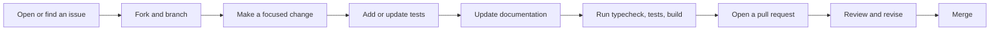

# Contributing

Thank you for considering a contribution. Siela Bot is a small self-hosted project, so clear bug reports, focused pull requests, and documentation fixes are all valuable.

## Before you start

- Read [GET_STARTED.md](GET_STARTED.md) for local setup.
- Read [docs/ARCHITECTURE.md](docs/ARCHITECTURE.md) before changing command flow, services, persistence, or deployment.
- Follow the [Code of Conduct](CODE_OF_CONDUCT.md).
- Report security issues privately as described in [SECURITY.md](SECURITY.md). Do not open a public issue for a vulnerability.

## Contribution flow



## Development setup

The supported development workflow uses Bun 1.4.

```bash
bun install
bun run typecheck
bun run test
bun run build
```

The bot process loads `.env` from `apps/bot`, not from the repository root. Use the local setup in [GET_STARTED.md](GET_STARTED.md). A root `.env` is ignored by `bun run dev:bot`.

Useful commands:

```bash
bun run dev:bot          # watch and run the bot
bun run dev:mcp          # watch and run the MCP server
bun run db:generate      # generate a Drizzle migration
bun run db:migrate       # apply migrations
bun run --cwd apps/bot test -- <file>   # run one bot test file
```

## Project conventions

- Use TypeScript and ESM. Imports use `.js` extensions.
- Keep feature logic in `apps/bot/src/features/` and command definitions in `apps/bot/src/commands/`.
- Register every new command in `apps/bot/src/commands/index.ts`.
- Add new services to `Services` in `apps/bot/src/framework/types.ts` and instantiate them in `apps/bot/src/bot.ts`.
- Route new component custom IDs in `apps/bot/src/bot.ts`.
- Use `UserError` for failures that users should understand.
- Use `ServiceUnavailableError` when an optional dependency is unavailable.
- Audit admin and MCP mutations with `AuditService` where the route supports it.
- Clean up timers, collectors, voice connections, and listeners during shutdown.
- Keep custom IDs namespaced, for example `music:`, `tambola:`, `tempvc:`, and `help:`.

## Adding a command

1. Create the command file under the appropriate category.
2. Define the name, aliases, category, description, usage, cooldowns, permissions, and slash builder.
3. Register it in `apps/bot/src/commands/index.ts`.
4. Add the service to `Services` if the command needs new state.
5. Route component interactions in `bot.ts` if the command adds buttons, selects, or modals.
6. Add tests for observable behavior.
7. Update the README or the relevant document if user-facing behavior changes.

## Database changes

The schema is in `packages/db/src/schema.ts`. Migrations are in `packages/db/drizzle/`.

```bash
bun run db:generate
bun run db:migrate
```

Review generated SQL before committing. Do not edit an applied migration. Add a new migration instead. If you add a table or durable field, update the persistence map in [docs/ARCHITECTURE.md](docs/ARCHITECTURE.md).

## Tests

Tests use Vitest and live next to the code as `*.test.ts`.

```bash
bun run test
bun run --cwd apps/bot test
bun run --cwd apps/bot test src/features/tambola/game.test.ts
```

Add tests for behavior that users or operators can observe. A test should fail when the behavior breaks and keep passing when only internal structure changes.

## Documentation

- Use Mermaid for architecture, sequence, and state diagrams.
- Mark planned behavior as planned. Do not present it as implemented.
- Prefer concrete file paths and copyable commands.
- Update the documentation in the same pull request as the behavior change.
- Add new documents to [docs/README.md](docs/README.md).

## Pull requests

A good pull request:

- Solves one problem or delivers one coherent feature.
- Explains the user-visible or operator-visible change.
- Includes the tests that prove the change.
- Calls out migrations, environment changes, or deployment changes.
- States what was not tested.

Before opening a pull request, run:

```bash
bun run typecheck
bun run test
bun run build
```

Use a clear title. Describe the problem, the approach, and the verification. Link the issue when one exists.

## Reporting bugs

Include:

- The command or feature.
- What you expected and what happened.
- Steps to reproduce.
- Relevant logs with secrets removed.
- Runtime version, deployment mode, and whether the issue is reproducible after a restart.

Do not include tokens, database URLs, `.env` contents, or personal data.

## Feature requests

Describe the use case before the implementation. Explain who benefits, how the feature fits the single-guild design, and whether it needs economy, database, or voice integration. Small, well-scoped requests are easier to evaluate.

## License

By contributing, you agree that your contribution is licensed under the MIT license in [LICENSE](LICENSE).
