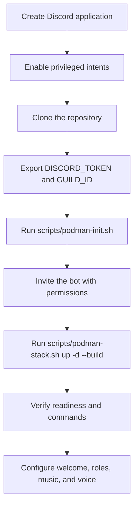

# Get Started

This guide takes you from a fresh clone to a working Siela Bot. Follow the container path for a production deployment. Use the local path when you want to develop without an NVIDIA GPU.



## 1. Choose your path

| Path | Requirements | What works |
|---|---|---|
| Container deployment | Linux, Podman 5+, a compose provider, NVIDIA GPU, `/opt/nvidia-libs` | Full stack, including local vLLM and KittenTTS |
| Local development | Bun 1.4, Node 24 tooling, PostgreSQL 17, optional Valkey | Bot, commands, database, music, and fallback TTS/LLM paths |

The checked-in compose stack defines a GPU-backed vLLM service. It does not provide a supported no-GPU production overlay. If you do not have an NVIDIA GPU, use local development. Delulu then falls back to public or built-in scenarios, and TTS can use Edge TTS.

## 2. Discord application setup

1. Open the [Discord Developer Portal](https://discord.com/developers/applications) and create an application.
2. Open **Bot**, reset the token, and store it safely.
3. Under **Privileged Gateway Intents**, enable **Server Members Intent** and **Message Content Intent**. The bot also uses the message content intent for prefix commands and voice-channel TTS.
4. Under **Installation**, confirm that the guild install includes the `bot` and `applications.commands` scopes.
5. Choose a test guild where you have **Manage Server**.

Without the two privileged intents, Discord closes the gateway connection and the bot cannot start.

## 3. Host prerequisites

Run these checks before you build:

```bash
podman --version                 # 5.0 or newer
podman compose version           # must print a compose provider
stat -fc %T /sys/fs/cgroup       # cgroup2fs
df -h .                          # allow about 25 GB for images and models
git --version
curl --version
python3 --version                # used by podman-init.sh to derive the client ID
```

The init script can use an explicit `DISCORD_CLIENT_ID` instead of `curl` and `python3`. Set it if those tools are unavailable.

For a rootless install, confirm that `/etc/subuid` and `/etc/subgid` contain your user, then enable lingering:

```bash
loginctl enable-linger "$USER"
```

For the GPU path, confirm that the device nodes exist and that `/opt/nvidia-libs` contains the driver userspace libraries:

```bash
ls /dev/nvidia0 /dev/nvidiactl /dev/nvidia-uvm
ls /opt/nvidia-libs
```

The stack needs outbound access to Discord, container registries, Hugging Face, YouTube, SoundCloud, Spotify, and LRCLIB. No inbound ports are required.

## 4. Clone and generate the environment

```bash
git clone https://github.com/DeathSurfing/siela-nogseuui-seobeo-bot.git
cd siela-nogseuui-seobeo-bot

export DISCORD_TOKEN="..."
export GUILD_ID="..."   # recommended for a single-guild install

./scripts/podman-init.sh
```

The script writes `deploy/podman/.env` with mode 600. It derives `DISCORD_CLIENT_ID`, generates `POSTGRES_PASSWORD` and `MCP_TOKEN`, and prints an invite URL with the recommended permission bitfield.

Set `GUILD_ID` on the first install. If it is unset and the bot joins a different guild first, it binds to that guild and leaves the others.

Do not run the init script with `FORCE=1` against an existing `pgdata` volume unless you intend to rotate the database password. PostgreSQL keeps the old password on an existing data directory.

## 5. Invite the bot

Use the URL printed by `podman-init.sh`. If you need to rebuild it manually:

```bash
CID=$(sed -n 's/^DISCORD_CLIENT_ID=//p' deploy/podman/.env)
GUILD=$(sed -n 's/^GUILD_ID=//p' deploy/podman/.env)
echo "https://discord.com/oauth2/authorize?client_id=${CID}&scope=bot%20applications.commands&permissions=322292816&guild_id=${GUILD}&disable_guild_select=true"
```

The permission value `322292816` covers channel access, message history, attachments, reactions, role management, member movement, and voice. Invite the bot only to the intended guild. The bot refuses to operate in additional guilds.

## 6. Start the stack

```bash
./scripts/podman-stack.sh up -d --build
./scripts/podman-stack.sh logs -f bot
```

The first run pulls PostgreSQL, Valkey, and vLLM. It also builds the bot and TTS images and downloads the model weights. Expect a long first start.

The bot container is ordered after the `migrate` container starts, but Compose does not wait for the one-shot migration to finish. If the first boot reports a database error, wait for `migrate` to exit and restart the bot.

## 7. Verify the installation

Check the process status and the migration result:

```bash
./scripts/podman-stack.sh ps -a
podman logs siela-bot | grep -E 'bot logged in|gateway ready|guild commands registered|guild initialized'
podman exec siela-bot python3 -c "import urllib.request; print(urllib.request.urlopen('http://127.0.0.1:3002/readyz', timeout=10).read().decode())"
```

A healthy `/readyz` response reports `gateway`, `guild`, and `database` as true. `podman ps` showing “healthy” only means `/healthz` responded. It does not prove that the gateway is connected or that the guild is bound.

Test the bot in Discord:

- `!ping` reports gateway, database, and music status.
- `!help` opens the command guide: browse a category, search, or run `!help <command>`.
- `/help` opens the same guide and confirms that slash commands were registered.
- Join a voice channel, then run `!join` and `!play <SoundCloud URL>`.

## 8. First-run configuration

These steps are optional but make the bot useful:

```text
!welcome channel #welcome
!welcome card on
!welcome test
!autorole add @Member
!autorole enable
!autorole validate
!jointocreate #voice-hub
!musicconfig djrole @DJ
!confession channel #confessions
!config
!prefix set ?
```

Change the prefix last. After `!prefix set ?`, every prefix command must use `?` instead of `!`.

Admin commands require the guild owner, `Manage Server`, `BOT_OWNER_ID`, or a role in `ADMIN_ROLE_IDS`. The bot’s role must sit above any role it assigns.

## 9. Local development without a GPU

Start a local PostgreSQL instance. The production compose file does not publish port 5432, so use a separate development container:

```bash
bun install

podman run -d --name siela-dev-postgres \
  -p 127.0.0.1:5432:5432 \
  -e POSTGRES_USER=siela \
  -e POSTGRES_PASSWORD=siela \
  -e POSTGRES_DB=siela \
  docker.io/library/postgres:17-alpine

podman run -d --name siela-dev-valkey \
  -p 127.0.0.1:6379:6379 \
  docker.io/valkey/valkey:8-alpine
```

Create `apps/bot/.env` from the example and set the token and guild ID. The bot loads `.env` from its working directory, not from the repository root:

```bash
cp apps/bot/.env.example apps/bot/.env
chmod 600 apps/bot/.env
$EDITOR apps/bot/.env
```

The example uses local PostgreSQL and Valkey addresses. A repository-root `.env` is not loaded by `bun run dev:bot`.

Run the migrations and start the bot:

```bash
bun run db:migrate
bun run dev:bot
```

For local music, install `ffmpeg`, `mpv`, and `yt-dlp`. For local TTS, install `edge-tts==7.3.1` or point `TTS_SERVICE_URL` at a running TTS container. For Delulu, point `LLM_URL` at an OpenAI-compatible server or leave it unset to use the fallback chain.

## 10. Troubleshooting

| Symptom | Likely cause | Fix |
|---|---|---|
| `Used disallowed intents` | Privileged intents are disabled | Enable Server Members and Message Content in the Developer Portal |
| Bot is online but no guild is ready | Wrong guild or no invite | Set `GUILD_ID` and re-invite |
| Container exits with `/dev/nvidia0` missing | Host has no NVIDIA GPU | Use local development or provide a GPU host |
| vLLM reports `libcuda.so` missing | `/opt/nvidia-libs` is empty | Populate the driver library directory |
| `password authentication failed` | `.env` password changed against an existing volume | Restore the old password or recreate the volume |
| Bot can send messages but roles and temp VCs fail | Invite lacked permissions | Re-invite with `permissions=322292816` |
| Slash commands are missing | Missing `applications.commands` scope or a stale client cache | Re-invite and restart Discord |
| Music does not play | `yt-dlp`, `mpv`, or `ffmpeg` is missing | Use the container image or install the tools locally |

More operational detail is in [docs/RUNBOOK.md](docs/RUNBOOK.md). For architecture and contribution guidance, see [docs/ARCHITECTURE.md](docs/ARCHITECTURE.md) and [CONTRIBUTING.md](CONTRIBUTING.md).
