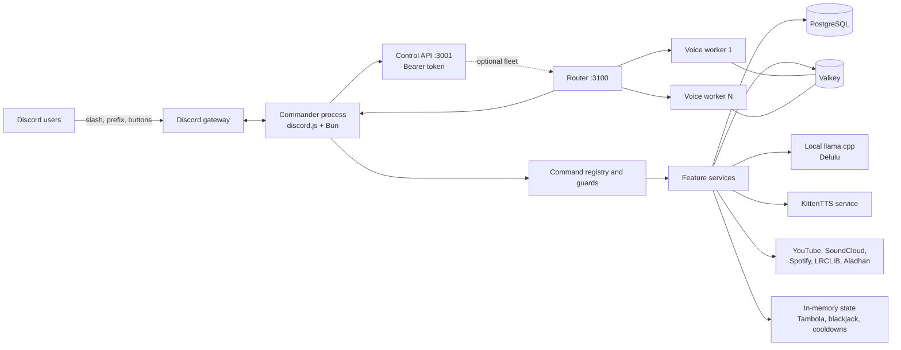
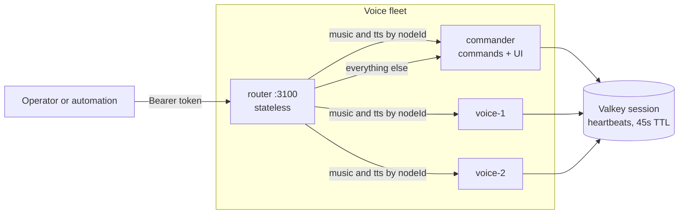
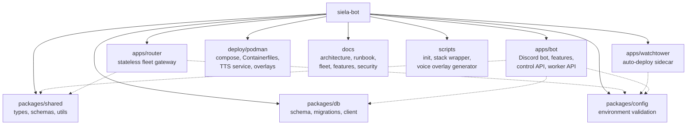

# Siela Bot

[](https://github.com/DeathSurfing/siela-bot/actions/workflows/ci.yml)
[](LICENSE)
[](https://bun.sh)
[](https://podman.io)

Siela Bot is a self-hosted Discord bot for one or many community servers. It combines music, a coin economy, daily trading-card auctions, Tambola, social features, text-to-speech, temporary voice channels, welcome automation, and a bearer-token control API.

The project is open source under the MIT license. Contributions, bug reports, and documentation fixes are welcome.

## What it does

- **Music.** Streams from SoundCloud, YouTube, and Spotify links through `yt-dlp` and `mpv`. Includes a persistent queue, live filters, lyrics from LRCLIB, and interactive controls.
- **Voice sound effects.** Typing `gay` in chat makes the bot join the author's voice channel and play the "Gay Echo" clip once, then leave. It stays out of the way when the bot is already busy in a voice channel.
- **Economy.** Tracks Siela Coins in a PostgreSQL ledger. Supports daily rewards, work, voice and Tambola income, transfers, gambling, a shop, premium passes, a six-stock exchange, and surge-priced Delulu with daily AI caps.
- **Siela Relics.** Auctions one procedurally generated, one-of-one meme card every day from 4:00 PM to 5:00 PM IST. Escrowed SC bidding, weekend rarity boosts, permanent vaults, passive yield, showcase profiles, and player trades.
- **Tambola.** Runs 90-ball games with private DM tickets, line and full-house claims, paid extra tickets, paid auto-marking, and spoken number calls.
- **Delulu.** Generates short bias scenarios through a local llama.cpp service. Falls back to Hugging Face, Pollinations, and built-in scenarios when the local service is unavailable.
- **TTS.** Reads enabled voice-channel chat with KittenTTS Nano ONNX and the Bruno voice. Edge TTS remains available as a fallback.
- **Community features.** Welcome cards, auto-role, temporary voice channels, confessions, birthdays, friendship levels, family trees, activity tracking, and scheduled prayer-time voice events.
- **Multi-server.** Serves every guild it joins, with per-guild settings, schedulers, and a guild-scoped control API. Set `GUILD_ID` to pin one server. See [docs/MULTI-GUILD.md](docs/MULTI-GUILD.md).
- **Operations.** Runs as a rootless Podman stack with PostgreSQL, Valkey, llama.cpp, KittenTTS, health endpoints, a bearer-token control API, and an optional watchtower that auto-deploys commits from GitHub. The bot registers 63 commands.

## Architecture



The bot is one long-lived Bun process. The control API and health server run inside that process; automation talks to the control API over the internal control network with a bearer token.

For more than one simultaneous voice stream, add N voice workers behind a stateless router. Each worker is the same image with its own Discord token, and every voice channel becomes its own music instance. See [docs/VOICE-FLEET.md](docs/VOICE-FLEET.md).



See [docs/ARCHITECTURE.md](docs/ARCHITECTURE.md) for command flow, boot order, persistence, and deployment diagrams.

## Quick start

The full production stack targets Linux with Podman 5 or newer and an NVIDIA GPU for the local LLM service. Local development works without a GPU.

```bash
git clone https://github.com/DeathSurfing/siela-bot.git
cd siela-bot

export DISCORD_TOKEN="..."
export GUILD_ID="..."   # optional: pins the bot to one server

./scripts/podman-init.sh
./scripts/podman-stack.sh up -d --build
```

`DISCORD_TOKEN` is the only secret you must provide. The init script derives the client ID, generates the database and control-API secrets, writes a mode 600 `.env`, and prints an invite URL with the recommended permissions.

The complete first-run checklist, including Discord intents, invite permissions, verification, and troubleshooting, is in [GET_STARTED.md](GET_STARTED.md).

## Technology

| Layer | Choice |
|---|---|
| Runtime and package manager | Bun 1.4 |
| Language | TypeScript, ESM |
| Discord client | discord.js |
| Database | PostgreSQL 17 with Drizzle ORM and Bun SQL |
| Cache and queues | Valkey 8, optional |
| Local LLM | llama.cpp server with an OpenAI-compatible API |
| Local TTS | KittenTTS Nano ONNX, Edge TTS fallback |
| Music | yt-dlp, mpv, ffmpeg |
| Containers | Rootless Podman and Podman Compose |
| Control and automation | Fastify control API, Prometheus metrics |

## Repository layout



## Development

```bash
bun install
bun run typecheck
bun run test
bun run build
```

For local development, use a PostgreSQL container and a `.env` file inside `apps/bot`. The process working directory is `apps/bot`, so a repository-root `.env` is not loaded. [GET_STARTED.md](GET_STARTED.md) includes a complete local setup and an example environment file.

## Documentation

- [GET_STARTED.md](GET_STARTED.md) is the short path from clone to a working bot.
- [docs/ARCHITECTURE.md](docs/ARCHITECTURE.md) explains process structure, command flow, boot order, and storage.
- [docs/MULTI-GUILD.md](docs/MULTI-GUILD.md) explains server binding, per-guild state, and the guild-scoped control API.
- [docs/FEATURES.md](docs/FEATURES.md) lists the per-guild feature switches and where they are enforced.
- [docs/DASHBOARD.md](docs/DASHBOARD.md) covers the web dashboard, its first-run setup, the Administrator gate on server changes, the name-to-ID resolver, the Scheduled Events, CAH, Tambola, Casino, Economy, Leaderboard, Stocks, and music tabs, and its security model.
- [docs/RUNBOOK.md](docs/RUNBOOK.md) covers deployment, updates, backups, and troubleshooting.
- [docs/ECONOMY.md](docs/ECONOMY.md) explains Siela Coins and pricing.
- [docs/ECONOMY_V2.md](docs/ECONOMY_V2.md) explains the earning, AI-gating, and exchange design choices.
- [docs/RELICS.md](docs/RELICS.md) explains relic cards, the daily auction, vaults, yield, and trades.
- [docs/TTS.md](docs/TTS.md) explains voice playback and the TTS service.
- [docs/DELULU.md](docs/DELULU.md) explains the LLM fallback chain.
- [docs/TAMBOLA_PLAN.md](docs/TAMBOLA_PLAN.md) documents Tambola rules and state.
- [docs/THREAT-MODEL.md](docs/THREAT-MODEL.md) lists security boundaries and residual risks.
- [docs/README.md](docs/README.md) is the full documentation index, including historical design documents.

## Contributing

Read [CONTRIBUTING.md](CONTRIBUTING.md) before opening a pull request. It covers the development loop, command registration, database migrations, tests, and documentation expectations.

- Use GitHub Issues for bugs and feature requests.
- Use GitHub Security Advisories for vulnerabilities. Do not open a public issue for a security problem.
- Run `bun run typecheck`, `bun run test`, and `bun run build` before submitting a change.
- Keep pull requests focused. A small, tested change is easier to review than a large rewrite.

## Security

The security policy is in [SECURITY.md](SECURITY.md). The deployment model, trust boundaries, and known residual risks are in [docs/THREAT-MODEL.md](docs/THREAT-MODEL.md).

## License

MIT. See [LICENSE](LICENSE).
