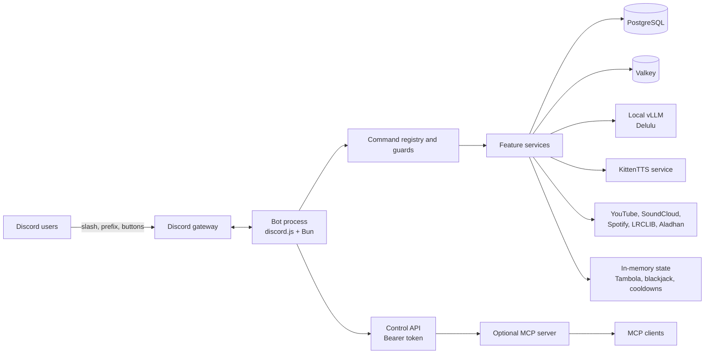

# Siela Bot

[](https://github.com/DeathSurfing/siela-nogseuui-seobeo-bot/actions/workflows/ci.yml)
[](LICENSE)
[](https://bun.sh)
[](https://podman.io)

Siela Bot is a self-hosted Discord bot for a single community server. It combines music, a coin economy, Tambola, social features, text-to-speech, temporary voice channels, welcome automation, and an optional MCP control server.

The project is open source under the MIT license. Contributions, bug reports, and documentation fixes are welcome.

## What it does

- **Music.** Streams from SoundCloud, YouTube, and Spotify links through `yt-dlp` and `mpv`. Includes a persistent queue, live filters, lyrics from LRCLIB, and interactive controls.
- **Economy.** Tracks Siela Coins in a PostgreSQL ledger. Supports daily rewards, work, transfers, gambling, a shop, premium passes, and paid Delulu and Tambola features.
- **Tambola.** Runs 90-ball games with private DM tickets, line and full-house claims, paid extra tickets, paid auto-marking, and spoken number calls.
- **Delulu.** Generates short bias scenarios through a local vLLM service. Falls back to Hugging Face, Pollinations, and built-in scenarios when the local service is unavailable.
- **TTS.** Reads enabled voice-channel chat with KittenTTS Nano ONNX and the Bruno voice. Edge TTS remains available as a fallback.
- **Community features.** Welcome cards, auto-role, temporary voice channels, confessions, birthdays, friendship levels, family trees, activity tracking, and scheduled prayer-time voice events.
- **Operations.** Runs as a rootless Podman stack with PostgreSQL, Valkey, vLLM, KittenTTS, health endpoints, and an optional MCP server. The bot registers 61 commands and exposes 51 MCP tools.

## Architecture



The bot is one long-lived Bun process. The control API and health server run inside that process. The MCP server is the only separate application process, and it reaches the bot over the internal control network. See [docs/ARCHITECTURE.md](docs/ARCHITECTURE.md) for command flow, boot order, persistence, and deployment diagrams.

## Quick start

The full production stack targets Linux with Podman 5 or newer and an NVIDIA GPU for the local vLLM service. Local development works without a GPU.

```bash
git clone https://github.com/DeathSurfing/siela-nogseuui-seobeo-bot.git
cd siela-nogseuui-seobeo-bot

export DISCORD_TOKEN="..."
export GUILD_ID="..."   # recommended for a single-guild install

./scripts/podman-init.sh
./scripts/podman-stack.sh up -d --build
```

`DISCORD_TOKEN` is the only secret you must provide. The init script derives the client ID, generates the database and MCP secrets, writes a mode 600 `.env`, and prints an invite URL with the recommended permissions.

The complete first-run checklist, including Discord intents, invite permissions, verification, and troubleshooting, is in [GET_STARTED.md](GET_STARTED.md).

## Technology

| Layer | Choice |
|---|---|
| Runtime and package manager | Bun 1.4 |
| Language | TypeScript, ESM |
| Discord client | discord.js |
| Database | PostgreSQL 17 with Drizzle ORM and Bun SQL |
| Cache and queues | Valkey 8, optional |
| Local LLM | vLLM with an OpenAI-compatible API |
| Local TTS | KittenTTS Nano ONNX, Edge TTS fallback |
| Music | yt-dlp, mpv, ffmpeg |
| Containers | Rootless Podman and Podman Compose |
| Control and automation | Fastify control API, MCP server, Prometheus metrics |

## Repository layout

```text
apps/bot        Discord bot, feature services, control API, health server
apps/mcp        Optional MCP server and tool catalog
packages/db     Drizzle schema, migrations, PostgreSQL client
packages/config Environment validation
packages/shared Shared types, schemas, constants, utilities
deploy/podman   Compose files, Containerfiles, TTS service, overlays
docs            Architecture, operations, feature, and security documentation
scripts         Podman setup, stack wrapper, smoke test, fast deploy
```

## Development

```bash
bun install
bun run typecheck
bun run test
bun run build
```

For local development, use a PostgreSQL container and a `.env` file inside `apps/bot`. The process working directory is `apps/bot`, so a repository-root `.env` is not loaded. [GET_STARTED.md](GET_STARTED.md) includes a complete local setup and an example environment file.

## Documentation

- [GET_STARTED.md](GET_STARTED.md) is the short path from clone to a working bot.
- [docs/ARCHITECTURE.md](docs/ARCHITECTURE.md) explains process structure, command flow, boot order, and storage.
- [docs/RUNBOOK.md](docs/RUNBOOK.md) covers deployment, updates, backups, and troubleshooting.
- [docs/MCP.md](docs/MCP.md) covers MCP transports, clients, and the 51-tool catalog.
- [docs/ECONOMY.md](docs/ECONOMY.md) explains Siela Coins and pricing.
- [docs/TTS.md](docs/TTS.md) explains voice playback and the TTS service.
- [docs/DELULU.md](docs/DELULU.md) explains the LLM fallback chain.
- [docs/TAMBOLA_PLAN.md](docs/TAMBOLA_PLAN.md) documents Tambola rules and state.
- [docs/THREAT-MODEL.md](docs/THREAT-MODEL.md) lists security boundaries and residual risks.
- [docs/README.md](docs/README.md) is the full documentation index, including historical design documents.

## Contributing

Read [CONTRIBUTING.md](CONTRIBUTING.md) before opening a pull request. It covers the development loop, command registration, database migrations, tests, and documentation expectations.

- Use GitHub Issues for bugs and feature requests.
- Use GitHub Security Advisories for vulnerabilities. Do not open a public issue for a security problem.
- Run `bun run typecheck`, `bun run test`, and `bun run build` before submitting a change.
- Keep pull requests focused. A small, tested change is easier to review than a large rewrite.

## Security

The security policy is in [SECURITY.md](SECURITY.md). The deployment model, trust boundaries, and known residual risks are in [docs/THREAT-MODEL.md](docs/THREAT-MODEL.md).

## License

MIT. See [LICENSE](LICENSE).
