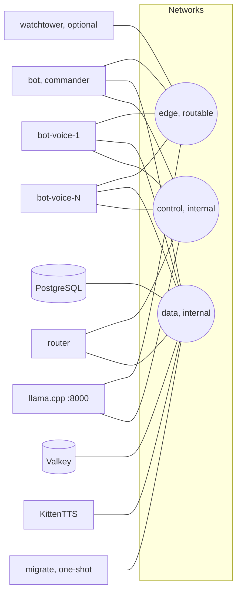

# Podman deployment

Production stack for Siela Bot. All services run under one compose project (`-p siela`). Use `scripts/podman-stack.sh` for compose operations. The wrapper selects the watchtower overlay when `WATCHTOWER_ENABLED=true`.

## Prerequisites

- Linux host with Podman 5 or newer and a compose provider.
- cgroups v2.
- About 25 GB of free disk for images and model weights.
- Outbound access to container registries, Hugging Face, Discord, and the music providers.
- NVIDIA GPU with driver 535 or newer, plus the driver userspace libraries in
  `/opt/nvidia-libs` (`libcuda.so.1`, `libnvidia-ml.so.1`,
  `libnvidia-ptxjitcompiler.so.1`). Podman here has no CDI spec, so the compose
  file passes `/dev/nvidia*` and mounts those libraries directly.

The `llm` service runs llama.cpp with CUDA and keeps the weights in VRAM, which
frees about 1 GB of system RAM and is roughly six times faster than CPU. Set
`-ngl 0` and remove the devices and library mount to fall back to CPU.

## Services



Workers only exist when `scripts/make-voice-overlay.sh <N>` has generated the overlay. `router` always runs; without workers its only node is the commander, so the fleet is a semaphore of one.

| Service | Image | Notes |
|---|---|---|
| `postgres` | `postgres:17-alpine` | Data on `pgdata`; `data` network only |
| `valkey` | `valkey/valkey:8-alpine` | Append-only cache; `VALKEY_URL=redis://valkey:6379` |
| `llm` | `ghcr.io/ggml-org/llama.cpp:server-cuda-b4729` (CUDA 12.4) | Model `DeathSurfing/tinyTanLLM-delulu-gemma` (`delulu-gemma-q4_k_m.gguf`, ctx 1024, q8_0 KV, flash attention); all 27 layers in VRAM, ~140 MB host RAM. Pinned to the last CUDA 12.4 build because the host driver is 535; newer tags need CUDA 12.8. Weights cached in `llmcache`. |
| `tts` | `localhost/siela-tts:latest` | CPU; KittenTTS model baked at build but loaded lazily; `/healthz`, `/warmup`, `/unload`, `/synthesize`, `/synthesize-stream` |
| `migrate` | `localhost/siela-bot:latest` | One-shot migration runner; exits after the schema is current |
| `bot` | `localhost/siela-bot:latest` | `oven/bun` image with yt-dlp, mpv, and ffmpeg; commander by default (`NODE_ROLE=commander`) |
| `router` | `localhost/siela-router:latest` | Voice fleet gateway `:3100`; fans music out by `nodeId`, proxies everything else to the commander |
| `bot-voice-*` | `localhost/siela-bot:latest` | Generated workers (`scripts/make-voice-overlay.sh <N>`). Slim `dist/worker.js` entrypoint under `bun --smol`, 1 GB cap: voice + music/TTS + worker API only, no commands or schedulers |
| `watchtower` | `localhost/siela-watchtower:latest` | Optional auto-deploy sidecar; mounts the host Podman socket |

Health endpoints:

- Bot health and metrics: `127.0.0.1:3002` (`/healthz`, `/readyz`, `/metrics`). The port is not published to the host.
- Control API: `:3001` with Bearer `MCP_TOKEN`, on the internal `control` network.
- Voice router: `:3100` with Bearer `MCP_TOKEN`, on the internal `control` network. See [docs/VOICE-FLEET.md](../../docs/VOICE-FLEET.md).
- TTS: `:8000` with `/healthz`, `/warmup`, `/unload`, `/synthesize`, and `/synthesize-stream`. The model is loaded on demand, so idle memory is low.

## Quickstart

Run these commands from the repository root:

```bash
export DISCORD_TOKEN="..."
export GUILD_ID="..."

./scripts/podman-init.sh
./scripts/podman-stack.sh up -d --build
./scripts/podman-stack.sh logs -f bot
```

`DISCORD_TOKEN` is the only secret you must provide. The init script generates the database and control-API secrets, writes `deploy/podman/.env` with mode 600, and prints an invite URL with the recommended permissions.

See [GET_STARTED.md](../../GET_STARTED.md) for the full first-run checklist.

## Wrapper

```bash
./scripts/podman-stack.sh up -d --build
./scripts/podman-stack.sh logs -f bot
./scripts/podman-stack.sh run --rm migrate
./scripts/podman-stack.sh down
```

When the flag is off, `up` and `down` remove a leftover `siela-mcp` container from pre-retirement deployments.

## Overlays

| File | Purpose |
|---|---|
| `compose.voice.generated.yaml` | Generated voice workers. Created by `scripts/make-voice-overlay.sh <N>`; auto-included when present |
| `compose.watchtower.yaml` | Optional auto-deploy sidecar. Enabled with `WATCHTOWER_ENABLED=true` |
| `compose.fast.yaml` | Fast code-only deploy. Bind-mounts `apps/bot/dist` over `/app/dist` |
| `.env.example` / `.env.voice.example` | Configuration references. Prefer `scripts/podman-init.sh` |

## Watchtower (automatic updates)

The optional `watchtower` container makes the configured branch the source of truth. It polls every 60 seconds, waits for CI on the new commit, fast-forwards the checkout, rebuilds, runs migrations, and recreates the stack (bot, TTS, router, voice workers — never itself). When the bot fails its health gate, it resets to the previous commit, redeploys it, and blocks the bad commit. Rebuild the watchtower image by hand after watchtower code changes; it never redeploys itself.

```bash
# One-time: build the watchtower image and start it with the stack.
podman build --network=host -f deploy/podman/Containerfile.watchtower \
  -t localhost/siela-watchtower:latest .
mkdir -p node_modules
WATCHTOWER_ENABLED=true ./scripts/podman-stack.sh up -d watchtower
```

Required in `deploy/podman/.env` when enabled:

| Variable | Purpose |
|---|---|
| `WATCHTOWER_ENABLED` | `true` includes the overlay |
| `WATCHTOWER_REPO_DIR` | Absolute host path of this checkout, for example `/root/siela-bot` |
| `WATCHTOWER_TOKEN` | Bearer token for `POST /trigger`; `scripts/podman-init.sh` generates it |

Common overrides:

| Variable | Default | Purpose |
|---|---|---|
| `WATCHTOWER_REPO_URL` | upstream repository | Point at a fork to follow it instead |
| `WATCHTOWER_BRANCH` | `main` | Branch to follow |
| `GH_TOKEN` | empty | Required for private forks; avoids anonymous GitHub API limits |
| `WATCHTOWER_CI_GATE` | `auto` | `auto`, `required`, or `off` |
| `WATCHTOWER_HEALTH_TIMEOUT_SEC` | `180` | Time allowed for `/readyz` before rollback |
| `WATCHTOWER_BUILD_NETWORK` | empty | Passed as `podman build --network=...`; use `host` if builds need it |
| `WATCHTOWER_DRY_RUN` | `false` | Log the decision without pulling or deploying |
| `WATCHTOWER_NOTIFY_WEBHOOK_URL` | empty | Discord webhook for deploy and rollback messages |

Deploy modes:

| Mode | Trigger | Action |
|---|---|---|
| `none` | Docs-only change | Pull, but do not rebuild |
| `fast` | Every change under `apps/bot/src/` | Rebuild `apps/bot/dist` and recreate the bot |
| `full` | Anything else | Rebuild images, run migrations, recreate services |

CI gate values:

- `auto` waits for checks; if none appear within `WATCHTOWER_CI_GRACE_SEC`, it deploys ungated.
- `required` waits the full `WATCHTOWER_CI_TIMEOUT_SEC` and defers when no checks appear.
- `off` skips the gate.

Operate it:

```bash
podman logs -f siela-watchtower
podman healthcheck run siela-watchtower
podman exec siela-watchtower bun -e \
  "fetch('http://127.0.0.1:3003/status').then(r=>r.text()).then(console.log)"

# Force a retry after a blocked commit (token from .env).
podman exec siela-watchtower bun -e \
  "fetch('http://127.0.0.1:3003/trigger',{method:'POST',headers:{authorization:'Bearer '+process.env.WATCHTOWER_TOKEN,'content-type':'application/json'},body:'{\"force\":true}'})"
```

The port is not published. `POST /trigger` accepts `{"force":true}` to clear a blocked commit.

To disable, set `WATCHTOWER_ENABLED=false` and remove the container. The wrapper does not remove it automatically because a deploy issued from inside the container would kill itself:

```bash
podman rm -f siela-watchtower
```

Watchtower deploys the stack, not itself. After it changes, rebuild and recreate it manually:

```bash
WATCHTOWER_ENABLED=true ./scripts/podman-stack.sh up -d --build watchtower
```

> **Security:** the container mounts the rootful Podman socket, which is equivalent to root on the host, and it pulls code from the configured repository. Only point it at a repository you control. Prefer HTTPS with a repo-scoped `GH_TOKEN`; the CI gate reduces, but does not remove, supply-chain risk.

## Notes

- Networks: `edge`, `data` (internal), and `control` (internal).
- The `migrate` service is one-shot and idempotent. The bot is ordered after the container starts, not after it exits.
- The compose files avoid `profiles`, `secrets`, `build.target`, and `depends_on.condition` so they work with both `podman compose` providers.
- Updates: `git pull --ff-only`, rebuild, run `migrate`, then start the stack. See [docs/RUNBOOK.md](../../docs/RUNBOOK.md). The optional `watchtower` container automates this flow.
- The compose stack runs on CPU. The Delulu model is a small quantized llama.cpp build with a fallback chain when the service is unavailable.
