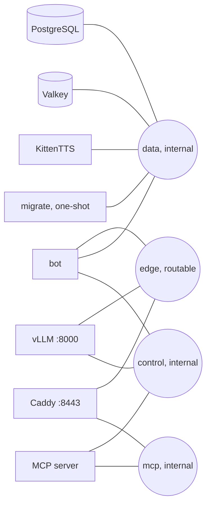

# Podman deployment

Production stack for Siela Bot. All services run under one compose project (`-p siela`). Use `scripts/podman-stack.sh` for compose operations. The wrapper selects the MCP overlay when `MCP_ENABLED=true`.

## Prerequisites

- Linux host with Podman 5 or newer and a compose provider.
- cgroups v2.
- NVIDIA GPU with the driver devices available for the local vLLM service.
- `/opt/nvidia-libs` populated with the driver userspace libraries.
- About 25 GB of free disk for images and model weights.
- Outbound access to container registries, Hugging Face, Discord, and the music providers.

The bot container does not require GPU access. Only the `llm` service receives the NVIDIA devices.

## Services



| Service | Image | Notes |
|---|---|---|
| `postgres` | `postgres:17-alpine` | Data on `pgdata`; `data` network only |
| `valkey` | `valkey/valkey:8-alpine` | Append-only cache; `VALKEY_URL=redis://valkey:6379` |
| `llm` | `vllm/vllm-openai:v0.6.3` | GPU; model `Goekdeniz-Guelmez/Josiefied-Qwen2.5-1.5B-Instruct-abliterated-v3`; weights cached in `llmcache` |
| `tts` | `localhost/siela-tts:latest` | CPU; KittenTTS model baked at build; `/healthz`, `/synthesize`, `/synthesize-stream` |
| `migrate` | `localhost/siela-bot:latest` | One-shot migration runner; exits after the schema is current |
| `bot` | `localhost/siela-bot:latest` | `oven/bun` image with yt-dlp, mpv, and ffmpeg |

Health endpoints:

- Bot health and metrics: `127.0.0.1:3002` (`/healthz`, `/readyz`, `/metrics`). The port is not published to the host.
- Control API: `:3001` with Bearer `MCP_TOKEN`, on the internal `control` network.
- TTS: `:8000` with `/healthz`, `/synthesize`, and `/synthesize-stream`.

## Quickstart

Run these commands from the repository root:

```bash
export DISCORD_TOKEN="..."
export GUILD_ID="..."

./scripts/podman-init.sh
./scripts/podman-stack.sh up -d --build
./scripts/podman-stack.sh logs -f bot
```

`DISCORD_TOKEN` is the only secret you must provide. The init script generates the database and MCP secrets, writes `deploy/podman/.env` with mode 600, and prints an invite URL with the recommended permissions.

See [GET_STARTED.md](../../GET_STARTED.md) for the full first-run checklist.

## Wrapper

```bash
./scripts/podman-stack.sh up -d --build
./scripts/podman-stack.sh logs -f bot
./scripts/podman-stack.sh run --rm migrate
./scripts/podman-stack.sh down
```

`MCP_ENABLED` is read from the environment first, then from `deploy/podman/.env`. When the flag is off, `up` and `down` remove a leftover `siela-mcp` container.

## Overlays

| File | Purpose |
|---|---|
| `compose.mcp.yaml` | Optional MCP server. Enabled with `MCP_ENABLED=true` |
| `compose.host.yaml` | Optional: publish MCP on `127.0.0.1:8080` for host-local clients. Requires the MCP overlay |
| `compose.proxy.yaml` | Optional: Caddy TLS front door for external MCP clients |
| `compose.fast.yaml` | Fast code-only deploy. Bind-mounts `apps/bot/dist` over `/app/dist` |
| `Caddyfile` | TLS proxy configuration |
| `.env.example` | Configuration reference. Prefer `scripts/podman-init.sh` |

Enable MCP and publish it to host loopback:

```bash
MCP_ENABLED=true ./scripts/podman-stack.sh \
  -f deploy/podman/compose.host.yaml up -d
```

The wrapper already includes `compose.yaml` and `compose.mcp.yaml`. Add only the override you need.

## MCP flag

MCP is off by default. Set this in `.env`:

```env
MCP_ENABLED=false
```

Enable it for one command:

```bash
MCP_ENABLED=true ./scripts/podman-stack.sh up -d
```

When enabled, the MCP server is reachable on the internal `mcp` network at `MCP_URL=http://mcp:8080/mcp`. It is not published to the host unless you add `compose.host.yaml` or the Caddy overlay.

## Notes

- Networks: `edge`, `data` (internal), `control` (internal), and `mcp` (internal) when MCP is enabled.
- The `migrate` service is one-shot and idempotent. The bot is ordered after the container starts, not after it exits.
- The compose files avoid `profiles`, `secrets`, `build.target`, and `depends_on.condition` so they work with both `podman compose` providers.
- Updates: `git pull --ff-only`, rebuild, run `migrate`, then start the stack. See [docs/RUNBOOK.md](../../docs/RUNBOOK.md).
- The production compose stack targets a GPU host because it runs vLLM. For a no-GPU environment, use local development and the Delulu fallback chain.
