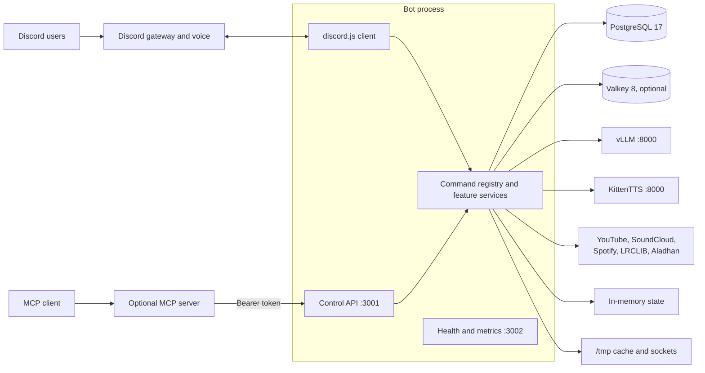
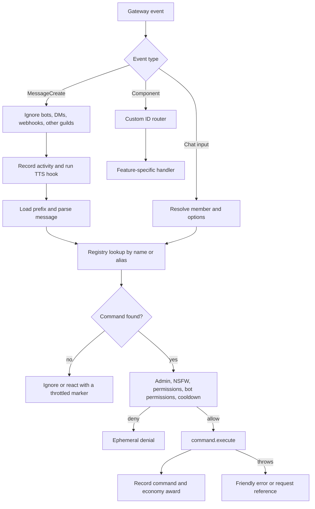
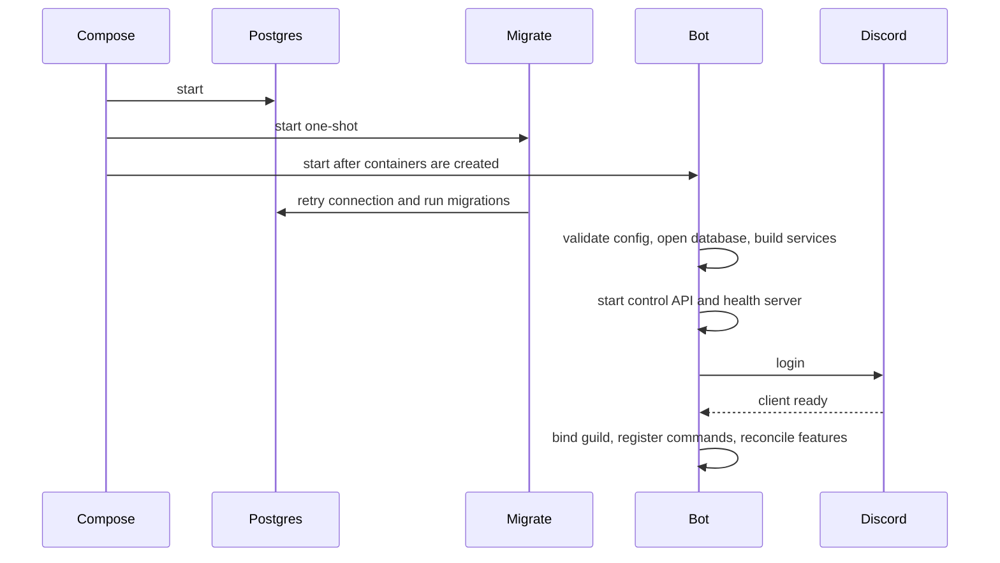
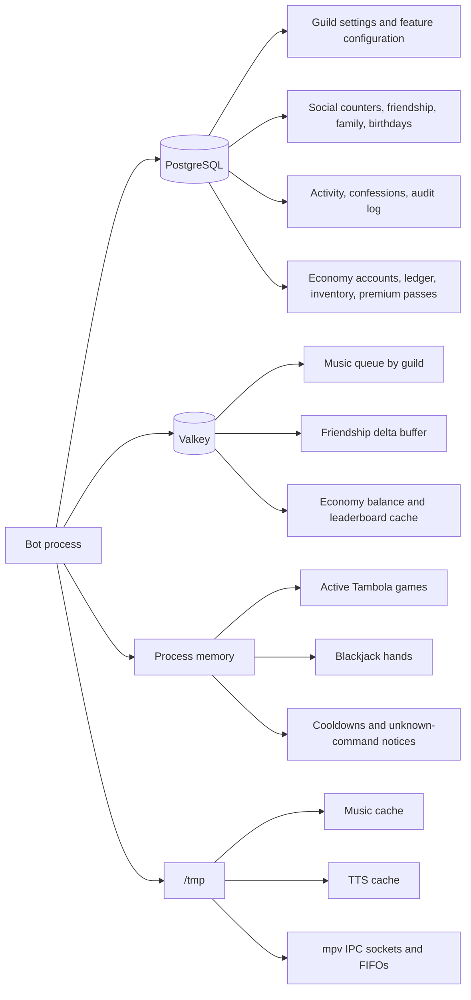
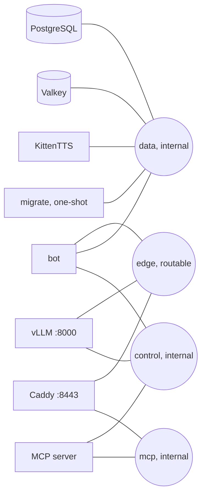

# Architecture

This document explains how the bot is assembled and where state lives. It is the current architecture reference. `docs/PLAN.md` is a historical design document and does not describe the deployed system.

## Process model

Siela Bot runs as one long-lived Bun process. `apps/bot/src/bot.ts` is the composition root. It creates the Discord client, the command registry, the feature services, the Fastify control API, and the health server.

The MCP server is the only separate application process. It has no Discord client and no database client. It calls the control API over the internal `control` network with a bearer token. The compose service currently receives the shared deployment env file, so treat the MCP container as secret-bearing. See [MCP.md](MCP.md).

## Command lifecycle

Prefix commands and slash commands share the same registry, guard, and execution path. Component interactions use a hand-written custom-ID router in `bot.ts`.

Component handlers cover `tambola:`, `economy:bj:`, `music:`, `tempvc:`, and `help:`. Queue pagination and confirmation cards use per-message collectors instead of the global component router.

## Boot sequence

The compose stack starts the migration container before the bot container, but short-form `depends_on` does not wait for the one-shot migration to exit. The migration runner retries database readiness. If the bot starts before the schema is ready, restart the bot after `migrate` exits.

Guild initialization ensures settings rows, registers slash commands, reconciles temporary voice channels, purges old activity rows, and starts the timer-driven features.

## Persistence map

PostgreSQL is the source of truth for durable state. Valkey is an optional cache and buffer. Active games and cooldown state live in process memory and disappear on restart.

The economy ledger is append-only. Every balance change writes a transaction row in the same database transaction as the account update. When Valkey is unavailable, economy reads fall back to PostgreSQL.

## Deployment topology

The production stack contains PostgreSQL, Valkey, vLLM, KittenTTS, a one-shot migration container, and the bot. MCP and Caddy are optional overlays.

The bot is attached to `edge`, `data`, and `control`. It reaches Discord and external services through `edge`, durable services through `data`, and MCP through the `bot-control` alias on `control`. The MCP server is attached to `control` for API access and `mcp` for clients.

See [deploy/podman/README.md](../deploy/podman/README.md) for service configuration and overlays.

## Extension points

To add a command:

1. Add the command definition under `apps/bot/src/commands/`.
2. Register it in `apps/bot/src/commands/index.ts`.
3. Add any service to `Services` and instantiate it in `apps/bot/src/bot.ts`.
4. Route new component custom IDs in `bot.ts`.
5. Add tests and run `bun run typecheck`, `bun run test`, and `bun run build`.

To add durable state, update `packages/db/src/schema.ts`, generate a migration, and update the persistence map in this document.

## Known constraints

- The bot is single-guild by design. It binds to `GUILD_ID` or the only guild it can see and leaves other guilds.
- Context-menu commands are not implemented. The registry supports slash and prefix commands.
- Active Tambola games and blackjack hands are not persisted. A restart cancels them.
- MCP tool coverage is limited to the control API surface. Economy, Delulu, TTS, and social commands have no MCP tools.
- The bot container does not need GPU access. Only the vLLM container does.
