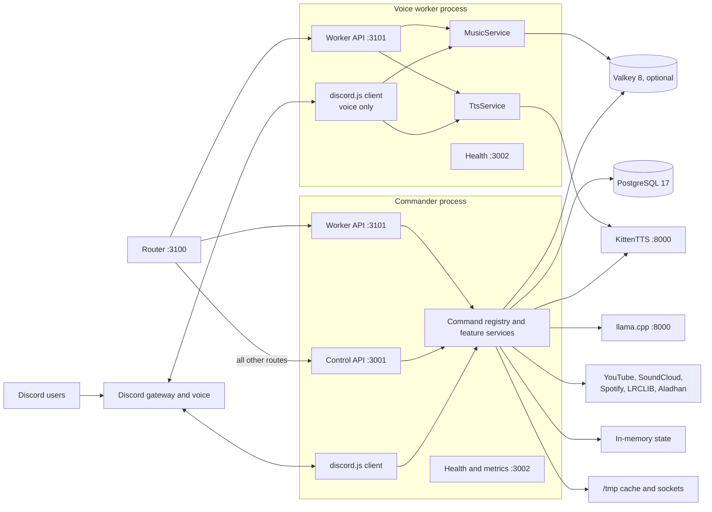
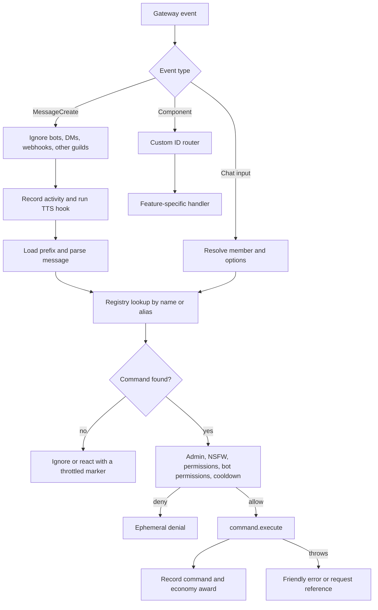
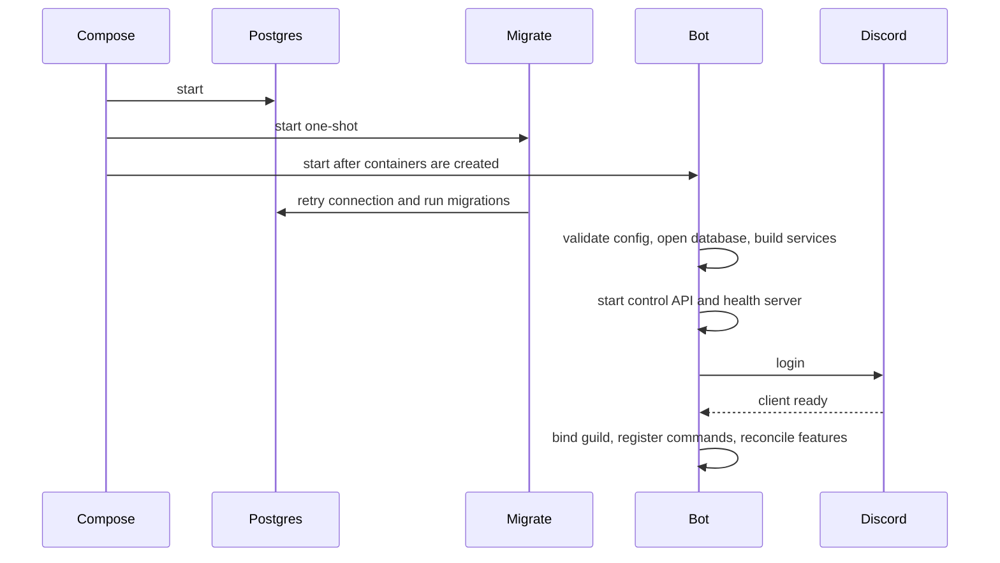
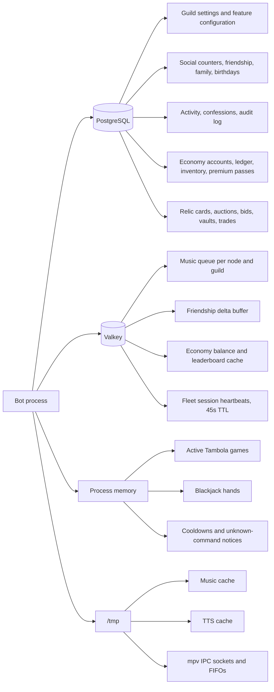
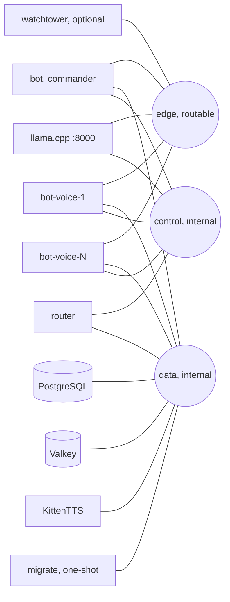

# Architecture

This document explains how the bot is assembled and where state lives. It is the current architecture reference. `docs/PLAN.md` is a historical design document and does not describe the deployed system.

## Process model

Siela Bot runs as one long-lived Bun process. `apps/bot/src/bot.ts` is the composition root. It creates the Discord client, the command registry, the feature services, the Fastify control API, and the health server.

Automation talks to the control API over the internal `control` network with a bearer token (`MCP_TOKEN`).

Only the commander serves the public control API and registers slash commands. Voice workers serve the internal worker API and health endpoints, take no chat input, and run no schedulers. The router is stateless and holds no Discord or database client.

## Command lifecycle

Prefix commands and slash commands share the same registry, guard, and execution path. Component interactions use a hand-written custom-ID router in `bot.ts`.

Component handlers cover `tambola:`, `economy:bj:`, `music:`, `tempvc:`, and `help:`. Queue pagination and confirmation cards use per-message collectors instead of the global component router.

## Boot sequence

The compose stack starts the migration container before the bot container, but short-form `depends_on` does not wait for the one-shot migration to exit. The migration runner retries database readiness. If the bot starts before the schema is ready, restart the bot after `migrate` exits.

Guild initialization ensures settings rows, registers slash commands, reconciles temporary voice channels, purges old activity rows, and starts the timer-driven features.

## Persistence map

PostgreSQL is the source of truth for durable state. Valkey is an optional cache and buffer. Active games and cooldown state live in process memory and disappear on restart. Relic auctions and trades are durable: the scheduler resumes and settles them after a restart.

The economy ledger is append-only. Every balance change writes a transaction row in the same database transaction as the account update. When Valkey is unavailable, economy reads fall back to PostgreSQL.

## Deployment topology

The production stack contains PostgreSQL, Valkey, llama.cpp, KittenTTS, a one-shot migration container, the commander, and the router. Voice workers and watchtower are optional.

The commander is attached to `edge`, `data`, and `control`. Workers need `edge` for the Discord gateway and voice, `data` for PostgreSQL and Valkey, and `control` so the router can reach their worker API. The router sits on `control` and `data` only. Watchtower attaches to `edge` and mounts the host Podman socket. Automation reaches the commander through the `bot-control` alias and the fleet through `voice-router`, both on `control`.

See [deploy/podman/README.md](../deploy/podman/README.md) for service configuration and overlays.

## Extension points

To add a command:

1. Add the command definition under `apps/bot/src/commands/`.
2. Register it in `apps/bot/src/commands/index.ts`.
3. Add any service to `Services` and instantiate it in `apps/bot/src/bot.ts`.
4. Route new component custom IDs in `bot.ts`.
5. Add tests and run `bun run typecheck`, `bun run test`, and `bun run build`.

To add durable state, update `packages/db/src/schema.ts`, generate a migration, and update the persistence map in this document.

## Known constraints

- The bot is single-guild by design. It binds to `GUILD_ID` or the only guild it can see and leaves other guilds.
- Context-menu commands are not implemented. The registry supports slash and prefix commands.
- Active Tambola games and blackjack hands are not persisted. A restart cancels them.
- The bot container does not need GPU access. The llama.cpp container runs on CPU.
- Fleet voice-busy checks are per process, not per fleet. Two nodes can be told to join the same channel; the last writer wins.
- Tambola, scheduled events, random VC drops, and activity tracking run on the commander only.
