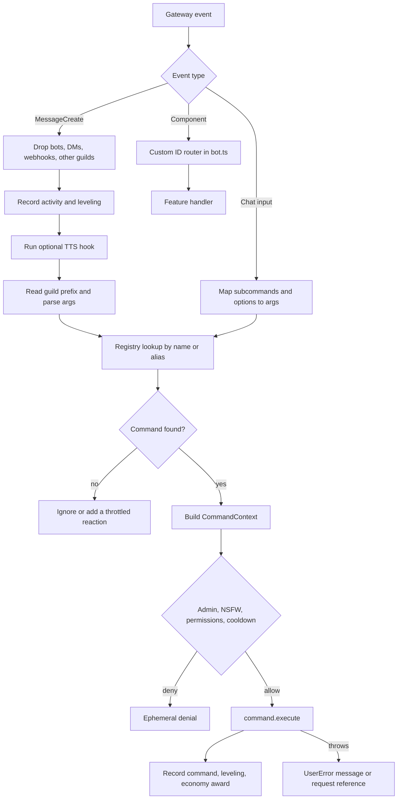

# Development

This guide covers the repository layout, command flow, extension points, tests, and debugging. It assumes local setup is complete.

- First run and Discord setup: [GET_STARTED.md](../GET_STARTED.md)
- Contribution rules and review expectations: [CONTRIBUTING.md](../CONTRIBUTING.md)
- Runtime architecture and persistence map: [ARCHITECTURE.md](ARCHITECTURE.md)
- Deployment, backups, and operations: [RUNBOOK.md](RUNBOOK.md)

## Repository layout

| Path | Contents |
|---|---|
| `apps/bot/src/bot.ts` | Composition root. Discord client, services, event handlers, command guard, component router, shutdown. |
| `apps/bot/src/commands/` | Command definitions under `admin`, `music`, `social`, `utility`, and `voice`. The barrel is `commands/index.ts`. |
| `apps/bot/src/features/` | Feature services and UI builders. Tests sit next to the code. |
| `apps/bot/src/framework/` | Command types, registry, prefix and slash parsing, context helpers, permissions, and cooldowns. |
| `apps/bot/src/control/` | Control API on port 3001 and health server on port 3002. |
| `apps/bot/src/scripts/migrate.ts` | Migration runner with database readiness retries. |
| `packages/config/` | Zod environment schemas. |
| `packages/db/` | Drizzle schema, database client, and migrations under `drizzle/`. |
| `packages/shared/` | Shared constants, types, and pure logic. |
| `deploy/podman/` | Compose stack, overlays, container files, and the TTS service. |
| `scripts/` | Init, stack wrapper, fast deploy, and smoke scripts. |

## Environment file

The bot loads `.env` from its process working directory. The root scripts use `bun run --cwd apps/bot ...`, so the working directory is `apps/bot` for `bun run dev:bot` and `bun run db:migrate`.

Put local values in `apps/bot/.env`:

```bash
cp apps/bot/.env.example apps/bot/.env
chmod 600 apps/bot/.env
```

A repository-root `.env` is not read by these commands. Startup fails with `Invalid environment` when `DISCORD_TOKEN`, `DATABASE_URL`, or `MCP_TOKEN` is missing. See section 9 of [GET_STARTED.md](../GET_STARTED.md) for PostgreSQL, Valkey, and optional local services.

## Command flow

Prefix and slash commands end in `command.execute`. The path differs before the registry lookup. Component interactions use a separate custom ID router.



- `apps/bot/src/bot.ts` registers gateway events in `registerEvents`.
- `onMessage` handles prefix commands. `onInteraction` handles chat input commands and component custom IDs.
- `apps/bot/src/framework/registry.ts` maps names and aliases and rejects duplicates.
- `createPrefixContext` and `createSlashContext` in `apps/bot/src/framework/context.ts` normalize replies, deferrals, and edits.
- `guard` checks `adminOnly`, `nsfw`, user permissions, bot permissions, and cooldown.
- Expected user failures throw `UserError`. Unexpected errors reply with a request reference and log the full error.
- Add new component routes in `onInteraction` next to the existing prefixes.

## Add a command

1. Create the file in the matching category, for example `apps/bot/src/commands/utility/example.ts`.
2. Export a `Command` object with `name`, `category`, `description`, `usage`, and `execute`. Add `aliases`, `cooldownMs`, permission fields, or `slash` when needed.
3. Register the export in `apps/bot/src/commands/index.ts`.
4. Use `ctx.reply`, `ctx.defer`, `ctx.edit`, or `ctx.followUp`. Do not call Discord reply methods directly.
5. Throw `UserError` for expected failures.
6. Add a test when the command contains logic that can run without Discord.
7. Run `bun run typecheck` and `bun run --cwd apps/bot test`.

```ts
import { SlashCommandBuilder } from "discord.js";
import type { Command, CommandContext } from "../../framework/types.js";

export const exampleCommand: Command = {
  name: "example",
  category: "utility",
  description: "Show an example response.",
  usage: "",
  slash: new SlashCommandBuilder().setName("example").setDescription("Show an example response"),
  async execute(ctx: CommandContext) {
    await ctx.reply({ content: "Example." });
  },
};
```

Slash commands register on guild initialization through `guild.commands.set`. Restart the bot after changing a slash builder. Prefix commands are available immediately.

## Add a service

1. Create a class under `apps/bot/src/features/`. Pass Discord, database, configuration, and logger dependencies through the constructor.
2. Add the property to `Services` in `apps/bot/src/framework/types.ts`.
3. Instantiate it in the `SielaBot` constructor in `apps/bot/src/bot.ts` and add it to the `this.services` object.
4. Start timers, collectors, and listeners in `initGuild`, `start`, or the first use. Stop them in `stop`.
5. Call the service from commands through `ctx.services.<name>`. Do not import `bot.ts` from a feature.
6. Add focused tests for pure logic and state transitions.

Services that write durable state or perform privileged actions should use `AuditService` where the existing routes do.

## Add a database migration

1. Edit `packages/db/src/schema.ts`.
2. Generate the migration:

```bash
bun run db:generate
```

3. Review the new SQL and metadata under `packages/db/drizzle/`. Do not edit an applied migration.
4. Apply it to the local database:

```bash
bun run db:migrate
```

5. Update the persistence map in [ARCHITECTURE.md](ARCHITECTURE.md) when durable state changes.
6. Describe the migration in the pull request. The deploy sequence is in [RELEASE.md](RELEASE.md).

The runner reads `DATABASE_URL` from `apps/bot/.env`, waits up to 30 attempts for PostgreSQL, and applies every pending migration. Production uses the one-shot `migrate` container.

## Add a component handler

1. Pick a namespaced custom ID, for example `example:confirm:<guildId>`. Keep the prefix stable.
2. Add a branch in `SielaBot.onInteraction`. Check the interaction type and `customId.startsWith("example:")`.
3. Implement the handler as a private method in `bot.ts` or a method on the feature service, depending on how much state it needs.
4. Parse the custom ID by position, then validate the guild ID against `this.guildId`.
5. Acknowledge within 3 seconds. Use `deferReply` or `deferUpdate` before slow work.
6. Use a per-message collector instead when the component belongs to one message or game session.

Component handlers currently cover `tambola:`, `economy:bj:`, `relics:`, `stocks:`, `music:`, `tempvc:`, and `help:`. Music queue pagination and confirmation cards use per-message collectors.

## Tests

```bash
bun run test                                  # packages/shared, then apps/bot
bun run --cwd apps/bot test                   # bot only
bun run --cwd packages/shared test            # shared only
bun run --cwd apps/bot test src/features/tambola/game.test.ts
bun run typecheck
bun run build
```

Test files are colocated as `*.test.ts` and use Vitest. There is no separate tests directory or global setup.

Covered today: pure game rules, parsers, UI payload builders, URL and lyric helpers, stock and relic logic, and shared utilities. Examples include `apps/bot/src/features/tambola/game.test.ts`, `apps/bot/src/framework/prefix.test.ts`, and `packages/shared/src/relics/logic.test.ts`.

Not covered: Discord gateway events, command registration, `bot.ts` wiring, component routing, database migrations and queries, live voice and music playback, llama.cpp and TTS calls, and the control API. Changes in those areas need manual verification in a test guild or a new test harness.

Manual check: run the bot in a test guild, then use `!ping`, `/ping`, and the command or component you changed. Check the logs for unexpected errors. Do not test destructive admin commands against a production guild.

## Debugging

Set `LOG_LEVEL=debug` in `apps/bot/.env` for verbose logs. Logs are JSON. Command failures return a short reference that also appears in the log entry.

### Discord intents

The client requests `Guilds`, `GuildMembers`, `GuildMessages`, `GuildMessageReactions`, `MessageContent`, and `GuildVoiceStates` in `apps/bot/src/bot.ts`. `GuildMembers` and `MessageContent` are privileged intents.

- `Used disallowed intents` means a privileged intent is disabled in the Discord Developer Portal. Enable Server Members and Message Content.
- Prefix commands do not run when Message Content is missing. The bot can appear online while receiving empty message content.
- Member lookup and role operations fail when Server Members is missing.
- Restart the bot after changing intents.
- `GUILD_ID` must match the invited guild. The bot leaves other guilds by design. Look for `guild initialized` in the logs.

### Database connection

- `Invalid environment` lists missing or malformed variables. Check `apps/bot/.env`, not a root `.env`.
- Confirm PostgreSQL is listening with `pg_isready -h 127.0.0.1 -p 5432` or `podman exec siela-dev-postgres pg_isready -U siela -d siela`.
- Run `bun run db:migrate` and read the retry output.
- `password authentication failed` usually means `DATABASE_URL` and the database volume disagree. Recreate the development container or restore the matching password.
- `/readyz` reports database connectivity. A 503 with `database: false` means the process cannot query PostgreSQL.

### Music binaries

Music uses `yt-dlp`, `mpv`, and `ffmpeg`. It does not use Lavalink. Check the binaries with:

```bash
yt-dlp --version
mpv --version
ffmpeg -version
```

If a binary is outside `PATH`, set `YTDLP_PATH`, `MPV_PATH`, or `FFMPEG_PATH`. `MUSIC_BACKEND=mpv` is the default. `MUSIC_BACKEND=ffmpeg` uses the ffmpeg playback path. `!ping` reports music status, and a failed binary check logs `<backend> backend not available`.

### Local LLM

`/delulu` uses `LLM_URL` when set. The compose service exposes `http://llm:8000`. Local development can leave `LLM_URL` unset and use the fallback chain in [DELULU.md](DELULU.md).

```bash
curl -fsS http://127.0.0.1:8000/health
curl -fsS http://127.0.0.1:8000/v1/models
```

For the container, check `podman logs siela-llm` and confirm the GPU devices and `/opt/nvidia-libs`. A missing `libcuda.so` is a host driver problem, not a bot problem.

### TTS

Synthesis tries remote streaming, remote buffered, then local. Check the service first:

```bash
curl -fsS "$TTS_SERVICE_URL/healthz"
python3 -m edge_tts --voice en-IN-NeerjaNeural --text "test" --write-media /tmp/tts-test.mp3
```

- `TTS_SERVICE_URL` unset means local synthesis. Set `TTS_BACKEND=edge` and install `edge-tts==7.3.1` for the fallback path.
- `TTS_SERVICE_URL` set uses the TTS container. If `TTS_STREAM=true`, the bot calls `/synthesize-stream`. Confirm the container is healthy on `http://tts:8000/healthz`.
- Voice playback needs `Connect` and `Speak` in the target channel. Join the channel first.
- Three synthesis failures disable TTS for that session. The game or command continues text only. Check the logs for the failing endpoint.

## Related documents

- [GET_STARTED.md](../GET_STARTED.md): first run, Discord setup, local PostgreSQL and Valkey, troubleshooting.
- [CONTRIBUTING.md](../CONTRIBUTING.md): contribution flow, conventions, and pull request expectations.
- [ARCHITECTURE.md](ARCHITECTURE.md): process model, command lifecycle, persistence, deployment topology.
- [RUNBOOK.md](RUNBOOK.md): deployment, updates, backups, health checks, and operations.
