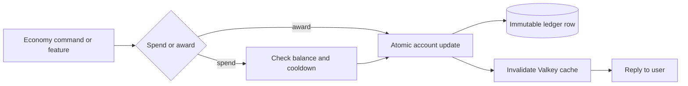

# Economy

Siela Coins (SC). One balance per user per guild. After account creation, every balance change writes an immutable row to `economy_transactions` in the same DB transaction. The design rationale and balance targets are in `docs/ECONOMY_V2.md`.

Storage: `economy_accounts`, `economy_transactions` (immutable ledger), `premium_passes`, `economy_shop_items`, `economy_inventory`, `economy_markets`, `economy_stocks`, `economy_holdings`. Valkey caches balance for 60s and leaderboard for 30s; DB is the source of truth when Valkey is unavailable. New accounts receive a 50 SC starting balance, recorded as a `starting_balance` ledger row.

Every balance change writes the account update and the ledger row in one database transaction. A failed spend leaves both untouched.

Commands: `economy balance|daily|work|transfer|top|shop|buy|coinflip|slots|blackjack|premium|grant|stats|adjust|shopadd|shopremove` (`apps/bot/src/commands/utility/economy.ts`). Aliases: `eco`, `coins`, `balance`. The exchange lives in `stocks market|portfolio|buy|sell`, with aliases `stock`, `market`, and `invest` (`apps/bot/src/commands/utility/stocks.ts`). Framework cooldown 3s on economy commands, 2s on stocks.

## Earning

- Starting balance: 50 SC on first account creation, written to the ledger as `starting_balance`.
- `daily`: 10 SC base, streak multiplier up to 7x (so 10–70 SC). The stored streak is the number of consecutive claim days, capped at 7x for payout. 24h cooldown, 36h streak window. Race-safe: the claim is a single conditional UPDATE, so concurrent claims cannot double-pay.
- `work`: 3–8 SC, 2h cooldown.
- Voice: 1 SC per 10 active minutes, 20/day cap. AFK-channel members and self-deafened or self-muted members are excluded.
- Social-command award: 1 SC per social command, idempotent per interaction, 20/day cap.
- Any-successful-command award: 1 SC, 5/hour cap.
- Tambola: 5 SC participation for games that reach at least 10 called numbers, 10 SC per line claim, 40 SC for Full House. Rewards use per-game idempotency keys.
- Stock market: capital gains after the 1% sell fee. The market maker is the counterparty, so gains come from price movement and are not capped per player.
- `transfer` in from another member: 1–1,000,000 SC per transfer; no self-transfers, no bot recipients. Transfers fail with `INSUFFICIENT_FUNDS` rather than going negative.
- Admin `adjust` can add or remove coins (see Admin).

## Spending and games

- `transfer <user> <amount>`: 1–1,000,000 SC. Debited atomically; fails if balance is insufficient.
- `coinflip <amount> <heads|tails>`: 48% win chance, win pays 2x the bet. The 4% edge is a sink. Bet is spent up front.
- `slots <amount>`: any pair pays 1.6x, triple pays 5x. The paytable returns about 96.8% of stakes, so slots are a sink rather than a faucet. Otherwise the bet is lost.
- `blackjack <amount>`: bet spent up front; win pays 2x, blackjack pays 2.5x (floored), push returns the bet. One hand per user at a time. Games are in-memory only and are lost on restart.
- All gambling commands cap a single bet at 10,000 SC.
- Actually charged features: delulu starts at 5 SC SFW / 15 SC NSFW and doubles with each use that day (SFW 5, 10, 20, 40; NSFW 15, 30, 60, ...). SFW is capped at 4 uses/day; NSFW has no daily cap and is limited only by coins. Failed generations are refunded.
- Tambola extra ticket 25 SC; Tambola per-player auto-mark 10 SC; `premium_30d` 2000 SC for 30 days.
- Relic auctions: bids are escrowed immediately and the winning bid is consumed; outbid bids are refunded. See [RELICS.md](RELICS.md).

## Relics

Siela Relics is the largest coin sink and a long-term coin source:

- **Auction bids** are deducted when placed and held in escrow. Outbid members are refunded in the same transaction. The winning bid leaves circulation.
- **Starting bid** is 25 SC and the minimum raise is 10 SC by default; both are configurable per guild in `relic_settings`.
- **Passive yield** returns 1 SC/day (Common) up to 25 SC/day (Mythic) while a card is held. Claim with `/relics collect`. Accrual caps at 30 days.
- **Genesis cards** (`#0001`–`#0010`) earn double yield.
- **Trades** can include up to 1,000,000 SC. Coins are escrowed when the offer is created and refunded if it is declined or expires.

The ledger records `relic_bid`, `relic_outbid_refund`, `relic_yield`, `relic_trade_escrow`, `relic_trade_payout`, `relic_trade_refund`, and `relic_auction_cancelled_refund` entries. The auction and trade writes happen in the same database transaction as the balance change.

Full mechanics and setup: [RELICS.md](RELICS.md).

## Shop

`economy shop` lists the global catalog plus per-guild server items. `economy buy <item>`:

- `delulu` / `delulu_nsfw` are not purchasable; they are charged automatically per use (`apps/bot/src/commands/utility/economy.ts`).
- `tambola_ticket` (25 SC) and `tambola_automark` (10 SC) are bought through the Tambola service for the current lobby.
- `premium_30d` (2000 SC) spends coins then grants 30 days of premium; if the grant fails after payment, the 2000 SC is refunded (`apps/bot/src/commands/utility/economy.ts`).
- Any other key falls through to the per-guild server shop (`buyItem`, `apps/bot/src/features/economy.ts`): stock (if set) is decremented, inventory quantity incremented, and a linked role (if set) is granted best-effort (`apps/bot/src/commands/utility/economy.ts`).

## Stock market

`stocks` is a bot market maker, not a player order book. Six fictional tickers (`SIELA`, `DELULU`, `TAMB`, `KIT`, `YAP`, `CHODU`) trade against the bot at the quoted price. Players cannot trade shares with each other, short, or place limit orders.

- Prices update hourly. Reads and trades catch up missed ticks, capped at 24 ticks per catch-up.
- Each tick applies a weak pull toward a slow-moving fair value, a volatility kick, and a small chance of a headline event.
- Every trade pays a 1% fee, minimum 1 SC, on both buy and sell. The fee is a sink.
- Buys use a weighted average cost that includes the buy fee. Sells report realized P/L against that average.
- The market card shows a 12-tick sparkline per stock, the equal-weight `SIELA-6` index, and the latest headline.
- The portfolio is ephemeral. The market board is public. Buy and sell open a modal from the card or accept `stocks buy <symbol> <shares>` / `stocks sell <symbol> <shares>`.
- Holdings are deleted with the rest of a user's data by `/privacy delete`.
- New accounts start with 50 SC, enough to buy a cheap position or three SFW delulu uses.

## Premium

- `economy premium` shows whether you have an active pass.
- `economy buy premium_30d` self-purchases 30 days for 2000 SC.
- Premium is status-only: it does not bypass any cost or cooldown. Everyone, including premium holders, still pays (see Design vs implementation).

## Admin

Requires admin permissions (`Manage Guild`/owner/`BOT_OWNER_ID`/`ADMIN_ROLE_IDS`); denied otherwise.

- `economy grant <user> <days>`: grants a premium pass for N days, audited as `economy.premium.grant` (`apps/bot/src/commands/utility/economy.ts`).
- `economy adjust <user> <amount> <reason>`: adds (positive) or removes (negative) coins. Reason and actor are recorded in the ledger (`reason by actorId`, `apps/bot/src/features/economy.ts`); negative adjustments fail instead of driving the balance below zero. Audited as `economy.adjust`.
- `economy shopadd <key> <price> <name>` / `economy shopremove <key>`: manage the per-guild server shop. Keys match `^[a-z0-9_-]{1,32}$` and are lowercased; price must be a positive integer. Audited as `economy.shop.add` / `economy.shop.remove`.
- `economy stats`: last 7 days of transaction volume grouped by kind, so faucets and sinks can be compared without opening the database.
- `economy balance <user>` and `economy top` work for all members; `top` paginates the 100 richest.

## Balance targets

The economy is tuned for a friends-only server, not a public bot. A member who claims daily, works a few shifts, and spends an hour in voice should land around 60–110 SC/day. A lurker who only claims daily should land around 20–35 SC/day.

- AI is the main sink and is gated twice: by price and by a daily use cap. A typical active day funds three or four SFW generations or one or two NSFW generations, not unlimited use.
- Gambling is a sink. Coinflip keeps a 4% edge and slots return about 96.8%, so neither is a reliable income source.
- The exchange is a game against the bot. Price risk, volatility drag, and the 1% fee mean it is not a reliable faucet; fees and losing positions remove supply, and winning positions pay from the bot's market making.
- Premium at 2,000 SC is a multi-week goal, not an impulse purchase.
- Use `economy stats` weekly. Change one faucet or one price at a time, then compare the next week's totals.

## Design vs implementation

`docs/ECONOMY_PLAN.md` and `docs/CURRENCY_GATING.md` are design history, not the implemented truth. Known differences:

- Daily is 10 SC base up to 7x with 24h cooldown and a 36h streak window, not 50 SC / 20h / 30x.
- Work is 3–8 SC with a 2h cooldown; no activity requirement.
- Only delulu (surge-priced 5/15 SC, daily-limited) and Tambola extra ticket (25 SC) / auto-mark (10 SC) are actually charged. TTS voices, Temp VC perks, event triggers, confession boosts, and family perks are not gated.
- Premium/admin bypass is not wired: premium is status-only and everyone still pays; there are no supporter tiers or tiered cooldowns.
- Not implemented: transfer caps (only the 1,000,000 per-transfer max), crime, quests, chat-message rewards, account-age gates, a global daily earn cap, and freeze/reset-cooldown commands.
- Blackjack games are in-memory only and lost on restart.
- The stock market has no design-history counterpart; it is a bot market maker, not a player order book.
