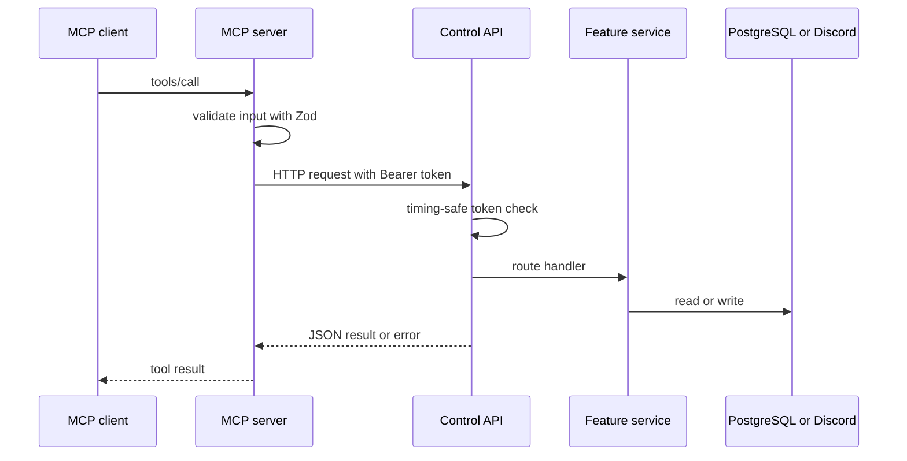

# Siela MCP

The MCP server exposes the bot control API as typed tools. It has no Discord client and no database client. It contains 51 tools in `apps/mcp/src/tools.ts`.

The compose service currently receives the shared deployment env file. The MCP process only reads its own variables, but the container environment also contains the Discord token and database URL. Treat the MCP container as secret-bearing and restrict access to the `mcp` network.

## Trust boundary



The control API runs inside the bot process. The MCP server reaches it through the internal `control` network and the `bot-control` alias.

## Transports

| Mode | Endpoint | Auth |
|---|---|---|
| stdio | `node apps/mcp/dist/index.js --stdio` | Process isolation plus `MCP_TOKEN` for the control API |
| HTTP on the Podman network | `http://mcp:8080/mcp` | `Authorization: Bearer <MCP_TOKEN>` |
| HTTP on the host | `http://127.0.0.1:8080/mcp` | Same token. Use `compose.host.yaml` |

The MCP server is attached to two networks when it runs in compose. `control` provides access to `bot-control`. `mcp` provides access to clients.

## Container image

The MCP image builds and runs with Bun. Build it from the repository root:

```bash
podman build -f deploy/podman/Containerfile.mcp -t localhost/siela-mcp:latest .
```

The container starts with `bun dist/index.js`. The resulting `localhost/siela-mcp:latest` image is the one `compose.mcp.yaml` runs.

## Client examples

### stdio in a container

The stdio container must join the `control` network so it can resolve `bot-control`. Pass only the variables the MCP process needs. Do not pass the full deployment `.env`, because it contains the Discord token and database URL.

```json
{
  "mcpServers": {
    "siela": {
      "command": "podman",
      "args": [
        "run", "-i", "--rm",
        "--network", "siela_control",
        "-e", "MCP_TOKEN=${MCP_TOKEN}",
        "-e", "CONTROL_API_URL=http://bot-control:3001",
        "localhost/siela-mcp:latest",
        "--stdio"
      ]
    }
  }
}
```

### HTTP on the Podman network

The client container must join `siela_mcp`.

```json
{
  "mcpServers": {
    "siela": {
      "url": "http://mcp:8080/mcp",
      "headers": { "Authorization": "Bearer ${MCP_TOKEN}" }
    }
  }
}
```

### HTTP on the host

Use the host overlay to publish MCP on loopback:

```bash
MCP_ENABLED=true ./scripts/podman-stack.sh \
  -f deploy/podman/compose.host.yaml up -d
```

Then connect to `http://127.0.0.1:8080/mcp` with the same bearer token.

## Tool groups

There are 51 tools.

- `bot_status`, `commands_list`
- `prefix_get`, `prefix_set`, `prefix_reset`
- `welcome_get`, `welcome_update`, `welcome_test`
- `autorole_get`, `autorole_update`, `autorole_validate`, `autorole_sync`
- `counters_get`, `counters_leaderboard`, `optouts_list`, `counters_reset`
- `tempvc_get_config`, `tempvc_update_config`, `tempvc_list`, `tempvc_get`, `tempvc_update`, `tempvc_permit`, `tempvc_deny`, `tempvc_disconnect`, `tempvc_claim`, `tempvc_transfer`, `tempvc_delete`
- `music_get_config`, `music_update_config`, `music_join`, `music_play`, `music_pause`, `music_resume`, `music_skip`, `music_stop`, `music_queue`, `music_nowplaying`, `music_volume`, `music_seek`, `music_loop`, `music_shuffle`, `music_remove`, `music_clear`, `music_move`, `music_jump`, `music_autoplay`, `music_filters`, `music_disconnect`
- `message_send`, `audit_tail`, `privacy_delete_user_data`

Destructive tools (`autorole_sync`, `counters_reset`, `tempvc_delete`, `message_send`, `privacy_delete_user_data`) require `confirm: true`.

There are no MCP tools for the economy, Delulu, TTS, or social commands. Those features are Discord-only.

## Audit coverage

Some control API mutations write an audit entry. Coverage is not universal. The following routes currently call `AuditService`:

- Prefix updates.
- Welcome updates.
- Auto-role updates and synchronization.
- Counter resets.
- Temporary voice channel configuration updates (`PATCH /v1/tempvc/config`).
- Music configuration updates (`PATCH /v1/music/config`).
- Message sends.
- Privacy deletion.

Music controls and most temporary voice channel mutations are not written to the audit log. Treat the MCP token as a privileged credential and restrict access to the `mcp` network.
