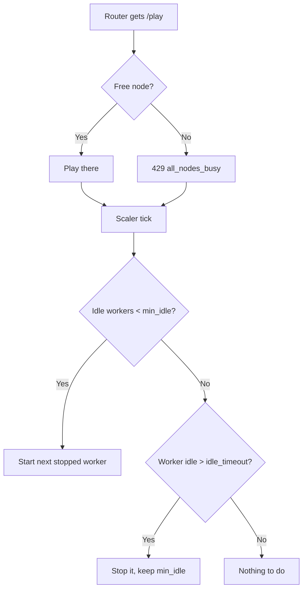

# On-demand voice workers

The fleet currently runs every worker container all the time. A worker costs
about 53 MB idle (measured: cgroup `anon`, `siela-voice-1` and `siela-voice-2`
on the production host). At 50 workers that is 2.6 GB of standing memory for
capacity that is usually idle.

This document describes an elastic pool instead: keep one free worker, start
another when that one gets used, stop workers that have been idle for a while.

## Why not a request queue

A request queue inside the router looks attractive and is the wrong shape.
Discord gives an interaction 3 seconds to answer, and a music request already
spends most of that on `yt-dlp`. Holding the request until a worker boots adds
2 to 3 seconds on a cold start and makes every future queue depth a timeout
bug.

Instead, keep at least one worker idle at all times. A request never waits,
because there is always somewhere for it to land, and the pool refills itself
in the background. When the pool is at its cap and every worker is busy, the
router's existing `429 all_nodes_busy` is the correct answer.

This is the same behaviour as the flowchart, with the "queue" branch replaced
by "keep a spare running".

## Shape

The scaler is not in the request path. It reacts to fleet state on a timer,
which means a slow Podman call can never delay a `/play`.

## Signals

The scaler reads only what the stack already publishes.

| Signal | Source |
|---|---|
| Live workers | Valkey keys `siela:fleet:node:*` (45 s TTL) |
| Busy or idle | `GET /v1/music/state-all` on the router |
| Sticky TTS | `GET /v1/tts/state?nodeId=` per node |
| Capacity | `deploy/podman/.env.voice-1..N` files |

A worker counts as busy when `playing` is true or `current` is not null, the
same rule the router's pool uses in `apps/router/src/pool.ts`.

A worker is never stopped while TTS is enabled on it, because that worker owns
the voice connection for the TTS session.

## Worker lifecycle

Workers are created once by `scripts/make-voice-overlay.sh` and managed with
`podman start` and `podman stop`, not created on demand. Creation would mean
mounting the full compose context, resolving tokens, and pulling an image on
the hot path. Starting an existing container takes about 2.3 seconds to
gateway login (measured from `siela-voice-2` restart timestamps), and the
container keeps its config.

Workers must deregister their heartbeat on `SIGTERM`. The Rust worker does
this in `apps/voice-worker/src/fleet.rs`. The TypeScript worker does it in
`FleetHeartbeat.stop`. Without it the router keeps a dead node for 45 seconds
and the semaphore over-reports capacity.

## Configuration

| Variable | Default | Purpose |
|---|---|---|
| `VOICE_POOL_MIN_IDLE` | `1` | Free workers kept ready, never 0 |
| `VOICE_POOL_MAX` | worker count | Upper bound on running workers |
| `VOICE_POOL_IDLE_SEC` | `600` | Idle time before a spare is stopped |
| `VOICE_POOL_TICK_SEC` | `15` | How often the scaler reconciles |

`VOICE_POOL_MAX` defaults to the number of `.env.voice-*` files, which is the
number of Discord applications that exist.

## Cost of a cold start

A stopped worker takes about 2.3 seconds to reach gateway login. With
`min_idle=1` that cost is never on a user's request, because the spare is
always already running. It only shows up as a brief window where the next
request would 429, which the tick closes within `VOICE_POOL_TICK_SEC`.

Lowering the tick to 5 seconds narrows that window at the cost of more Podman
API calls.

## What this saves

Measured per worker on the production host: 53 MB idle for Bun, about 2 MB for
the Rust worker. With `min_idle=1` at a capacity of 50:

| Approach | Standing memory |
|---|---|
| 50 Bun, always on | 2,650 MB |
| 50 Rust, always on | 600 MB |
| 1 Bun on demand, 49 stopped | 53 MB |
| 1 Rust on demand, 49 stopped | 2 MB |

The two changes compose. Either one alone removes most of the standing cost;
together they remove almost all of it.

## Failure modes

- **Scaler down.** Nothing new starts and nothing stops. The pool stays at
  whatever is running, so the stack degrades to the current behaviour.
- **Podman API unreachable.** The tick logs and retries. No worker is stopped,
  because stopping is the destructive direction.
- **Worker fails to start.** It is counted as broken and the scaler tries the
  next slot, with a backoff so a bad token cannot spin.
- **Race with watchtower.** Watchtower recreates the fleet on deploy. The
  scaler must skip nodes that watchtower is recreating, or it will fight it.
  Simplest guard: pause reconciliation for 120 seconds after the bot or router
  container start time changes.

## Status

Design only. The scaler is not implemented. The Rust worker must land first,
because the pool is only worth running if the per-worker cost is the 2 MB
measured for Rust rather than 53 MB for Bun.
