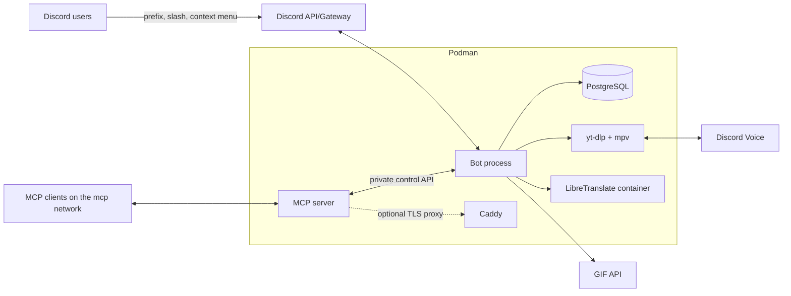
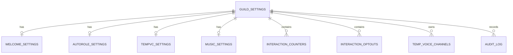

# Siela Bot — Architecture & Delivery Plan

> **Status:** Draft v0.2 — major decisions confirmed; remaining smaller decisions in §14  
> **Scope:** One Discord guild, one bot instance, fully deployable with rootless Podman  
> **Last updated:** 2026-10-21

---

## Contents

- [0. Executive summary](#0-executive-summary)
- [1. Goals, non-goals, assumptions](#1-goals-non-goals-assumptions)
- [2. Requirements traceability](#2-requirements-traceability)
- [3. System architecture](#3-system-architecture)
- [4. Stack decisions](#4-stack-decisions)
- [5. Feature design](#5-feature-design)
- [6. Data model](#6-data-model)
- [7. MCP server](#7-mcp-server)
- [8. Security](#8-security)
- [9. Podman deployment](#9-podman-deployment)
- [10. Observability and operations](#10-observability-and-operations)
- [11. Testing strategy](#11-testing-strategy)
- [12. Delivery roadmap](#12-delivery-roadmap)
- [13. Gap analysis](#13-gap-analysis)
- [14. Open decisions](#14-open-decisions)
- [15. Launch checklist](#15-launch-checklist)
- [Appendix A — Command reference](#appendix-a--command-reference-v1)
- [Appendix B — Environment variables](#appendix-b--environment-variables)
- [Appendix C — Podman quickstart](#appendix-c--podman-quickstart)
- [Appendix D — Glossary](#appendix-d--glossary)
- [Appendix E — Plan quality checklist](#appendix-e--plan-quality-checklist)

---

## 0. Executive summary

Build a TypeScript monorepo with a Discord bot, a separate MCP control server, PostgreSQL, and yt-dlp/mpv, packaged as OCI containers and deployed with rootless Podman.

```
Discord users ── prefix / slash / context menu ──┐
                                                  ▼
                                         ┌─────────────────┐
                                         │   Bot process   │
                                         │   discord.js    │
                                         │ feature services│
                                         │   control API   │◀──── MCP server ◀──── MCP clients
                                         └───┬───────┬─────┘
                                             │       │
                                   ┌─────────▼──┐  ┌─▼──────────────┐
                                   │ PostgreSQL │  │ yt-dlp/mpv  │
                                   └────────────┘  │  (voice/music) │
                                                   └────────┬───────┘
                                                            │
                                                     Discord Voice
```

### Recommended defaults

| Area | Recommendation |
|---|---|
| Runtime | Node.js 24 LTS + TypeScript |
| Discord library | discord.js v14.x, pinned |
| Database | PostgreSQL 17 + Drizzle ORM |
| Music | yt-dlp + mpv: SoundCloud streaming out of the box; Spotify links resolve through oEmbed metadata and SoundCloud search |
| Translation | Self-hosted LibreTranslate container (zero API tokens, free) |
| Command UX | **Hybrid (confirmed):** prefix + slash + context menu + mention prefix |
| Admin model | `Manage Guild` permission, server owner, optional `ADMIN_ROLE_IDS`; runtime checks on every admin action |
| MCP | Separate process; stdio locally; Streamable HTTP exposed on the Podman `mcp` network; one `MCP_TOKEN`; `MCP_URL` flag |
| Deployment | Rootless Podman; Compose is `podman compose`-compatible; Quadlet for production |
| Help UI | Components V2 with embed fallback, ephemeral, permission-aware |
| Single guild | `GUILD_ID` is auto-detected when the bot is in exactly one guild; set explicitly only if needed; other guilds rejected |
| Social | `slap`, `kiss`, `hug`, `chodu`, counters in Postgres |
| Config philosophy | Only `DISCORD_TOKEN` is required; the client ID is derived from it and the guild ID is auto-detected; internal secrets are generated by a bootstrap script |

### Confirmed decisions

| Decision | Choice |
|---|---|
| Music sources | yt-dlp + mpv; SoundCloud is the zero-token default; Spotify links resolve through oEmbed metadata and SoundCloud search |
| Translation | Self-hosted LibreTranslate; no paid API key |
| MCP exposure | Exposed on the Podman `mcp` network via `MCP_URL=http://mcp:8080/mcp`; one generated `MCP_TOKEN`; optional host/TLS overrides |
| Social action | `chodu` (renamed from `fuck`), opt-out-aware, cooldown-limited, text-only; optional NSFW gate |
| Command UX | Hybrid: prefix + slash + context menu + mention prefix |
| Compose | Restricted to the `podman compose`-compatible subset; `-p siela` for deterministic network names |
| Config | Only `DISCORD_TOKEN` is required; client ID is derived, guild ID is auto-detected, Postgres/MCP secrets are generated; Spotify is the only optional credential |

### What this plan deliberately closes

- Runtime authorization, not just hidden commands or slash-command defaults.
- Auto-role privilege-escalation protection.
- Consent/opt-out and cooldown handling for the `chodu` action.
- Custom-VC permission boundaries and lifecycle reconciliation.
- MCP audit trail, confirmation for destructive tools, network isolation, and one-token simplicity.
- yt-dlp URL isolation and a zero-token music-source policy (SoundCloud; Spotify links resolve through metadata search).
- Podman rootless constraints, SELinux, healthchecks, backups, and migrations.
- Privacy/retention for counters, audit logs, and translation content.
- Minimal configuration: one required Discord token; internal secrets auto-generated.

### Biggest risks

1. **Music source reliability and legality** — yt-dlp depends on third-party services; SoundCloud search can be inconsistent and Spotify playback is metadata search only. Respect third-party terms.
2. **"Private" voice channels are not absolute** — Discord role-level permission allows can bypass an `@everyone` deny. The plan mitigates this but cannot make it mathematically private without controlling all roles.
3. **MCP is an admin control plane** — even on the private Podman network, one leaked `MCP_TOKEN` can change guild configuration. The plan keeps the network private, requires confirmation for destructive tools, and audits every mutation.
4. **LibreTranslate resource usage** — self-hosted translation is free but costs RAM/CPU and needs a model volume; first boot downloads models.
5. **`chodu` is a moderation risk** — it is opt-out-aware, cooldown-limited, text-only, and can be NSFW-gated or disabled by an admin.

---

## 1. Goals, non-goals, assumptions

### 1.1 Goals

| ID | Goal |
|---|---|
| G1 | Music bot with queue, playback controls, and reliable voice lifecycle. |
| G2 | MCP server that can read and control every bot feature through typed tools. |
| G3 | Welcome messages on guild join. |
| G4 | Auto-role assignment on guild join, safely validated. |
| G5 | `slap`, `kiss`, `hug`, `chodu` actions with persistent PostgreSQL counters. |
| G6 | Join-to-create private temporary voice channels with owner controls. |
| G7 | Reply-to-translate into English. |
| G8 | Global prefix change for the single guild. |
| G9 | Admin-only configuration commands with runtime authorization. |
| G10 | Clean, permission-aware help UI. |
| G11 | Entire stack deployable with rootless Podman. |

### 1.2 Non-goals for v1

- Multi-guild support or sharding.
- Web dashboard.
- Full moderation suite (bans, kicks, automod, tickets).
- Voice recording, transcription, or AI chat.
- Invite tracking / inviter attribution.
- Deep welcome-card customization beyond the generated card (the generated card is implemented and toggled with `welcome card on/off`).
- Apple Music, Deezer, YouTube, and other music sources (only SoundCloud + optional Spotify in v1).
- Public bot listing or verification-scale operation.
- Paid translation APIs and OAuth for MCP in v1 (LibreTranslate and one shared token instead).

### 1.3 Assumptions

- One Discord guild; `GUILD_ID` is auto-detected at boot when the bot is in exactly one guild, binds to the first guild it joins when it is in none, and can be set explicitly if needed.
- The bot is invited with the minimum permissions listed in §8.3, **not** Administrator.
- `Guild Members` and `Message Content` privileged intents are enabled in the Discord developer portal.
- Production host is Linux with Podman 5+ and cgroups v2; macOS uses a Podman machine for development only.
- MCP is exposed on the Podman `mcp` network via `MCP_URL`; a public domain/TLS proxy is optional and out of the default compose.
- No paid translation key is required: LibreTranslate runs as a local container.
- SoundCloud works with zero tokens; Spotify is optional and requires a free Spotify client ID/secret only if `spsearch:` is wanted.
- Expected scale is a single community (assume < 1,000 members, < 50 concurrent voice users); this is not a hard limit.
- UI language is English for v1.

### 1.4 Non-functional targets

| Area | Target |
|---|---|
| Command acknowledgement | < 2.5s; defer if provider/music work will take longer. |
| Translation latency | p95 < 5s for a 2,000-character message on a CPU-only host (LibreTranslate). |
| Music start | < 5s after `play` for a SoundCloud search result; Spotify-mirrored tracks may take longer. |
| Required user config | `DISCORD_TOKEN` only; the client ID is derived from the token and the guild ID is auto-detected when the bot is in exactly one guild; internal secrets are generated. |
| Availability | Best-effort single instance; systemd/Podman restart within 60s. |
| Data loss | RPO 24h (nightly backup); RTO 1h for a single-host restore. |
| Scale | 1 guild, < 1,000 members, < 50 concurrent voice users. |
| Logs | 14 days; audit 90 days; no message content. |
| Security | No Administrator permission; runtime admin checks; private MCP by default. |

---

## 2. Requirements traceability

| Req | Feature | Primary implementation | User commands | Admin commands | MCP tools |
|---|---|---|---|---|---|
| G1 | Music | yt-dlp/mpv player + queue service | `play`, `pause`, `skip`, `queue`, `nowplaying`, etc. | DJ role / queue config | `music_*` |
| G2 | MCP control | `apps/mcp` + bot control API | — | — | All tools |
| G3 | Welcomer | `welcome` service + `guildMemberAdd` | — | `welcome ...` | `welcome_get`, `welcome_update`, `welcome_test` |
| G4 | Auto-role | `autorole` service + `guildMemberAdd` | — | `autorole ...` | `autorole_get`, `autorole_update`, `autorole_validate`, `autorole_sync` |
| G5 | Social counters | `counters` service + atomic upsert | `slap`, `kiss`, `hug`, `chodu`, `socialstats`, `socialtop`, `optout`, `optin` | Optional reset | `counters_get`, `counters_leaderboard`, `counters_reset` |
| G6 | Temp VC | `tempvc` service + `voiceStateUpdate` | `vc lock`, `vc permit`, `vc deny`, `vc disconnect`, etc. | `tempvc setup`, `tempvc config` | `tempvc_*` |
| G7 | Translate | `translate` service + LibreTranslate container | `translate` (reply or text) | — | `translate_text`, `translate_message` |
| G8 | Prefix | `prefix` service + cache | `prefix` | `prefix set`, `prefix reset` | `prefix_get`, `prefix_set`, `prefix_reset` |
| G9 | Admin security | Central `assertAdmin` + audit | — | All config commands | Tier checks |
| G10 | Help | Command registry + Components V2 | `help`, `/help` | — | `commands_list` |
| G11 | Podman deploy | `podman compose`-safe Compose + Quadlet + two Containerfiles | — | — | `bot_status` health |

---

## 3. System architecture

### 3.1 Context diagram



### 3.2 Components and responsibilities

| Component | Responsibility | Must not do |
|---|---|---|
| Bot gateway | Discord login, events, command routing, voice state tracking | Accept arbitrary guild IDs |
| Command framework | Parse prefix/slash, check permissions, cooldowns, errors | Trust client-side permission hints |
| Feature services | Welcome, autorole, counters, temp VC, translate, prefix, music | Bypass validation or audit |
| yt-dlp + mpv | Music search/streaming and voice encoding | Reach PostgreSQL or control API |
| Control API | Private, typed API over bot services | Be publicly exposed without auth |
| MCP server | Translate tool calls into control API calls; require `MCP_TOKEN` on HTTP | Connect to Discord gateway, hold DB credentials, run SQL/shell |
| LibreTranslate | Self-hosted English translation | Be exposed outside `edge`, hold DB/control access |
| PostgreSQL | Persistent settings, counters, temp VC state, audit | Be published to the host |
| Caddy | Optional TLS/reverse proxy for clients outside the Podman network | Terminate non-TLS admin traffic |
| Podman | Build, run, isolate, healthcheck, restart | Require Docker |

### 3.3 Repository layout

```text
.
├── apps/
│   ├── bot/
│   │   ├── src/
│   │   │   ├── index.ts                 # boot, graceful shutdown
│   │   │   ├── client.ts                # discord.js client + intents
│   │   │   ├── commands/
│   │   │   │   ├── admin/               # prefix, welcome, autorole, tempvc config
│   │   │   │   ├── social/              # slap, kiss, hug, chodu, stats
│   │   │   │   ├── voice/               # vc subcommands
│   │   │   │   ├── utility/             # translate, help, ping, privacy
│   │   │   │   └── music/               # play, queue, controls
│   │   │   ├── events/                  # ready, messageCreate, voiceStateUpdate, member add/remove
│   │   │   ├── framework/               # command metadata, parser, context, cooldowns
│   │   │   ├── features/                # welcome, autorole, counters, tempvc, translate, music, prefix
│   │   │   ├── control/                 # Fastify control API, auth, routes
│   │   │   ├── music/                   # yt-dlp/mpv player, queue, voice
│   │   │   └── lib/                     # logger, errors, permissions, mentions, time
│   │   └── package.json
│   └── mcp/
│       ├── src/
│       │   ├── index.ts                 # stdio/HTTP entrypoint (--mcp-url, --stdio)
│       │   ├── server.ts                # MCP server + tool registration
│       │   ├── tools/                   # one file per feature group
│       │   ├── control-client.ts        # typed control API client
│       │   └── auth.ts                  # MCP_TOKEN check + origin/host checks
│       └── package.json
├── packages/
│   ├── core/src/                        # services, ports, domain errors
│   ├── db/src/                          # Drizzle schema, client, migrations
│   ├── shared/src/                      # Zod schemas, DTOs, constants
│   └── config/src/                      # env parsing + secret file support
├── deploy/
│   └── podman/
│       ├── Containerfile.bot            # bot image + migration runner
│       ├── Containerfile.mcp            # MCP image
│       ├── compose.yaml                 # podman compose-compatible core stack
│       ├── compose.host.yaml            # optional host-local MCP publish
│       ├── compose.proxy.yaml           # optional Caddy/TLS override
│       ├── README.md                    # Podman quickstart
│       ├── .env.example
│       ├── Caddyfile                    # optional remote MCP
│       └── quadlet/                     # production systemd units
├── docs/
│   ├── PLAN.md                          # this file
│   ├── RUNBOOK.md
│   ├── THREAT-MODEL.md
│   └── MCP.md
├── scripts/
│   ├── podman-init.sh                   # generates .env secrets
│   ├── podman-compose-smoke.sh          # validates the compose file
│   ├── backup.sh
│   └── restore.sh
├── .containerignore
├── pnpm-workspace.yaml
├── package.json
└── tsconfig.base.json
```

### 3.4 Trust boundaries

| Boundary | Trust level | Controls |
|---|---|---|
| Discord user → bot | Untrusted input | Validation, permission checks, cooldowns, mention sanitization |
| MCP client → MCP server | Untrusted, authenticated | One `MCP_TOKEN`, Podman-network exposure, rate limits, audit |
| MCP server → control API | Private service | Private network, same `MCP_TOKEN`, request IDs, schema validation |
| Bot → PostgreSQL | Trusted | Parameterized ORM, least-privilege DB user, no public port |
| Bot → yt-dlp/mpv | Local subprocess | Timeouts, URL allowlist, private-IP blocking |
| yt-dlp → internet | Untrusted content | http(s)-only URLs, private-IP/loopback/link-local blocking |
| Bot → LibreTranslate | Trusted local service | `edge` network only, timeouts, circuit breaker, no content logging |
| Bot → GIF API | Third-party, no key | Fixed endpoint, timeout, text-only fallback |

### 3.5 Key flows

#### Prefix command

1. `messageCreate` arrives.
2. Ignore bots, webhooks, DMs, and other guilds.
3. Resolve prefix from in-memory cache; also accept mention prefix.
4. Parse command name, aliases, and arguments.
5. Run guards: guild, NSFW, admin, user permissions, bot permissions, cooldown.
6. Execute the feature service.
7. Reply with safe `allowedMentions`.
8. Log request ID, command, duration, result.

#### MCP tool call

1. MCP client calls `MCP_URL` with `Authorization: Bearer <MCP_TOKEN>`.
2. MCP server validates the token (HTTP) or runs under stdio (trusted local process).
3. Zod validates the tool input; no `guildId` is accepted.
4. MCP server calls the control API over the private `control` network.
5. Control API authenticates the same `MCP_TOKEN` and re-validates the payload.
6. Feature service executes against Discord/DB.
7. Audit row is written with actor `mcp`, action, before/after, request ID.
8. Structured result returns to the MCP client.

#### Member join (welcome + auto-role)

1. `guildMemberAdd` fires.
2. Both handlers run independently with `Promise.allSettled`.
3. Auto-role validates hierarchy/dangerous permissions, then assigns roles.
4. Welcome sends to the configured channel and/or DM.
5. Failures are logged/audited but do not block the other handler.

#### Temp VC lifecycle

1. User joins the configured hub voice channel.
2. Bot takes a per-user advisory lock; checks for an existing active channel.
3. Bot creates a voice channel in the configured category, applies overwrites, moves the user in.
4. Bot inserts a `temp_voice_channels` row.
5. Owner uses `vc` commands or Discord UI.
6. When empty, bot waits the grace period, then deletes the channel and marks the row deleted.
7. On restart, bot reconciles DB rows against Discord channels.

#### Translation

1. User replies to a message with `translate` (or uses `/translate`).
2. Bot fetches the target message, extracts text (content or embed description).
3. Mentions/custom emoji are protected with placeholders.
4. Bot calls LibreTranslate on the `edge` network with timeout/retry.
5. Bot replies with original (truncated) + translation + detected language.
6. No message content is persisted; only an in-memory LRU cache is used.

#### Music

1. User runs `play <query>`.
2. Bot validates voice channel and permissions.
3. yt-dlp resolves the SoundCloud search (or Spotify link via oEmbed + SoundCloud search).
4. Bot joins voice, enqueues, and starts playback.
5. On empty/alone timeout, bot stops and disconnects.
6. On voice disconnect, the player cleans up and reports status.

---

## 4. Stack decisions

| Concern | Choice | Why | Alternative considered |
|---|---|---|---|
| Runtime | Node.js 24 LTS | Long support, first-class TS, MCP SDK | Node 22 (older), Bun (less proven for voice) |
| Language | TypeScript strict | Shared schemas/types across bot/MCP | Python + discord.py |
| Discord | discord.js v14.x | Mature, voice helpers, Components V2 support | discord.py, @discordjs/core |
| Database | PostgreSQL 17 | Atomic upserts, arrays, JSONB, strong constraints | SQLite (no concurrent writes), MySQL |
| ORM | Drizzle + drizzle-kit | SQL-first, typed, lightweight migrations | Prisma (heavier), Kysely |
| Validation | Zod | Shared input/output schemas, JSON Schema for MCP | Valibot, io-ts |
| HTTP | Fastify | Fast, schema-friendly, small | Express, Hono |
| MCP | `@modelcontextprotocol/sdk` | Official SDK, stdio + Streamable HTTP | Custom JSON-RPC |
| Music | yt-dlp + mpv + @discordjs/voice | Zero-token SoundCloud; Spotify metadata search; no JVM | Lavalink (extra service/JVM) |
| Translation | LibreTranslate container | Free, self-hosted, no API token; text stays on the host | DeepL/Google (paid keys) |
| GIFs | Adapter: nekos.best default | Simple SFW API with no key for slap/kiss/hug | Tenor (key/policy), local assets |
| Logs | Pino | JSON logs, redaction, low overhead | Winston |
| Metrics | prom-client | Prometheus-compatible | OpenTelemetry-only |
| Tests | Vitest | Fast, TS-native | Jest |
| Cache/queues | In-process maps; yt-dlp/mpv player queue | Single guild/process; no Redis to operate | Redis |
| Containers | Podman + Buildah | Rootless, daemonless, systemd-native | Docker |
| Compose compatibility | `podman compose`-safe compose subset | Works with both Docker Compose provider and `podman-compose` | Docker-only compose features |
| Secrets | One required Discord token; internal secrets generated by `scripts/podman-init.sh` | Minimal config, no copy-pasting random passwords | Hand-managed `.env` with many secrets |
| Production units | Quadlet | systemd integration, auto-update, no generated units | `podman generate systemd` (deprecated) |
| CI | GitHub Actions + Podman | Build/test/push OCI images | Docker-based CI |

---

## 5. Feature design

### 5.1 Command framework (hybrid)

One command definition, two adapters (prefix message and slash interaction), plus optional context-menu commands.

```ts
interface Command {
  name: string;
  aliases?: string[];
  category: "music" | "social" | "voice" | "utility" | "admin";
  description: string;
  usage: string;
  examples?: string[];
  adminOnly?: boolean;
  nsfw?: boolean;
  guildOnly?: boolean;
  cooldownMs?: number;
  userPermissions?: bigint[];
  botPermissions?: bigint[];
  slash?: SlashOptions;
  execute(ctx: CommandContext): Promise<void>;
}
```

Rules:

- Prefix commands are primary; slash commands are registered guild-scoped for instant updates.
- Mention prefix `<@bot>` and `<@!bot>` always works.
- Runtime guards run for both adapters; slash `defaultMemberPermissions` is only UX.
- Unknown commands: one throttled `❓` reaction, no error spam.
- Errors reply with a short message + request ID; stack traces only in logs.
- Cooldowns are in-memory keyed by `command:user`; single process, so no Redis needed.
- Command metadata feeds the help UI automatically.
- No `eval`, `exec`, dynamic imports, or arbitrary SQL from commands.

### 5.2 Prefix

**Model:** one global prefix per guild, stored in `guild_settings.prefix`, cached in memory. There are no per-user prefixes.

**Commands:**

| Command | Access | Behavior |
|---|---|---|
| `prefix` | Everyone | Show current prefix and examples. |
| `prefix set <new>` | Admin | Validate, persist, update cache, audit. |
| `prefix reset` | Admin | Restore default (`!`), audit. |

**Validation:**

- 1–5 printable characters.
- Must contain at least one non-alphanumeric character (so `?`, `.`, `!!`, `>` are valid; `hello` and `a` are rejected to avoid accidental triggers).
- No whitespace, `@`, `#`, `/`, backslash, backtick, or control characters.
- Reject a prefix equal to the current one (no-op with notice).
- Warn if the prefix is a common word or likely to trigger accidentally.
- Database check constraint plus application validation.

**Behavior:**

- Old prefix stops working immediately after update.
- Mention prefix and slash commands remain available.
- Prefix cache is loaded on ready and updated transactionally after a successful DB write.
- If the DB write succeeds but the cache update fails, the next message falls back to a DB read and repairs the cache.

**Acceptance:** admin sets `?`; all members can use `?help`; `!help` no longer works; invalid prefixes are rejected; audit row exists.

### 5.3 Welcome

**Config fields:** enabled, channel, message template, embed toggle, ping-user toggle, DM toggle/message, optional goodbye channel/message.

**Scope:** human members only; bots are ignored unless an explicit `welcomeBots` flag is added later.

**Placeholders:** `{user}`, `{mention}`, `{username}`, `{displayName}`, `{server}`, `{memberCount}`, `{createdAt}`, `{joinedAt}`. Unknown placeholders are rejected at save time.

**Safety:**

- Default `allowedMentions: { parse: [], repliedUser: false }`.
- `@everyone`/`@here` are never rendered from templates.
- Optional user ping only if `pingUser` is enabled.
- Escape Markdown where appropriate; enforce 2,000-char content / 4,096-char embed limits.
- Validate the bot can view/send/embed in the target channel before saving.
- DM failures (closed DMs) are caught, counted, and never retried indefinitely.

**Commands:** `welcome setup`, `welcome channel`, `welcome message`, `welcome embed`, `welcome ping`, `welcome dm`, `welcome test`, `welcome disable`, `welcome goodbye`.

**Welcome card:** `welcome card on/off` toggles a generated PNG card (avatar, display name, message, server, member count) rendered with `@napi-rs/canvas`. The bot image installs DejaVu fonts; if rendering fails, the welcome falls back to the normal embed/text path.

### 5.4 Auto-role

**Config fields:** enabled, role IDs (max 10), include bots (default false), minimum account age in days (default 0), delay in ms (default 500).

**Assignment flow:**

1. Ignore bots unless `includeBots`.
2. If `minAccountAgeDays > 0`, skip accounts younger than the threshold.
3. Fetch the member and the guild's roles.
4. Filter to roles that still exist and are assignable.
5. Assign only the missing roles; role assignment is idempotent.
6. Log partial failures with the role ID and Discord error code.
7. Audit the assignment (or the skip reason) with source `discord`.

**Security validation (at save time and runtime):**

- Bot must have `Manage Roles`.
- Bot's highest role must be **above** every configured role.
- Reject `@everyone`.
- Reject managed/integration roles.
- Reject roles with `Administrator`.
- Reject or warn on roles with `Manage Guild`, `Manage Roles`, `Ban Members`, `Kick Members`, `Manage Channels`, `Manage Webhooks`. Recommended default: reject `Administrator`, `Manage Roles`, `Manage Guild`, `Ban Members`, `Kick Members`; warn on the rest.
- Never grant a role above the bot; never grant a role above the invoker (for manual config, the invoker's role position matters).
- Maximum 10 auto-roles to keep join handling bounded.

**Reconciliation:** `autorole sync [dry-run]` (admin) checks all members for missing auto-roles and assigns them in batches. Default is dry-run. MCP `autorole_sync` requires `confirm: true`.

**Gaps closed:** missed joins during downtime, role deletion, role moved above bot, partial assignment, duplicate assignment, raid-age gating.

**Acceptance:** joining member receives all configured roles; a role above the bot blocks save with a clear error; an Administrator role is rejected; `sync --dry-run` reports counts without changing roles.

### 5.5 Social actions and counters

**Commands:**

| Command | Behavior |
|---|---|
| `slap <user>` | Increment `actor → target` slap counter, reply with GIF + count. |
| `kiss <user>` | Same for kiss. |
| `hug <user>` | Same for hug. |
| `chodu <user>` | Opt-out-aware, cooldown-limited, text-only; NSFW gate is a config flag (default off because it is an insult, not sexual content). |
| `socialstats [user]` | Given/received totals and top counterpart. |
| `socialtop [kind]` | Leaderboard for a kind. |
| `optout [kind]` | Stop being a target (all kinds if omitted). |
| `optin [kind]` | Reverse an opt-out. |

**Counter storage:** one row per `(guild_id, actor_id, target_id, kind)`, atomic upsert:

```sql
INSERT INTO interaction_counters (guild_id, actor_id, target_id, kind, count, last_used_at)
VALUES ($1, $2, $3, $4, 1, now())
ON CONFLICT (guild_id, actor_id, target_id, kind)
DO UPDATE SET count = interaction_counters.count + 1, last_used_at = now()
RETURNING count;
```

**Safety:**

- `chodu` has an optional NSFW gate (`social.choduNsfwOnly`, default `false`). If enabled, threads use the parent channel's NSFW flag.
- Target opt-out always wins; self-target is rejected for `chodu` (others may allow self).
- 3-second per-user cooldown across social commands.
- 2,000-char response limit; no mass mentions.
- GIF provider failure falls back to text-only, never blocks the counter.
- `chodu` uses no GIF; an operator can disable the command entirely.
- Counters are pair-based; totals/leaderboards are derived with indexed queries.

**Privacy:** counters store Discord user IDs and counts only. `privacy delete` removes the caller's counter and opt-out rows. Audit logs are retained separately per policy.

**Acceptance:** counters survive restart; two concurrent invocations produce `+2`; opt-out blocks targeting; the optional NSFW gate rejects in SFW channels when enabled; `socialtop` orders correctly.

### 5.6 Temporary voice channels

**Config fields:** enabled, hub channel, category, name template (`{user}'s VC`), default user limit, default locked, auto-delete, grace seconds, max channels globally, max per user (default 1).

**Creation flow:**

- `voiceStateUpdate` detects a join to the hub; ignore bots.
- Per-user PostgreSQL advisory lock (`pg_advisory_xact_lock`) prevents duplicate creation on rapid rejoin.
- If the user already owns an active channel, move them there instead of creating a new one.
- Create the channel with a marker in the topic if the channel type supports it (`siela-tempvc:<ownerId>`); the DB row is the source of truth for reconciliation.
- Apply overwrites, move the member, insert the DB row.
- Post a persistent control panel in the voice channel's text chat: lock/unlock, rename, user limit, kick, transfer ownership, open chat, and delete. The owner receives text-chat permissions for that channel.
- If creation fails, reply/log with a safe error and do not leave a half-created row.

**Permission matrix:**

| Principal | View | Connect | Manage Channel | Move Members | Mute/Deafen | Priority Speaker | Kick/Ban |
|---|---|---|---|---|---|---|---|
| `@everyone` | ✅ | ❌ (locked) | ❌ | ❌ | ❌ | ❌ | ❌ |
| Owner | ✅ | ✅ | ✅ | ✅ | ✅ | ✅ | ❌ |
| Bot | ✅ | ✅ | ✅ | ✅ | ✅ | ❌ | ❌ |
| Permitted user | ✅ | ✅ | ❌ | ❌ | ❌ | ❌ | ❌ |

- No guild-level `Kick Members` or `Ban Members` is granted to the owner.
- Discord has no channel-level ban; "disallow to join" is a `Connect` deny overwrite.
- `vc disconnect` (alias `vc kick`) disconnects from the voice channel only; it is not a server kick.
- `vc deny` sets `Connect: false`; `vc permit` sets `Connect: true`.
- Owner can use the Discord UI because of `Manage Channels`; the bot re-asserts its own required overwrites if they are removed.

**Commands:** `vc lock`, `vc unlock`, `vc permit @user`, `vc deny @user`, `vc disconnect @user`, `vc rename <name>`, `vc limit <0-99>`, `vc claim`, `vc transfer @user`, `vc delete`, `vc panel`, `vc info`.

**Control panel:** each new temp VC gets a pinned-or-visible panel in its text chat. It shows owner/status/limit and provides Lock/Unlock, Rename, Limit, Open chat, Delete, Kick (member select), and Transfer ownership (member select). Only the owner or an admin can use it.

**Hub setup:** `jointocreate <#voice-channel> [template]` (aliases `j2c`) sets the join-to-create hub, auto-creates a **Temporary VCs** category if none is configured, sets the default `{user}'s VC` template, enables the feature, and warns about role-level `Connect` allows. `jointocreate template <text>`, `jointocreate category <#category>`, `jointocreate status`, and `jointocreate disable` are also available. The existing `tempvc setup` remains available.

**Lifecycle and reconciliation:**

- Empty channel: delete immediately.
- Owner leaves the guild: delete immediately if the channel is empty; otherwise leave the channel controllable by admins/claiming.
- Channel manually deleted: mark DB row deleted.
- Bot restart: fetch active rows, compare to Discord; delete orphans, adopt marker-matching channels, close stale rows.
- Hub/category deleted: disable creation, alert admins, keep existing channels.
- Owner deletes their channel: allowed; they can rejoin the hub and get a new one.

**Abuse controls:**

- Sanitize names: strip mentions, control characters, trim to 100 chars, optional profanity filter.
- Enforce global/per-user channel caps and creation cooldown.
- On `channelUpdate`, re-check bot overwrites and name; restore bot permissions if removed.
- Rate-limit `vc` commands per user.
- Audit owner actions where practical (rename, lock, deny, disconnect).

**Important privacy caveat:** a role with an explicit `Connect` allow can bypass an `@everyone` deny. True privacy requires either (a) a dedicated category where no other role explicitly allows `Connect`, or (b) adding deny overwrites for every role that allows it, which is bounded by Discord's overwrite limit. The plan uses (a) by default and documents the limitation. `tempvc setup` warns if any role grants `Connect` in the configured category. The owner can always make the channel public via the Discord UI; that is their choice.

**Acceptance:** join hub creates one channel and posts the control panel; rapid rejoin does not duplicate; owner can lock/permit/deny/disconnect/kick/rename/limit/delete; non-owner cannot use the panel; an empty channel is removed immediately; restart reconciliation leaves no orphans; owner never receives guild kick/ban.

### 5.7 Translation

**Commands:**

- `translate` as a reply to a message → translate that message to English.
- `translate <text>` → translate the provided text.
- `/translate` with optional `message`/`text`.
- Message context menu: **Translate to English**.

**Provider adapter:**

```ts
interface TranslationProvider {
  translate(text: string, target: "EN"): Promise<{
    text: string;
    detectedSource?: string;
    provider: string;
  }>;
}
```

- Default and only required provider: **LibreTranslate**, self-hosted in the Podman stack.
- `LIBRETRANSLATE_URL` defaults to `http://libretranslate:5000`; no API key is required for an internal instance.
- The adapter interface is kept so a paid provider can be added later, but no paid provider is configured by default.
- Timeout 10s (CPU-only self-host may be slower than a cloud API), 1 retry, circuit breaker after repeated failures.
- Max 2,000 characters per request (matches Discord message content).
- In-memory LRU cache keyed by SHA-256 of `(text, target, provider)`; no DB persistence.
- If the detected source is already English, return a clear "already English" response (still show the original).

**Formatting and safety:**

- Protect user/channel/role mentions and custom emoji with placeholders before sending to the provider; restore afterward.
- `allowedMentions: { parse: [], repliedUser: false }`.
- Do not translate attachments; if the target has no text, explain the limitation.
- Code blocks may be translated literally; document that formatting is best-effort. A future improvement is to segment fenced code blocks and translate only prose.
- Defer the interaction if the provider takes longer than 2.5s.
- Never log message content or provider payloads.

**Cost controls (resource, not money):**

- Per-user 5 requests/minute and 100 requests/hour.
- Global concurrent translation limit (default 2) to protect the CPU.
- `LT_LOAD_ONLY` on the LibreTranslate container limits loaded language models and RAM; default a small set (for example `en,es,fr,de,hi`). Add languages by extending `LT_LOAD_ONLY` and restarting the container; each language adds model disk/RAM.
- No paid API budget is needed; the only cost is host RAM/CPU.

**Privacy:** with LibreTranslate, message text stays on the Podman host (no third-party API). The model download is the only outbound traffic. The command is opt-in per use; no persistent content storage.

**Acceptance:** reply translation works; missing reply shows usage; long text is rejected cleanly; LibreTranslate outage returns a friendly error; mentions are not pinged; rate limits enforced.

### 5.8 Music

**Topology:** the bot plays audio directly with **yt-dlp + mpv**. There is no Lavalink container and no Java process. The bot image installs `yt-dlp`, `mpv`, `fontconfig`, and DejaVu fonts. Voice is handled by `@discordjs/voice` with `libsodium-wrappers` for encryption and `opusscript` for Opus encoding.

**Source policy:**

| Source | Playback | Notes |
|---|---|---|
| SoundCloud | Direct | `yt-dlp` search and stream; zero tokens. |
| Spotify | Metadata + search | Spotify links are resolved through `https://open.spotify.com/oembed` and then searched on SoundCloud. |
| Direct URLs | yt-dlp supported | Only http(s) URLs; private-IP/loopback/link-local URLs are rejected. |
| YouTube | Supported by yt-dlp | Not the default search; SoundCloud is used first. |

**Resolution and playback:**

- `yt-dlp --dump-single-json --default-search scsearch` resolves searches and direct URLs; Spotify links become `title + artist` searches.
- `yt-dlp -g` resolves a fresh direct audio URL; `mpv --ao=pcm` decodes it and writes raw PCM (`s16le`, 48 kHz, stereo) to a named FIFO, which `@discordjs/voice` reads. Playlist URLs import every entry into the queue.
- `GuildPlayer` owns the queue, current track, loop mode, volume, autoplay, and the running yt-dlp/mpv processes.
- The queue is intentionally in-memory only. Disconnecting, leaving voice, or restarting the bot clears the queue; nothing is restored on the next join.
- Max queue size (default 100), max volume 150, default volume 80.
- `seek` restarts the current mpv stream at the requested offset.
- The now-playing message supports reaction controls: `⏯️` pause/resume, `⏪`/`⏩` seek 10s, `⏭️` skip, `⏹️` stop/disconnect, `🔀` shuffle, `🔁` loop.

**Commands:**

| Command | Description |
|---|---|
| `join [voice-channel]` | Join your current voice channel, or a specified one. |
| `play <query/url>` | Search SoundCloud, enqueue a track URL, or import a YouTube/YouTube Music/SoundCloud playlist into the queue. |
| `pause` / `resume` | Toggle playback. |
| `skip [n]` | Skip current or n tracks. |
| `stop` | Stop and clear the queue. |
| `queue [page]` | Paginated queue view with total duration and page number. |
| `nowplaying` (aliases `current`, `currentlyplaying`, `cp`, `np`) | Current track + reaction controls. |
| `volume <0-150>` | Set volume. |
| `seek <mm:ss>` | Seek the current track by restarting the stream at the offset. |
| `loop <off/track/queue>` | Loop mode. |
| `shuffle` | Shuffle the queue. |
| `remove <index>` | Remove a track. |
| `clear` | Clear queued tracks. |
| `clearqueue` (aliases `cq`, `emptyqueue`) | Clear every upcoming track while keeping the current song. |
| `move <from> <to>` | Reorder. |
| `jump <index>` | Jump to a queue position. |
| `disconnect` | Leave voice and clear the live process. |
| `autoplay` | Optional related-track autoplay via yt-dlp search. |
| `filters` | `off`, `bassboost`, `nightcore`, `vaporwave` via mpv audio filters. |

**Voice checks:** user must be in a voice channel; the bot must have `Connect`/`Speak`; the bot leaves when the channel is empty or the bot is alone for the configured timeout.

**Reliability:**

- yt-dlp or mpv missing → music commands return a clear error; `bot_status` reports `music: down`.
- Stream failure → skip and report; the queue continues.
- Voice disconnect → attempt to resume; if that fails, clear the queue and player state.
- Bot restart → queue starts empty; it is never restored from the database.

**Legal/operational:** yt-dlp downloads from third-party services; respect their terms and do not operate as a public music service.

**Acceptance:** SoundCloud search/play works with zero tokens; Spotify links resolve through metadata search; empty-channel leave works; missing binaries are reported cleanly; MCP can control the same player.

### 5.9 Help UI

**Response:** ephemeral Components V2 container by default; embed fallback if the discord.js build lacks a component.

**Layout:**

```
┌──────────────────────────────────────────────┐
│  Siela  •  prefix: !  •  ping: 42ms          │
│  Choose a category or search a command.      │
│  ┌────────────────────────────────────────┐  │
│  │ Music ▾                                │  │
│  └────────────────────────────────────────┘  │
│  play <query>        Search or enqueue       │
│  pause               Pause playback          │
│  skip [n]            Skip track(s)           │
│  ...                                          │
│  [◀ Prev] [Next ▶] [Search] [Close]          │
└──────────────────────────────────────────────┘
```

- Categories: Music, Social, Voice, Utility, Admin.
- Admin category hidden from non-admins; direct selection returns an ephemeral denial.
- Command detail: usage, aliases, examples, required permissions, cooldown, NSFW marker.
- Pagination: 8–10 commands per page; max 25 select options; max 5 action rows.
- Collector timeout: 5 minutes; components disabled on timeout.
- Prefix shown dynamically; slash equivalents listed where available.
- No command execution from help buttons except navigation/search.
- Mobile-friendly: short lines, no dense embeds.

**Acceptance:** `!help` and `/help` render; category switching works; admin section is hidden; timeout disables buttons; prefix change is reflected on next open.

### 5.10 Admin and permission model

**Admin definition (recommended):**

- Discord `Manage Guild` permission, **or**
- Guild owner, **or**
- A role ID in `ADMIN_ROLE_IDS`, **or**
- `BOT_OWNER_ID` for emergency operations.

**Rules:**

- Every admin command is marked `adminOnly: true` and passes through a single `assertAdmin` guard.
- Slash `defaultMemberPermissions` is set for UX but never trusted.
- If `ADMIN_ROLE_IDS` is used for admins who lack `Manage Guild`, those users use prefix commands for admin actions; slash admin commands are registered with `Manage Guild` to keep the picker clean. Alternatively, register admin slash commands visible to everyone and rely on runtime checks, at the cost of clutter.
- Configuration writes require validation + audit.
- Destructive operations from MCP require `confirm: true` and are classified in the `admin` tier.
- The bot never grants `Administrator` through auto-role or temp VC.
- Temp VC owners get channel-scoped permissions only, never guild-level moderation permissions.
- Users cannot use welcome templates to ping `@everyone`/`@here`.
- Auto-role rejects dangerous roles and roles above the bot.
- Admin commands are not executable via mention prefix by non-admins, and help hides them.

**Admin command inventory:** `prefix set/reset`, `welcome *`, `autorole *`, `jointocreate *`, `tempvc setup/config`, `music djrole`, `music maxqueue`, `social reset` (optional), `privacy delete` (self or admin), `config` overview.

---

## 6. Data model

### 6.1 ER overview



### 6.2 Tables

#### `guild_settings`

| Column | Type | Notes |
|---|---|---|
| `guild_id` | `text` PK | Discord snowflake; only `GUILD_ID` is accepted. |
| `prefix` | `varchar(5)` | Default `!`, no whitespace. |
| `locale` | `varchar(10)` | Default `en`. |
| `created_at` | `timestamptz` | |
| `updated_at` | `timestamptz` | |
| `updated_by` | `text` | Actor ID or `mcp:<name>`. |

#### `welcome_settings`

| Column | Type | Notes |
|---|---|---|
| `guild_id` | `text` PK/FK | Cascade. |
| `enabled` | `boolean` | Default false. |
| `channel_id` | `text` | Required when enabled. |
| `message` | `text` | Placeholder template. |
| `embed` | `boolean` | Default true. |
| `card` | `boolean` | Default false; generated welcome image card. |
| `ping_user` | `boolean` | Default false. |
| `dm_enabled` | `boolean` | Default false. |
| `dm_message` | `text` | Optional. |
| `goodbye_enabled` | `boolean` | Optional. |
| `goodbye_channel_id` | `text` | Optional. |
| `goodbye_message` | `text` | Optional. |
| `updated_at` / `updated_by` | | |

#### `autorole_settings`

| Column | Type | Notes |
|---|---|---|
| `guild_id` | `text` PK/FK | |
| `enabled` | `boolean` | Default false. |
| `role_ids` | `text[]` | Max 10, unique. |
| `include_bots` | `boolean` | Default false. |
| `min_account_age_days` | `integer` | 0–365, default 0. |
| `delay_ms` | `integer` | 0–10,000, default 500. |
| `updated_at` / `updated_by` | | |

#### `tempvc_settings`

| Column | Type | Notes |
|---|---|---|
| `guild_id` | `text` PK/FK | |
| `enabled` | `boolean` | Default false. |
| `hub_channel_id` | `text` | Voice channel. |
| `category_id` | `text` | Category for new channels. |
| `name_template` | `text` | Default `{user}'s VC`. |
| `default_user_limit` | `integer` | 0–99. |
| `default_locked` | `boolean` | Default true. |
| `auto_delete` | `boolean` | Default true. |
| `grace_seconds` | `integer` | 0–600, default 30. |
| `max_channels` | `integer` | 1–100, default 50. |
| `max_per_user` | `integer` | 1–3, default 1. |
| `updated_at` / `updated_by` | | |

#### `music_settings`

| Column | Type | Notes |
|---|---|---|
| `guild_id` | `text` PK/FK | |
| `dj_role_ids` | `text[]` | Empty = everyone. |
| `default_volume` | `integer` | 0–150. |
| `max_queue_size` | `integer` | 1–500. |
| `music_channel_id` | `text` | Optional restriction. |
| `alone_timeout_seconds` | `integer` | Default 120. |
| `updated_at` / `updated_by` | | |

#### `interaction_counters`

| Column | Type | Notes |
|---|---|---|
| `guild_id` | `text` | |
| `actor_id` | `text` | |
| `target_id` | `text` | |
| `kind` | `text` | `slap`, `kiss`, `hug`, `chodu`. |
| `count` | `integer` | Default 0, check >= 0. |
| `last_used_at` | `timestamptz` | |
| PK | `(guild_id, actor_id, target_id, kind)` | |

Indexes: `(guild_id, kind, count DESC)`, `(guild_id, target_id, kind)`, `(guild_id, actor_id, kind)`.

#### `interaction_optouts`

| Column | Type | Notes |
|---|---|---|
| `guild_id` | `text` | |
| `user_id` | `text` | |
| `kind` | `text` | `*` for all, or a specific kind. |
| `created_at` | `timestamptz` | |
| PK | `(guild_id, user_id, kind)` | |

#### `temp_voice_channels`

| Column | Type | Notes |
|---|---|---|
| `channel_id` | `text` PK | |
| `guild_id` | `text` | |
| `owner_id` | `text` | |
| `hub_id` | `text` | |
| `status` | `text` | `active` / `deleted`. |
| `locked` | `boolean` | |
| `user_limit` | `integer` | |
| `created_at` | `timestamptz` | |
| `deleted_at` | `timestamptz` | |
| `last_empty_at` | `timestamptz` | |

Partial unique index: `(guild_id, owner_id) WHERE status = 'active'`.

#### `audit_log`

| Column | Type | Notes |
|---|---|---|
| `id` | `bigserial` PK | |
| `guild_id` | `text` | |
| `actor_id` | `text` | Discord user or MCP key name. |
| `actor_type` | `text` | `user`, `mcp`, `system`. |
| `source` | `text` | `discord`, `mcp`, `control`, `system`. |
| `action` | `text` | e.g. `prefix.set`, `welcome.update`. |
| `target_type` / `target_id` | `text` | Optional. |
| `before` / `after` | `jsonb` | Redacted diff. |
| `request_id` | `text` | Correlation. |
| `created_at` | `timestamptz` | |

Indexes: `(guild_id, created_at DESC)`, `(action, created_at DESC)`.

#### MCP tokens

There is no token table in v1. One `MCP_TOKEN` is generated by `scripts/podman-init.sh` and read from `.env`. If multi-token scopes are added later, this is the place for an `mcp_api_keys` table.

### 6.3 Data lifecycle

| Data | Retention | Deletion |
|---|---|---|
| Counters | Until reset or user deletion request | `privacy delete`; admin reset via MCP. |
| Opt-outs | Until opt-in | `optin` or user deletion. |
| Temp VC rows | 7 days after deletion | Scheduled purge. |
| Audit log | 90 days (configurable) | Scheduled purge; redacted. |
| Message content | Not persisted | Translation cache is in-memory only. |
| Logs | 14 days | Log rotation; no content. |
| Backups | 14 daily + 4 weekly | Encrypted, off-host. |

### 6.4 Migrations and single-guild enforcement

- Drizzle Kit generates SQL migrations; they are committed and reviewed.
- Migrations run as a separate one-shot job/container, never automatically inside the bot on boot.
- `GUILD_ID` is resolved at boot: explicit if set; otherwise auto-detected when the bot is in exactly one guild; if it is in zero guilds, the bot waits and binds to the first guild it joins; if it is already in multiple guilds and unset, it exits with a clear error.
- On `guildCreate`, if `GUILD_ID` is unbound it binds to that guild; if the guild is different, the bot leaves immediately and logs the event.
- All feature queries include `guild_id = $GUILD_ID`.
- Commands are registered guild-scoped; global commands are cleared.
- A startup check verifies the bot is actually a member of `GUILD_ID`.

---

## 7. MCP server

### 7.1 Why a separate process

- The bot owns the Discord gateway and voice state; a second gateway connection would be wasteful and fragile.
- The MCP server has no Discord token and no DB credentials; it can only call the bot's control API.
- Local clients can use stdio; HTTP clients reach the MCP server on the Podman `mcp` network.
- The trust boundary is explicit: client → MCP server → private control API → bot.
- MCP controls configuration and operator actions; it does not impersonate members for social commands. Counters are readable/resettable, but `slap`/`kiss`/`hug`/`chodu` remain user-initiated.
- Configuration is intentionally minimal: one `MCP_TOKEN`, one `MCP_URL`.

### 7.2 Transports, exposure, and auth

| Mode | Use case | Auth |
|---|---|---|
| stdio | Local Claude Desktop/Cursor via Podman `-i` | Process isolation; no network auth |
| Streamable HTTP on the `mcp` network | Containers and clients on the Podman network | One bearer token: `MCP_TOKEN` |
| Control API | MCP → bot on the `control` network | Same `MCP_TOKEN` (or bind-only trust on the private network) |

**Exposure via `MCP_URL`:**

- The MCP server listens on `0.0.0.0:8080` inside the `mcp` network.
- `MCP_URL` (env) and `--mcp-url` (flag) define the URL clients use, for example `http://mcp:8080/mcp`.
- The compose file does **not** publish MCP to the host by default. Add the optional `compose.host.yaml` override only if a host-local client needs `127.0.0.1:8080`.
- A TLS proxy/Caddy is optional and lives outside the default compose; it is only needed for clients outside the Podman network.
- If `MCP_URL` is a public HTTPS URL, put TLS in front; never expose plain HTTP beyond the Podman network.

**HTTP hardening (minimal):**

- Validate `Origin` and `Host`; enable DNS-rebinding protection. Native clients may omit `Origin`; if present, it must be allowlisted.
- Require `Authorization: Bearer <MCP_TOKEN>` when HTTP is enabled.
- One token, all operator tiers. If you later need least-privilege tokens, add scoped tokens then; v1 deliberately does not.
- Hide admin tools from a read-only mode only if you add one later; the default single token can do everything and relies on confirmation + audit for destructive tools.
- Rate-limit per token and per tool.
- Do not log arguments that may contain message text; log tool name, request ID, duration, result code.
- Do not enable OAuth in v1; it is a documented upgrade path, not required for the Podman network.

**Tool safety tiers (code-level, no extra tokens):**

- Read: status, config, counters, queue, command metadata. Read tools do not return Discord message content.
- Operate: music controls, temp VC actions, welcome test, message translation.
- Admin: prefix/welcome/autorole/tempvc config, message send, resets, sync, delete, privacy deletion, audit access.

Destructive tools still require `confirm: true` and write an audit row. `translate_message` is treated as operate because it fetches message content.

### 7.3 Tool catalog

All tool names are lowercase snake case. No tool accepts a `guildId`; the configured guild is implicit. All inputs are validated with Zod and published as JSON Schema. Each tool declares MCP annotations (`readOnlyHint`, `destructiveHint`, `idempotentHint`, `openWorldHint`) and a safety tier (`read`, `operate`, `admin`) that drives confirmation and audit behavior. The tier is code-level metadata, not a separate token in v1.

| Tool | Tier | Mutating | Purpose |
|---|---|---|---|
| `bot_status` | read | no | Gateway, DB, music, translation, uptime, version. |
| `commands_list` | read | no | Command metadata for help/automation. |
| `prefix_get` | read | no | Current prefix. |
| `prefix_set` | admin | yes | Validate and set prefix. |
| `prefix_reset` | admin | yes | Reset to default. |
| `welcome_get` | read | no | Welcome config. |
| `welcome_update` | admin | yes | Partial config update with validation. |
| `welcome_test` | operate | yes | Send a preview to a channel (no real member). |
| `autorole_get` | read | no | Auto-role config + validation warnings. |
| `autorole_update` | admin | yes | Update roles/flags with hierarchy checks. |
| `autorole_validate` | read | no | Check roles against bot permissions/hierarchy. |
| `autorole_sync` | admin | yes | Dry-run or assign missing roles; requires `confirm`. |
| `counters_get` | read | no | Pair/total counters for a user. |
| `counters_leaderboard` | read | no | Top users/pairs by kind. |
| `optouts_list` | read | no | List interaction opt-outs (IDs/kinds only). |
| `counters_reset` | admin | yes | Reset scope; requires `confirm`. |
| `tempvc_get_config` | read | no | Temp VC settings. |
| `tempvc_update_config` | admin | yes | Hub/category/limits/template. |
| `tempvc_list` | read | no | Active temp channels. |
| `tempvc_get` | read | no | One channel + owner + state. |
| `tempvc_update` | operate | yes | Rename, lock/unlock, user limit. |
| `tempvc_permit` | operate | yes | Allow a user to connect. |
| `tempvc_deny` | operate | yes | Deny a user connect. |
| `tempvc_disconnect` | operate | yes | Disconnect a user from the VC. |
| `tempvc_claim` | operate | yes | Claim an ownerless temp VC. |
| `tempvc_transfer` | operate | yes | Transfer ownership to another member. |
| `tempvc_delete` | admin | yes | Delete a channel; requires `confirm`. |
| `music_get_config` | read | no | DJ roles, default volume, queue cap, music channel, alone timeout. |
| `music_update_config` | admin | yes | Update music policy fields. |
| `music_join` | operate | yes | Join a voice channel. |
| `music_play` | operate | yes | Play/queue a search, track URL, or playlist URL. |
| `music_pause` / `music_resume` | operate | yes | Playback state. |
| `music_skip` | operate | yes | Skip current. |
| `music_stop` | operate | yes | Stop and clear. |
| `music_queue` | read | no | Queue page. |
| `music_nowplaying` | read | no | Current track. |
| `music_volume` | operate | yes | Set volume. |
| `music_seek` | operate | yes | Seek. |
| `music_loop` | operate | yes | Loop mode. |
| `music_shuffle` | operate | yes | Shuffle. |
| `music_remove` | operate | yes | Remove a track. |
| `music_clear` | operate | yes | Clear queue. |
| `music_move` / `music_jump` | operate | yes | Reorder/jump. |
| `music_autoplay` | operate | yes | Toggle related-track autoplay. |
| `music_filters` | operate | yes | Apply a filter preset. |
| `music_disconnect` | operate | yes | Leave voice. |
| `translate_text` | read | no | Translate literal text to English. |
| `translate_message` | operate | no | Translate a message by channel/message ID. This can expose message content, so it is not a read-tier tool. |
| `message_send` | admin | yes | Send an announcement; requires `confirm`. |
| `audit_tail` | admin | no | Recent audit entries (redacted). |
| `privacy_delete_user_data` | admin | yes | Delete counters/opt-outs for a user; requires `confirm`. |

**Input conventions (selected):**

| Tool | Key input fields |
|---|---|
| `prefix_set` | `prefix` (1–5 chars, validated). |
| `welcome_update` | Partial config: `enabled`, `channelId`, `message`, `embed`, `pingUser`, `dmEnabled`, `dmMessage`, `goodbyeEnabled`, `goodbyeChannelId`, `goodbyeMessage`. |
| `welcome_test` | `channelId`; optional template override. |
| `autorole_update` | `enabled`, `roleIds[]` (max 10), `includeBots`, `minAccountAgeDays`, `delayMs`. |
| `autorole_sync` | `dryRun` (default true), `confirm`. |
| `counters_get` | `userId`, `kind`, optional `actorId`/`targetId` filters. |
| `counters_reset` | `scope` (`user`, `pair`, `kind`, `all`), relevant IDs, `confirm`. |
| `tempvc_update_config` | `enabled`, `hubChannelId`, `categoryId`, `nameTemplate`, `defaultUserLimit`, `defaultLocked`, `autoDelete`, `graceSeconds`, `maxChannels`, `maxPerUser`. |
| `tempvc_update` | `channelId`, optional `name`, `locked`, `userLimit`. |
| `tempvc_permit` / `tempvc_deny` / `tempvc_disconnect` | `channelId`, `userId`. |
| `tempvc_claim` | `channelId`, `userId` (claimant). |
| `tempvc_transfer` | `channelId`, `userId` (new owner). |
| `tempvc_delete` | `channelId`, `confirm`. |
| `music_update_config` | `djRoleIds[]`, `defaultVolume`, `maxQueueSize`, `musicChannelId`, `aloneTimeoutSeconds`. |
| `music_play` | `query` (1–500 chars), optional `voiceChannelId`, `next`. |
| `music_seek` | `positionMs` (>= 0). |
| `music_volume` | `volume` (0–150). |
| `music_autoplay` | `enabled` (boolean). |
| `music_filters` | `preset` (`off`, `bassboost`, `nightcore`, ...). |
| `translate_text` | `text` (1–2,000 chars). |
| `translate_message` | `channelId`, `messageId`. |
| `message_send` | `channelId`, `content` or `embed`, `confirm`. No mass mentions; `allowedMentions` is always empty. |
| `privacy_delete_user_data` | `userId`, `confirm`. |

All IDs must be Discord snowflakes and are validated with a regex. All tools reject unknown fields. All mutation tools return the resulting state, not just `ok`.

**MCP resources (optional, read-only, same tier checks):** `siela://status`, `siela://settings`, `siela://music/queue`. Tools remain the source of truth for mutations. Guided setup prompts are a later nicety, not a v1 requirement.

### 7.4 Control API

**Base:** `http://bot-control:3001` on the private `control` network. `bot-control` is a control-network alias for the bot, so the MCP server cannot accidentally resolve the bot's `edge` address. Not published to the host by default. Health and readiness are exposed on a separate localhost-bound port (`3002` by default), so the control API can bind only to the control interface.

| Method | Path | Tool(s) |
|---|---|---|
| GET | `/healthz`, `/readyz` | healthchecks (health port 3002) |
| GET | `/v1/status` | `bot_status` |
| GET | `/v1/commands` | `commands_list` |
| GET/PATCH | `/v1/prefix` | `prefix_get`, `prefix_set`, `prefix_reset` |
| GET/PATCH | `/v1/welcome` | `welcome_get`, `welcome_update` |
| POST | `/v1/welcome/test` | `welcome_test` |
| GET/PATCH | `/v1/autorole` | `autorole_get`, `autorole_update` |
| POST | `/v1/autorole/validate` | `autorole_validate` |
| POST | `/v1/autorole/sync` | `autorole_sync` |
| GET | `/v1/counters` | `counters_get` |
| GET | `/v1/counters/leaderboard` | `counters_leaderboard` |
| GET | `/v1/optouts` | `optouts_list` |
| POST | `/v1/counters/reset` | `counters_reset` |
| GET/PATCH | `/v1/tempvc/config` | `tempvc_get_config`, `tempvc_update_config` |
| GET | `/v1/tempvc/channels` | `tempvc_list` |
| GET/PATCH/DELETE | `/v1/tempvc/channels/:id` | `tempvc_get`, `tempvc_update`, `tempvc_delete` |
| POST | `/v1/tempvc/channels/:id/permit` | `tempvc_permit` |
| POST | `/v1/tempvc/channels/:id/deny` | `tempvc_deny` |
| POST | `/v1/tempvc/channels/:id/disconnect` | `tempvc_disconnect` |
| POST | `/v1/tempvc/channels/:id/claim` | `tempvc_claim` |
| POST | `/v1/tempvc/channels/:id/transfer` | `tempvc_transfer` |
| GET/PATCH | `/v1/music/config` | `music_get_config`, `music_update_config` |
| GET | `/v1/music/state` | `music_queue`, `music_nowplaying` |
| POST | `/v1/music/play` | `music_play` |
| POST | `/v1/music/:action` | pause/resume/skip/stop/volume/seek/loop/shuffle/remove/clear/move/jump/autoplay/filters/disconnect |
| POST | `/v1/translate` | `translate_text`, `translate_message` |
| POST | `/v1/messages` | `message_send` |
| GET | `/v1/audit` | `audit_tail` |
| DELETE | `/v1/users/:id/data` | `privacy_delete_user_data` |

**Contract rules:**

- Shared Zod request/response schemas in `packages/shared`.
- `Authorization: Bearer <MCP_TOKEN>` (one shared internal token; the control API is not exposed outside the `control` network).
- `X-Request-Id` required (UUID); propagated to logs/audit.
- `X-Actor` required for MCP calls (default `mcp`).
- Body limit 16 KB (except `message_send`, 8 KB text).
- 10s default timeout; music play 15s.
- Idempotency key support for `message_send` and `counters_reset`.
- Error shape: `{ "error": { "code": "...", "message": "...", "requestId": "..." } }`; no stack traces.
- Never return secrets or raw provider errors.

### 7.5 Destructive-tool policy

- `autorole_sync`, `counters_reset`, `tempvc_delete`, `message_send`, `privacy_delete_user_data` require `confirm: true`.
- Without `confirm`, return a preview/summary and `confirmation_required`.
- `autorole_sync` defaults to dry-run; the caller must explicitly set `dryRun: false` and `confirm: true`.
- Every destructive call writes an audit row before and after the action.
- DB-only mutations write the audit row in the same transaction; Discord-side actions write audit metadata and log if the audit insert fails. An audit failure must never be silently swallowed.
- MCP clients are instructed (tool descriptions) to ask the human before destructive calls. This is not a substitute for `confirm` and audit.

### 7.6 Prompt-injection and LLM safety

- Tools never accept SQL, shell commands, arbitrary URLs for fetching, or code.
- Free-text tools are bounded: `translate_text`, welcome templates, and `message_send`. None execute code; `message_send` is admin-only, confirmation-gated, and mention-safe.
- Discord message content is untrusted data; tool outputs include a `source: "discord"` marker and are truncated.
- The MCP server does not expose a generic "run action" or "eval" tool.
- One token does everything; destructive tools still require `confirm: true` and audit.
- Audit every mutation as `mcp`.

### 7.7 MCP client examples

**Local stdio (Podman):**

```json
{
  "mcpServers": {
    "siela": {
      "command": "podman",
      "args": [
        "run", "-i", "--rm",
        "--network", "siela_mcp",
        "--env-file", "deploy/podman/.env",
        "ghcr.io/OWNER/siela-mcp:latest",
        "--stdio"
      ]
    }
  }
}
```

**On the Podman network (HTTP):**

```json
{
  "mcpServers": {
    "siela": {
      "url": "http://mcp:8080/mcp",
      "headers": { "Authorization": "Bearer ${MCP_TOKEN}" }
    }
  }
}
```

For a host-local client, use the optional `compose.host.yaml` override and `http://127.0.0.1:8080/mcp`. For clients outside the Podman network, terminate TLS in front of MCP and set `MCP_URL` to the HTTPS URL. The exact client config differs by client; docs/MCP.md will include tested examples for Claude Desktop and Cursor.

---

## 8. Security

### 8.1 Threat model

| Threat | Vector | Control | Residual risk |
|---|---|---|---|
| Privilege escalation | Non-admin runs config command | Runtime `assertAdmin`, audit, tests | Low |
| Role escalation | Auto-role grants Administrator | Reject dangerous roles, hierarchy check | Low |
| Temp VC abuse | Owner renames/denies/deletes | Sanitize, bot-overwrite guard, audit, limits | Medium |
| Private VC bypass | Role-level Connect allow | Dedicated category, role sweep, docs | Medium |
| MCP admin abuse | Leaked `MCP_TOKEN` / malicious LLM | One token, Podman-network exposure, confirm, audit, no host publish by default | Medium |
| Prompt injection | Discord text tricks MCP client | No arbitrary tools, bounded outputs, human confirm | Medium |
| SSRF | Music URL hits internal service | Host allowlist, private-IP block, network isolation | Low/Medium |
| Mention spam | Welcome template / translate | `allowedMentions`, escaping, no @everyone | Low |
| SQL injection | User input in queries | Drizzle parameterization, no raw interpolation | Low |
| Secret leakage | Logs/repo/images | `.gitignore`, secret files, Pino redaction, scans | Low |
| DoS | Command/queue/channel spam | Cooldowns, caps, rate limits, queue limits | Medium |
| Data loss | DB volume lost | Podman volume, nightly backups, restore drill | Low |
| Supply chain | Compromised image/dependency | Pin digests, lockfile, Trivy, SBOM | Medium |

| Discord rate-limit ban | Burst API calls | discord.js rate limiter, queues, backoff | Low |

### 8.2 Security controls checklist

- [ ] No `Administrator` bot permission.
- [ ] Runtime admin guard on every config command.
- [ ] Slash default permissions are UX only.
- [ ] Auto-role rejects Administrator/managed/above-bot roles.
- [ ] Temp VC owner gets channel-scoped perms only.
- [ ] Welcome templates cannot mention `@everyone`/`@here`.
- [ ] `allowedMentions` set on every outbound message.
- [ ] Zod validation on commands, control API, MCP tools.
- [ ] Snowflake/ID validation; no arbitrary guild IDs.
- [ ] Prefix validation and DB constraint.
- [ ] Music URL allowlist + private-IP blocking.
- [ ] Postgres not published; strong password; least-privilege user.
- [ ] Control API on the private `control` network; one `MCP_TOKEN`.
- [ ] MCP exposed only on the Podman `mcp` network by default; TLS is an optional front door.
- [ ] Secrets via generated `.env` (600) or Podman secrets; never committed or baked into image layers.
- [ ] Containers run non-root with read-only root filesystems where practical.
- [ ] Pino redaction for tokens, API keys, message content.
- [ ] Audit log for admin/MCP mutations.
- [ ] Rate limits and cooldowns.
- [ ] Dependency/image scanning in CI.
- [ ] Backups encrypted and restore-tested.
- [ ] 2FA on Discord/GitHub/host accounts.
- [ ] Firewall: only SSH + TLS proxy ports exposed.

### 8.3 Bot permissions

Grant only these guild permissions:

| Permission | Why |
|---|---|
| View Channels | Read channels. |
| Send Messages | Replies, welcomes, music notices. |
| Embed Links | Embeds/help. |
| Read Message History | Reply translation, context. |
| Add Reactions | Unknown-command hint, optional. |
| Use External Emojis | UI polish (optional). |
| Manage Channels | Create/delete temp VCs; re-assert overwrites. |
| Manage Roles | Auto-role only; bot role must be above assigned roles. |
| Move Members | Disconnect/move temp VC members. |
| Connect | Join voice. |
| Speak | Play music. |
| Use Voice Activity | Optional; not required for music. |

Do **not** grant: Administrator, Kick Members, Ban Members, Manage Guild, Manage Webhooks, Mention Everyone, Manage Nicknames.

### 8.4 Secrets

| Secret | Required? | Storage |
|---|---|---|
| Discord bot token | Yes | `.env` (600) or Podman secret |
| Postgres password | Generated | `scripts/podman-init.sh` writes it to `.env` |
| `MCP_TOKEN` | Generated | Same script |
| Spotify client ID/secret | Optional | Add to `.env` only if Spotify search is wanted |
| LibreTranslate API key | Not used | Internal instance has no API key |
| DeepL/Google keys | Not used | Removed from v1 |

- The bootstrap script generates internal secrets with `openssl rand`; the human supplies only `DISCORD_TOKEN` (and optional Spotify values).
- No DeepL, Google, YouTube, Tenor, or other third-party API keys: translation is local, GIFs use the keyless nekos.best endpoint, and music is SoundCloud-first.
- `.env.example` contains placeholders only.
- `.gitignore` excludes `.env`, `secrets/`, dumps, and local volumes.
- Rotate the Discord token immediately if it is ever exposed.
- Secret values are never echoed in logs or error messages.

### 8.5 Rate limits

| Action | Limit |
|---|---|
| Social command | 3s/user across kinds |
| Translate | 5/min and 100/hour per user; max 2 concurrent LibreTranslate requests |
| Music play | 5/min/user; queue max 100 |
| Temp VC create | 30s/user; max 1 active/user; max 50 global |
| VC management | 10/min/user |
| Admin commands | 5/min/user |
| MCP read tools | 120/min/token |
| MCP mutating tools | 30/min/token |
| MCP destructive tools | 10/min/token |
| Welcome | Queue join events; no per-event API bursts |

### 8.6 Privacy

- Store only Discord IDs, configuration, counters, temp VC state, and audit metadata.
- Do not store message content, translation payloads, or music search history. For `message_send`, the audit records the channel ID, message ID, and length, not the body.
- Audit diffs redact secrets and avoid storing free-text message bodies; templates are configuration, not user messages.
- Translation text stays on the Podman host (LibreTranslate); only model downloads leave the host.
- Audit logs are redacted and retained 90 days by default.
- `privacy` command explains what is stored; `privacy delete` removes the caller's counters/opt-outs.
- Backups are encrypted and access-controlled.

---

## 9. Podman deployment

### 9.1 Target topology

```text
                         host firewall
                              │
                    ┌─────────▼─────────┐
                    │ Caddy (optional)  │  :8443 / :443 via host proxy
                    └───────┬───────────┘
                            │ mcp + edge
┌───────────────┐   ┌───────▼────────┐   ┌──────────────┐   ┌────────────────┐
│  PostgreSQL   │◀──│   Bot process  │──▶│ yt-dlp/mpv│   │ LibreTranslate │
│  data network │   │ control+data+  │   │ edge network │   │  edge network  │
└───────────────┘   │ edge networks  │   └──────┬───────┘   └────────────────┘
                    └───┬────────┬───┘          │
                        │ control│              │ internet
                ┌───────▼────────┴──┐          ▼
                │    MCP server     │   Discord Voice / music sources
                │ control + mcp     │
                └─────────┬─────────┘
                          │ mcp
                 MCP clients on the Podman network
                 (MCP_URL=http://mcp:8080/mcp)
```

**Network segmentation:**

| Network | Members | Internet | Purpose |
|---|---|---|---|
| `edge` | bot, libretranslate | yes | Discord, yt-dlp downloads, LibreTranslate model downloads, GIF API |
| `data` | bot, postgres | no (internal) | Database only |
| `control` | bot, mcp | no (internal) | MCP → bot control API only |
| `mcp` | mcp, optional Caddy, optional client containers | no (internal) by default | MCP HTTP exposed on the Podman network via `MCP_URL` |

- MCP cannot reach PostgreSQL.
- The control API listens on `0.0.0.0:3001` inside the bot container and is protected by the generated `MCP_TOKEN`. For defense in depth, bind to the `control` interface or a Unix socket via the optional `CONTROL_API_HOST` setting.
- Postgres publishes no host ports.
- LibreTranslate is reachable only on `edge`; it does not need DB or control access.
- MCP is reachable only on the `mcp` network by default. A host-local client can use the optional `compose.host.yaml` override; a public client needs an optional TLS proxy outside the default compose.

| Port | Service | Exposure |
|---|---|---|
| 3001 | Bot control API | `control` network only |
| 3002 | Bot health/metrics | `127.0.0.1` inside bot container |
| 8080 | MCP HTTP | `mcp` network only; `MCP_URL=http://mcp:8080/mcp` |
| 5000 | LibreTranslate | `edge` network only |
| 8443 | Caddy HTTPS | Optional, only if you add the proxy override |
| 5432 | PostgreSQL | `data` network only |

### 9.2 Container images

Two simple `Containerfile`s, no multi-stage `target` selection, so both `podman compose` providers can build them without ambiguity:

| File | Base | Contents |
|---|---|---|
| `deploy/podman/Containerfile.bot` | `node:24-alpine` | Built bot + production deps + Drizzle migration runner |
| `deploy/podman/Containerfile.mcp` | `node:24-alpine` | Built MCP server + production deps |

Build rules:

- Multi-stage inside each file: install with `pnpm --frozen-lockfile`, build, then `pnpm deploy`/prune for runtime.
- Run as non-root `node` (UID 1000).
- `NODE_ENV=production`.
- `tini`/`--init` for signal handling.
- No build tools in the runtime image.
- Pin base image digests for reproducible builds.
- `.containerignore` excludes `.git`, `node_modules`, tests, docs, local volumes.
- Healthchecks live in compose/Quadlet, not the image, so they can vary per environment.
- Migrations run from the bot image (`node apps/bot/dist/scripts/migrate.js`); there is no separate migrate image.
- Verify the bot image contains working `yt-dlp` and `mpv` binaries for the target architecture (amd64 VPS vs arm64 Mac/ARM VPS).

**Resource baseline:**

| Service | Memory guidance | CPU guidance |
|---|---|---|
| Bot | 512 MiB–1 GiB | 0.5–1 vCPU |
| LibreTranslate | 1–2 GiB | 1 vCPU |
| PostgreSQL | 256–512 MiB | 0.25–0.5 vCPU |
| MCP | 128–256 MiB | 0.1–0.25 vCPU |
| Caddy (optional) | 64–128 MiB | 0.1 vCPU |
| **Host** | **4 GiB recommended; 2 GiB minimum with a small `LT_LOAD_ONLY` set** | **2 vCPU minimum** |

LibreTranslate is the largest consumer. Loading fewer languages reduces its RAM and disk; the first boot downloads models, so allow time and disk. yt-dlp/mpv add CPU during playback but no permanent service.

### 9.3 Compose for development/staging

`deploy/podman/compose.yaml`:

```yaml
# deploy/podman/compose.yaml
# Kept to the compose subset that works with both `podman compose`
# (Docker Compose provider) and `podman-compose`.
# No top-level `name`, no `profiles`, no `deploy`, no `secrets`,
# no `build.target`, and no `depends_on.condition`.
# Use `podman compose -p siela -f deploy/podman/compose.yaml ...`
# so network names are deterministic (`siela_mcp`, `siela_control`, ...).

networks:
  edge:
  data:
    internal: true
  control:
    internal: true
  mcp:
    internal: true

volumes:
  pgdata:
  libretranslate_models:

services:
  postgres:
    image: docker.io/library/postgres:17-alpine
    container_name: siela-postgres
    env_file: .env
    volumes:
      - pgdata:/var/lib/postgresql/data
    networks: [data]
    restart: unless-stopped
    healthcheck:
      test: ["CMD-SHELL", "pg_isready -U siela -d siela"]
      interval: 10s
      timeout: 5s
      retries: 10
    mem_limit: 512m

  migrate:
    image: localhost/siela-bot:latest
    build:
      context: ../..
      dockerfile: deploy/podman/Containerfile.bot
    env_file: .env
    networks: [data]
    depends_on:
      - postgres
    restart: "no"
    command: ["node", "dist/scripts/migrate.js"]


  libretranslate:
    image: libretranslate/libretranslate:latest
    container_name: siela-libretranslate
    environment:
      LT_LOAD_ONLY: en,es,fr,de,hi
      LT_DISABLE_WEB_UI: "true"
      LT_CHAR_LIMIT: "2000"
      LT_REQ_LIMIT: "60"
      LT_THREADS: "2"
    volumes:
      - libretranslate_models:/home/libretranslate/.local
    networks: [edge]
    restart: unless-stopped
    healthcheck:
      test: ["CMD-SHELL", "./venv/bin/python scripts/healthcheck.py"]
      interval: 15s
      timeout: 5s
      retries: 60
      start_period: 60s
    mem_limit: 2g

  bot:
    image: localhost/siela-bot:latest
    build:
      context: ../..
      dockerfile: deploy/podman/Containerfile.bot
    container_name: siela-bot
    env_file: .env
    networks:
      edge:
      data:
      control:
        aliases: [bot-control]
    depends_on:
      - postgres
      - migrate
      - libretranslate
    restart: unless-stopped
    init: true
    read_only: true
    tmpfs:
      - /tmp
    security_opt:
      - no-new-privileges:true
    cap_drop: [ALL]
    healthcheck:
      test: ["CMD-SHELL", "wget -qO- http://127.0.0.1:3002/healthz || exit 1"]
      interval: 15s
      timeout: 5s
      retries: 10
    mem_limit: 1g

  mcp:
    image: localhost/siela-mcp:latest
    build:
      context: ../..
      dockerfile: deploy/podman/Containerfile.mcp
    container_name: siela-mcp
    env_file: .env
    networks: [control, mcp]
    depends_on:
      - bot
    restart: unless-stopped
    init: true
    read_only: true
    tmpfs:
      - /tmp
    security_opt:
      - no-new-privileges:true
    cap_drop: [ALL]
    healthcheck:
      test: ["CMD-SHELL", "wget -qO- http://127.0.0.1:8080/healthz || exit 1"]
      interval: 15s
      timeout: 5s
      retries: 10
    mem_limit: 256m
    # No host port. MCP is exposed on the `mcp` network at
    # MCP_URL=http://mcp:8080/mcp.
```

**Optional host-local MCP publish (`deploy/podman/compose.host.yaml`):**

```yaml
services:
  mcp:
    ports:
      - "127.0.0.1:8080:8080"
```

Run it as an override only when a host-local HTTP client is needed:

```bash
podman compose -p siela -f deploy/podman/compose.yaml -f deploy/podman/compose.host.yaml up -d
```

**Optional external TLS proxy (`deploy/podman/compose.proxy.yaml`):**

```yaml
services:
  caddy:
    image: docker.io/library/caddy:2-alpine
    container_name: siela-caddy
    networks: [mcp, edge]
    ports:
      - "8443:8443"
    volumes:
      - ./Caddyfile:/etc/caddy/Caddyfile:ro,Z
      - caddy_data:/data
    restart: unless-stopped

volumes:
  caddy_data:
```

Only needed when clients outside the Podman network must reach MCP. Set `MCP_URL` to the HTTPS URL in that case.

**Podman notes:**

- Use `podman compose -p siela ...` so network names are deterministic: `siela_edge`, `siela_data`, `siela_control`, `siela_mcp`.
- `:Z` is for SELinux hosts (Fedora/RHEL); harmless on others.
- Named volumes avoid rootless bind-mount ownership problems.
- `internal: true` networks have no default route. The bot joins `edge` for internet and `data`/`control` for internal services; MCP joins `control` and `mcp`.
- `depends_on` is a plain list; startup order is best-effort and both compose providers may start services before dependencies are ready. The app retries DB and LibreTranslate connections.
- `migrate` is a one-shot compose service (`restart: "no"`). `podman compose up -d` runs it once; it retries until Postgres is ready and then exits. You can also run it explicitly:
  ```bash
  podman compose -p siela -f deploy/podman/compose.yaml run --rm migrate
  ```
- The bot has a control-network alias `bot-control`; MCP uses `CONTROL_API_URL=http://bot-control:3001` to avoid resolving the bot's `edge` address. If a compose provider does not support network `aliases`, `http://bot:3001` still works because the control API binds `0.0.0.0` inside the container by default.
- MCP listens on the `mcp` network and is addressed as `http://mcp:8080/mcp` via `MCP_URL`.
- The control API is protected by `MCP_TOKEN`. Optionally set `CONTROL_API_HOST` to bind it to the control interface only; the default `0.0.0.0` inside the container is acceptable because the token is required.
- Do not publish 5432, 2333, 3001, 5000, or 8080 by default.
- Compose `secrets` and `profiles` are intentionally not used; Podman secrets and Quadlet cover production.

**Podman Compose compatibility checklist:**

- The checked-in `deploy/podman/compose.yaml` was validated with `podman compose -p siela -f deploy/podman/compose.yaml config` on Podman 6.1.3 with the Docker Compose provider (all six services parsed, exit 0). `scripts/podman-compose-smoke.sh` reruns this and can do a full `up` + health + `down` once the app images exist. Re-run with `podman-compose` on the target distro as part of Phase 5.

- No top-level `name`, `profiles`, `deploy`, `secrets`, `configs`, `build.target`, or `depends_on.condition`.
- `depends_on` is a plain list; the app retries connections instead of relying on startup order.
- Healthchecks use `CMD-SHELL` with a tool that exists in the image (`wget` for Node, the LibreTranslate health script, `pg_isready` for Postgres).
- Secrets are environment variables from a generated `.env` (600) or Podman secrets in Quadlet; compose `secrets` is not used.
- Migrations are a one-shot compose service (`restart: "no"`), not a profile service; the runner retries until Postgres is ready.
- `scripts/podman-compose-smoke.sh` runs `podman compose config`, `up -d`, healthchecks, and a sample MCP call, then tears down. CI and release checks run it.

### 9.4 Quadlet for production

Compose is convenient, but production should use Quadlet units so the stack starts on boot and integrates with systemd.

Suggested units in `~/.config/containers/systemd/`:

```text
siela-edge.network
siela-data.network
siela-control.network
siela-mcp.network
siela-pgdata.volume
siela-libretranslate-models.volume
siela-postgres.container
siela-libretranslate.container
siela-bot.container
siela-mcp.container
siela-caddy.container   # optional
```

Example `siela-bot.container`:

```ini
[Unit]
Description=Siela Discord bot
After=siela-postgres.service siela-libretranslate.service
Wants=siela-postgres.service siela-libretranslate.service

[Container]
ContainerName=siela-bot
Image=ghcr.io/OWNER/siela-bot:latest
Network=siela-edge.network
Network=siela-data.network
Network=siela-control.network:alias=bot-control
EnvironmentFile=%h/siela/.env
ReadOnly=true
Tmpfs=/tmp
NoNewPrivileges=true
DropCapability=ALL
HealthCmd=wget -qO- http://127.0.0.1:3002/healthz
HealthInterval=30s
HealthRetries=10

[Service]
Restart=on-failure
TimeoutStopSec=30

[Install]
WantedBy=default.target
```

Example `siela-mcp.container` (exposes MCP on the `mcp` network):

```ini
[Unit]
Description=Siela MCP server
After=siela-bot.service
Wants=siela-bot.service

[Container]
ContainerName=siela-mcp
Image=ghcr.io/OWNER/siela-mcp:latest
Network=siela-control.network
Network=siela-mcp.network
EnvironmentFile=%h/siela/.env
ReadOnly=true
Tmpfs=/tmp
NoNewPrivileges=true
DropCapability=ALL
HealthCmd=wget -qO- http://127.0.0.1:8080/healthz
HealthInterval=30s
HealthRetries=10

[Service]
Restart=on-failure
TimeoutStopSec=30

[Install]
WantedBy=default.target
```

Notes:

- The default `.env` is generated by `scripts/podman-init.sh` with 600 permissions; Podman secrets are optional, not required. If you use secrets, `Secret=...,type=env,target=...` is supported by Podman 4.6+; verify on the target version.
- Do **not** enable `AutoUpdate=registry` for bot/MCP unless migrations are guaranteed to run first. A new bot image with pending migrations can fail at boot. Use the deploy script (pull → migrate → restart), or add a one-shot `siela-migrate.service` that runs the bot image's `migrate.js` and that the bot unit `Requires=`/`After=`.
- `AutoUpdate=registry` is safer for stateless images, but pin major versions (for example Postgres) rather than auto-updating blindly.
- If you build locally instead, use `podman compose build` + `systemctl --user restart`.
- Use a `.network` unit per network; `Internal=true` for `data` and `control`.
- `After=`/`Wants=` only orders starts; healthchecks are still needed.
- Do not run Compose and Quadlet for the same containers at the same time.

### 9.5 Rootless Podman setup (Linux production)

```bash
# Install Podman 5+ and a compose provider
sudo apt install podman podman-compose   # Debian/Ubuntu example
# or: sudo dnf install podman podman-compose

# Verify rootless + cgroups v2
podman info
stat -fc %T /sys/fs/cgroup        # expect cgroup2fs

# Allow the user's services to run without an active login
loginctl enable-linger "$USER"
systemctl --user enable --now podman.socket

# Check subordinate IDs
grep "$USER" /etc/subuid /etc/subgid
```

- Rootless containers cannot bind ports below 1024 by default. MCP stays on the `mcp` network; if a host-local HTTP client is needed, use the `compose.host.yaml` override and `127.0.0.1:8080`.
- For public TLS, the simplest rootless setup is a host-level Caddy/nginx on 443 proxying to `127.0.0.1:8080` (with the host override) or a Caddy container on the `mcp` network. Neither is required for Podman-network-only clients.
- For bind mounts, use `:Z` and `podman unshare chown` if ownership is wrong. Prefer named volumes.
- If rootless networking or volume ownership is a blocker on the target distro, rootful Podman is a fallback. Rootless remains the default because it reduces host compromise impact.
- Firewall only SSH and any optional TLS proxy port; never expose 5432, 2333, 3001, 5000, or 8080 publicly.
- On macOS, use a Podman machine for development only:

```bash
podman machine init --cpus 4 --memory 4096 --disk-size 30
podman machine start
podman compose -p siela -f deploy/podman/compose.yaml up -d --build
```

### 9.6 Secrets with Podman

**Default (minimal):** generate a 600-permission `.env` once.

```bash
# scripts/podman-init.sh
# 1. Requires only DISCORD_TOKEN in the environment.
#    It derives DISCORD_CLIENT_ID from the token via /oauth2/applications/@me and prints an invite URL.
#    GUILD_ID is optional; the bot auto-detects it when it is in exactly one guild,
#    or binds to the first guild it joins when it is in none.
# 2. Generates POSTGRES_PASSWORD and MCP_TOKEN with openssl rand.
# 3. Writes deploy/podman/.env with mode 600, including fixed defaults:
#    POSTGRES_USER=siela, POSTGRES_DB=siela,
#    DATABASE_URL=postgres://siela:<generated>@postgres:5432/siela,
#    LIBRETRANSLATE_URL=http://libretranslate:5000,
#    CONTROL_API_URL=http://bot-control:3001,
#    MCP_URL=http://mcp:8080/mcp.
# 4. No Spotify credentials are needed; Spotify links resolve through oEmbed.
```

```bash
export DISCORD_TOKEN="..."
./scripts/podman-init.sh
```

- The human supplies only `DISCORD_TOKEN`. The script derives the client ID, prints an invite URL (select the §8.3 permissions on Discord's invite screen), and generates the internal secrets.
- `GUILD_ID` is optional; the bot auto-detects it when it is in exactly one guild, or binds to the first guild it joins when it is in none. Set it explicitly only if the bot is ever in more than one guild.
- Spotify is the only optional music credential; omit it and SoundCloud still works.
- LibreTranslate needs no API key on the internal network.
- Podman secrets are optional; if you prefer them, create `discord_token`, `database_password`, and `mcp_token` and reference them with `Secret=`.
- The app config loader supports `*_FILE` variables (for example `DISCORD_TOKEN_FILE`) so secrets can be mounted as files if env secrets are not available.
- Rotate a generated secret by re-running the bootstrap script (or updating the Podman secret) and restarting the affected units.

### 9.7 Migrations

Migrations are a one-shot container, not an automatic bot boot step:

```bash
# `up` runs the one-shot migrate service; or run it explicitly:
podman compose -p siela -f deploy/podman/compose.yaml run --rm migrate
```

- The migrate service uses the bot image and the same migration runner; there is no separate migrate image.
- The runner retries the database connection, then exits 0. A non-zero exit is a hard failure.
- The bot checks the expected schema version and does not report ready until it matches; this makes `depends_on` ordering non-critical.
- Take a backup before a destructive migration.
- Run migrations before starting/restarting the new bot image.
- Keep migrations forward-only where possible.
- CI checks that migrations apply cleanly to a fresh database.

### 9.8 Backups and restore

Nightly host systemd timer:

```bash
podman exec siela-postgres pg_dump -U siela -Fc siela | gzip > /var/backups/siela/siela-$(date +%F).dump.gz
```

- Retain 14 daily + 4 weekly.
- Encrypt off-host backups (age/GPG) and test restore monthly.
- Restore drill:

```bash
gunzip -c siela-YYYY-MM-DD.dump.gz | podman exec -i siela-postgres \
  pg_restore -U siela -d siela --clean --if-exists
```

- Back up the Postgres volume only as a secondary method; logical dumps are portable across versions.
- Store a copy of `.env.example` (not secrets) in the repo.

### 9.9 Updates

- **Do not blindly auto-update bot/MCP.** Pull the new images, run the migration job, then restart the bot and MCP. A `podman auto-update` that restarts the bot before migrations is a production outage waiting to happen.
- If you want systemd automation, add a one-shot `siela-migrate.service` and make `siela-bot.service` `Requires=` and `After=` it. The migration job must be idempotent and must fail closed.
- Local builds: `podman compose build && podman compose up -d`.
- Migration ordering: backup → migrate → deploy bot → deploy MCP.
- Rollback: keep the previous image tag; restore the DB only if the migration is backward-incompatible.
- Pin production image tags/digests; avoid `latest` for critical rollback.

### 9.10 CI/CD with Podman

GitHub Actions:

1. `pnpm install --frozen-lockfile`
2. `pnpm lint`, `pnpm typecheck`, `pnpm test`
3. Integration tests with a Podman Postgres service (`podman run` or `podman compose -f compose.test.yaml`)
4. `podman compose -p siela -f deploy/podman/compose.yaml config` validates the compose file
5. `podman build -f deploy/podman/Containerfile.bot` and `-f deploy/podman/Containerfile.mcp`
6. Trivy image scan
7. Push to GHCR with `podman push` (tags: `sha-<short>`, semver, `latest` on main)
8. Deploy by SSH: pull images, run migrations, restart Quadlet units, healthcheck, rollback on failure

No Docker daemon is required. If the runner lacks rootless Podman, use a dedicated self-hosted runner or a privileged container with Podman (documented separately).

### 9.11 Podman troubleshooting

| Symptom | Likely cause | Fix |
|---|---|---|
| `bind: permission denied` on port 80/443 | Rootless cannot bind privileged ports | Use 8080/8443, or a host-level proxy on 443. |
| Permission denied on a bind mount | SELinux label or UID mismatch | Add `:Z`; use a named volume; `podman unshare chown` if needed. |
| `exec format error` | Image built for the wrong architecture | Build/pull `linux/amd64` or `linux/arm64` for the host. |
| `no such service` / compose command missing | No compose provider installed | Install `podman-compose` or Docker Compose v2 as the Podman provider. |
| `depends_on` ignored | Older compose provider | Let the app retry DB/LibreTranslate; use healthchecks + restart policies. |
| Service cannot reach `bot-control` | Missing network alias / wrong network | Attach MCP and bot to `control`; add `aliases: [bot-control]` to the bot. |
| Secret not found | Secret created in a different user namespace | Create secrets as the same rootless user; verify `podman secret ls`. |
| Healthcheck fails | `wget`/`curl` missing in the image | Use a tool present in the image, or a TCP check; keep the app health endpoint. |
| MCP unreachable from the host | The `mcp` network is internal and no host port is published | Use the `compose.host.yaml` override, or run the client as a container on the `mcp` network. |
| LibreTranslate unhealthy / 503 on first boot | Language models are still downloading | Wait for the model volume to populate; keep the healthcheck retries high. |
| Spotify track does not play | No SoundCloud search match | Try the track name directly, or use a SoundCloud link. |

---

## 10. Observability and operations

### 10.1 Logs

- Pino JSON to stdout; Podman/journald collects.
- Fields: `requestId`, `guildId`, `command`/`tool`, `durationMs`, `result`, `errorCode`.
- Redact: tokens, API keys, message content, authorization headers.
- No stack traces in Discord replies; include a short request ID.

### 10.2 Metrics

`prom-client` on the health port (private):

- Gateway ready/latency, reconnect count.
- Commands total/errors/duration by command.
- MCP tool calls total/errors/duration by tool/tier.
- DB pool size, query errors.
- yt-dlp/mpv availability, active players, queue length.
- Temp VC active count, creation failures.
- LibreTranslate requests/characters, errors, in-flight count, model-load state.
- Rate-limit hits.

### 10.3 Health

- Health listener: `127.0.0.1:3002` inside the bot container (not published).
- `/healthz`: process alive.
- `/readyz`: DB reachable + Discord gateway ready; music reported separately (music degraded, bot still ready).
- Podman healthchecks use `/healthz`; monitoring uses `/readyz`.
- MCP `/healthz` is process-only; MCP `/readyz` also checks control API reachability.
- `bot_status` MCP tool returns component states.
- Metrics are exposed on the health listener, or on the control network if a Prometheus container needs to scrape them.

### 10.4 Alerts

- Bot offline > 2 minutes.
- yt-dlp/mpv unavailable > 5 minutes.
- DB errors > 5/minute.
- Command/MCP error rate > 5%.
- LibreTranslate unhealthy > 5 minutes.
- Backup failed or older than 36 hours.
- Disk > 80%.

Delivery: optional Discord admin webhook, email, or uptime service. Do not put the webhook URL in logs.

### 10.5 Failure behavior

| Failure | Behavior |
|---|---|
| PostgreSQL down | DB-backed commands fail with a friendly error; `/readyz` fails; Podman restarts the bot. Music already playing continues from memory; the queue is not persisted. |
| yt-dlp/mpv down | Music commands return a clear error; other features keep working. |
| Discord API outage | discord.js retries/rate-limits; commands may be delayed; no silent data corruption. |
| LibreTranslate down | Friendly error; circuit breaker prevents a retry storm; other features unaffected. |
| MCP server down | Discord bot and music are unaffected; Podman-network automation unavailable. |
| Caddy down | External MCP clients unavailable; Podman-network/stdio clients and Discord still work. |
| Host reboot | Quadlet/systemd restarts containers; temp VC state is reconciled; queue is lost (documented). |

### 10.6 Runbook (docs/RUNBOOK.md)

- Start/stop/restart with Podman/Quadlet.
- Bot token rotation.
- DB restore.
- yt-dlp/mpv outage or upgrade.
- Temp VC orphan reconciliation.
- MCP token rotation.
- LibreTranslate outage / model volume reset / disable command.
- SoundCloud or Spotify source outage / switch source.
- Disk full / log cleanup.
- Emergency: disable MCP HTTP, revoke tokens, stop bot.

---

## 11. Testing strategy

### 11.1 Unit tests

- Prefix parser: mention prefix, aliases, quotes, empty args, invalid prefix.
- Permission guard: admin by Manage Guild, owner, role ID, bot owner; denial cases.
- Template renderer: placeholders, unknown placeholders, mention sanitization, length limits.
- Auto-role validator: Administrator, managed, above-bot, @everyone, max roles.
- Temp VC overwrite builder: owner/bot/everyone permutations.
- Counter service: atomic upsert, opt-out, self-target, optional NSFW gate.
- Translate: mention/emoji placeholders, length limit, LibreTranslate timeout, already-English.
- MCP tools: schema validation, `MCP_TOKEN` check, destructive confirmation.
- Control API: auth, request ID, error shape.

### 11.2 Integration tests (Podman)

- Postgres via `podman run` or `podman compose -f compose.test.yaml`.
- Migrations apply to an empty DB; constraints reject invalid prefixes/duplicate active temp VCs.
- Concurrent counter upserts produce the correct count.
- Temp VC creation lock prevents duplicates.
- Audit row written for each admin/MCP mutation.
- Control API round-trip with a fake Discord gateway/player.
- LibreTranslate container responds to a sample translation on `edge`.

### 11.3 Discord E2E (manual/scheduled)

- Private test guild + test bot token.
- Join hub → channel created → lock/permit/deny/disconnect → empty cleanup.
- Member join → welcome + auto-role.
- Prefix change → old prefix rejected; help updates.
- Translate reply; music play/pause/skip.
- Admin denial for non-admin.
- MCP Inspector call for each tool group.

E2E is not in the default PR CI because it needs a real guild and token; run it on a schedule or before releases.

### 11.4 Security tests

- Non-admin attempts every admin command (prefix and slash).
- Auto-role rejects Administrator/managed/above-bot roles.
- Welcome template with `@everyone`/`@here` is rejected or rendered inert.
- `chodu` with the NSFW gate enabled is rejected in an SFW channel; an opted-out target is always rejected.
- MCP: missing `MCP_TOKEN`, wrong token, unknown tool, oversized body, missing actor.
- Control API: missing/invalid `MCP_TOKEN`, oversized payload, invalid ID.
- Music URL: `file://`, `http://127.0.0.1`, `http://169.254.169.254`, private IP, unsupported host, `spsearch:` without Spotify credentials.
- Rate limits: social, translate, temp VC, MCP.
- Container: non-root, read-only rootfs, no extra caps, no published DB ports.

### 11.5 Load tests

- 100 concurrent social commands (single guild) without DB errors.
- 50 temp VC creations/cleanups.
- 100-track queue operations.
- MCP burst within rate limits.

### 11.6 Definition of done

- All acceptance criteria in §5 pass.
- Unit + integration tests green.
- Security checklist complete.
- Podman compose smoke test passes from a clean host.
- Quadlet restart/reboot test passes.
- Backup/restore drill passes.
- Docs updated: README, RUNBOOK, MCP, THREAT-MODEL, command reference.

---

## 12. Delivery roadmap

Estimates assume one experienced developer, part-time review, and no major Discord/yt-dlp surprises.

### Phase 0 — Decisions and accounts (1–2 days)

- Confirm remaining defaults (hosting size, admin model, welcome card, audit retention).
- Create Discord application; enable intents; invite bot to the test guild with minimal permissions.
- Provision Linux host with Podman 5+, or Podman machine locally.
- Run `scripts/podman-init.sh` with `DISCORD_TOKEN`; it generates DB/MCP secrets.
- Optional: add Spotify client ID/secret only if `spsearch:` is wanted.
- Create GHCR repo and GitHub Actions secrets.
- Write `docs/THREAT-MODEL.md` and `docs/RUNBOOK.md` skeletons.

**Exit:** decisions signed off; one-token `.env` generated; bot can log in to the test guild.

### Phase 1 — Foundation (3–4 days)

- Monorepo, TypeScript config, pnpm workspace, lint/format.
- Config loader with `*_FILE` secret support; Zod env validation.
- Postgres schema/migrations for `guild_settings` and `audit_log`.
- Pino logging, error IDs, graceful shutdown.
- Command framework: prefix parser, slash adapter, permission/cooldown guards.
- `prefix`/`prefix set`/`prefix reset`, `ping`, `help` skeleton.
- Control API skeleton with `/healthz`, `/readyz`, `/v1/status`.
- Podman Compose for postgres + bot; healthchecks.
- CI: lint, typecheck, unit tests, image build.

**Exit:** bot online; `!ping`, `!prefix`, `!help` work; non-admin cannot set prefix; Podman compose starts from clean.

### Phase 2 — Guild features (5–7 days)

- Welcome service/commands/tests.
- Auto-role service/commands/validation/sync/tests.
- Counters schema, social commands (`slap`/`kiss`/`hug`/`chodu`), stats/leaderboard, opt-out, optional NSFW gate, GIF adapter (no key).
- Temp VC service, event handler, owner commands, permissions, cleanup/reconciliation.
- LibreTranslate service in compose, translation command/context menu, limits/cache.
- Help UI with categories/pagination/admin hiding.

**Exit:** all guild feature acceptance criteria pass in the test guild.

### Phase 3 — Music (4–6 days)

- yt-dlp/mpv installed in the bot image; SoundCloud search default; Spotify links via oEmbed.
- Optional Spotify credentials path; `spsearch:` disabled cleanly when absent.
- @discordjs/voice connection, queue/player, yt-dlp/mpv processes.
- Music commands, now-playing UI, timeouts, reconnection.
- DJ roles/queue limits config.
- Music tests (unit + resolver/binary checks where practical).

**Exit:** SoundCloud search/play works with zero tokens; Spotify links resolve via metadata search; empty-channel leave; missing binaries handled.

### Phase 4 — MCP (4–5 days)

- Control API routes for all features; shared schemas.
- MCP server stdio + Streamable HTTP on the `mcp` network; one `MCP_TOKEN`; `MCP_URL` flag; tool catalog.
- Audit integration; destructive confirmation; dry-run sync.
- MCP Inspector tests; client docs.
- Network isolation (`control` + `mcp` networks, no DB access).

**Exit:** every tool in §7.3 callable with `MCP_URL=http://mcp:8080/mcp` and `MCP_TOKEN`; destructive tools require `confirm`; audit rows exist.

### Phase 5 — Hardening and Podman production (4–5 days)

- Security tests and fixes; rate limits.
- Quadlet units, generated `.env`, rootless setup, firewall.
- Migrations one-shot command, backups, restore drill.
- CI/CD image push, Trivy scan, deploy script.
- `podman compose config` + `podman compose up` smoke test with both providers where available.
- Metrics/alerts; runbook.
- Load tests.

**Exit:** clean-host `podman compose up` deploy; reboot survives; backup restores; security checklist complete.

### Phase 6 — Launch (2–3 days)

- Production deploy; smoke tests.
- Monitor for 48–72 hours.
- Fix launch issues; finalize docs.
- Handover: command reference, MCP examples, runbook.

**Total:** roughly 22–30 development days (4.5–6 weeks), depending on yt-dlp friction.

### Critical path

`Phase 0 decisions → Phase 1 foundation → Phase 2 guild features → Phase 3 music → Phase 4 MCP → Phase 5 Podman hardening → launch`

Music and MCP can overlap after Phase 2 if two developers are available. Podman should be exercised from Phase 1, not left to the end.

---

## 13. Gap analysis

This section separates **ambiguities in the brief** from **design gaps found while planning**.

### 13.1 Requirements gaps and recommended resolutions

| # | Gap / ambiguity | Why it matters | Recommended resolution | Status |
|---|---|---|---|---|
| 1 | "Only admin commands can be ran by commands" is ambiguous. | Could mean all commands are admin-only, or only config commands. | All **configuration** commands admin-only; social/music/translate/VC-owner commands member-accessible. Document the matrix. | Needs confirmation |
| 2 | No definition of "admin". | Role names are unreliable; `Manage Guild` may be too broad/narrow. | `Manage Guild` + owner + optional `ADMIN_ROLE_IDS` + bot owner emergency. | Recommended |
| 3 | "MCP server to control all features" has no auth model. | An LLM with full admin can damage the guild. | Explicit tool catalog, one `MCP_TOKEN`, Podman-network exposure via `MCP_URL`, confirmations, audit. | Resolved |
| 4 | The action formerly named `fuck` has no consent policy. | Discord ToS/moderation risk; targeted harassment. | Renamed to `chodu`; opt-out, self-target rejection, cooldown, text-only; optional NSFW gate (default off); admin kill switch. | Resolved |
| 5 | Counter semantics are unspecified (pair vs total). | Wrong schema is expensive to migrate. | Store pair counters; derive totals/leaderboards; add indexes. | Resolved |
| 6 | Temp VC "private" is not absolute. | Role-level `Connect` allows can bypass `@everyone` deny. | Dedicated category, deny `@everyone`, role sweep, documented limitation. | Partially resolved |
| 7 | "Can't kick/ban, just disconnect" mixes guild and channel actions. | Users may expect a server kick. | No guild Kick/Ban perms; `vc disconnect` only; `vc deny` blocks rejoin. | Resolved |
| 8 | Temp VC ownership lifecycle is unspecified. | Orphans, duplicate channels, owner leaves. | Advisory lock, unique active row, grace cleanup, restart reconciliation, transfer/claim. | Resolved |
| 9 | Music source/legality is unspecified. | Third-party terms and playback reliability. | SoundCloud is the zero-token primary; Spotify is optional metadata + SoundCloud mirror; no YouTube; no public music service. | Residual risk |
| 10 | Translation provider/cost/privacy is unspecified. | Recurring cost; message text leaves server. | Self-hosted LibreTranslate: no API key, text stays on the host, only CPU/RAM cost. | Resolved |
| 11 | Prefix vs slash is unspecified. | Prefix-only needs Message Content intent and is poor on mobile. | **Confirmed hybrid:** prefix + slash + context menu + mention prefix. | Resolved |
| 12 | Prefix validation rules are unspecified. | A bad prefix breaks parsing or conflicts. | 1–5 chars, at least one non-alphanumeric, no whitespace/`@#/`, DB constraint, mention fallback. | Resolved |
| 13 | Auto-role policy is unspecified. | Admin-role auto-grant is a severe escalation. | Max 10 roles, skip bots, optional account-age gate, reject dangerous roles, hierarchy checks, sync. | Recommended |
| 14 | Welcome extras are unspecified. | Scope creep (image cards, DM, goodbye, invite tracking). | Channel + generated welcome card (`welcome card on/off`); DM/goodbye remain optional and off by default; invite tracking is out of scope. | Resolved |
| 15 | Help "clean UI" is subjective. | Component limits, mobile layout, admin visibility. | Components V2 + categories + pagination + ephemeral + permission-aware. | Resolved |
| 16 | Single-guild enforcement is implicit. | Accidental multi-guild data or commands. | Resolve `GUILD_ID` explicitly or auto-detect it when only one guild exists; guild-scoped registration; reject other guilds; all queries scoped. | Resolved |
| 17 | MCP exposure is unspecified. | Public control plane is dangerous. | Exposed on the Podman `mcp` network via `MCP_URL`; one `MCP_TOKEN`; host/public exposure is an optional override; no OAuth in v1. | Resolved |
| 18 | Queue lifetime is unspecified. | Music stops after restart. | Keep the queue in memory only; clear it on disconnect or restart by design. | Resolved |
| 19 | Data retention/privacy is unspecified. | User IDs, audit logs, translation text. | 90-day audit, no content logs, in-memory translation cache, `privacy delete`. | Resolved |
| 20 | Hosting/scale is unspecified. | Resource sizing, voice latency, backups. | 2 vCPU / 8 GB RAM recommended (4 GB only with reduced limits) / 20 GB disk; Linux host near community; Podman rootless. | Needs confirmation |
| 21 | Welcome image cards / invite tracking are not requested but often assumed. | Scope/CPU/assets. | Generated welcome card implemented; invite tracking explicitly out of scope. | Resolved |
| 22 | Music DJ/permissions are unspecified. | Everyone can stop/disconnect. | Optional DJ roles; default everyone; configurable. | Needs confirmation |
| 23 | Translation formatting (code blocks/mentions) is unspecified. | Mangled output or accidental pings. | Protect mentions/emoji; plain-text best effort; no pings; document code limitation. | Residual |
| 24 | Podman rootless constraints were not considered. | Ports, secrets, SELinux, compose differences. | Named volumes, `mcp` network, generated `.env`, Quadlet, `:Z`, healthchecks, podman-compose-safe compose subset. | Resolved |
| 25 | No backup/restore/monitoring in the brief. | Silent failures and data loss. | Nightly `pg_dump`, restore drill, healthchecks, alerts, runbook. | Resolved |

### 13.2 Design gaps found (and how the plan closes them)

1. **Two sources of truth for settings.** If MCP writes directly to the DB, caches and Discord state diverge. **Closed:** MCP only calls the control API; the bot is the single writer.
2. **Music state is ephemeral.** A restart loses the queue. **Closed by design:** the queue is memory-only and clears on disconnect or restart; no snapshot is restored.
3. **Temp VC creation races.** Rapid rejoin/leave can create duplicates. **Closed:** advisory lock + partial unique index + idempotent reconciliation.
4. **Counter races.** Read-modify-write loses increments. **Closed:** atomic `INSERT ... ON CONFLICT DO UPDATE`.
5. **Prefix cache staleness.** **Closed:** write DB first, update cache, fallback read on miss.
6. **Auto-role partial failures.** Some roles may be above the bot. **Closed:** pre-validate, filter at runtime, log partial failures, sync command.
7. **Welcome autorole ordering.** Both run on join. **Closed:** independent handlers with `allSettled`; neither blocks the other.
8. **MCP destructive operations.** An LLM can issue them. **Closed:** one `MCP_TOKEN`, `confirm: true`, dry-run defaults, audit.
9. **Music URL SSRF.** A URL could hit internal services. **Closed:** http(s)-only URLs, private-IP/loopback/link-local blocking, yt-dlp runs in the bot container.
10. **Custom VC overwrite tampering.** Owner can remove the bot's permissions. **Closed:** `channelUpdate` guard re-asserts bot overwrites; audit.
11. **Help UI component limits.** Too many commands/rows. **Closed:** categories, pagination, 25-option select cap, 5-row cap.
12. **Podman secret handling in Compose.** Compose secret support is inconsistent, and hand-managed tokens are easy to get wrong. **Closed:** `scripts/podman-init.sh` generates internal secrets; `.env` is the default; Podman secrets are optional; compose avoids `secrets`/`profiles`/`build.target`.
13. **Rootless ports.** 443 cannot be bound rootless. **Closed:** MCP stays on the `mcp` network; host publish is an optional override; TLS proxy is optional.
14. **SELinux volume labels.** **Closed:** `:Z` and named volumes.
15. **MCP prompt injection.** **Closed:** no arbitrary tools, one token, confirmations, audit; residual risk documented.
16. **Too many API tokens.** Spotify and paid translation keys were going to be required. **Closed:** SoundCloud + LibreTranslate need zero tokens; Spotify is optional; internal secrets are generated.
17. **Spotify is a mirror, not a stream.** LavaSrc resolves Spotify metadata and plays from SoundCloud. **Closed:** documented; `spsearch:` fails cleanly when credentials are absent; SoundCloud always works.
18. **Translation mention/emoji mangling.** **Closed:** placeholder protection; code blocks documented as best effort.
19. **Admin permission drift.** Slash defaults are not enforcement. **Closed:** runtime `assertAdmin` on every path.
20. **NSFW thread detection.** `channel.nsfw` differs for threads. **Closed:** resolve parent channel when the optional gate is enabled.
21. **Role hierarchy for auto-role.** **Closed:** save-time and runtime checks.
22. **Single-guild leakage.** **Closed:** `GUILD_ID` guard and scoped queries.

### 13.3 Residual risks (accepted or needing monitoring)

| Risk | Why it remains | Mitigation |
|---|---|---|
| SoundCloud/Spotify ToS and reliability | Third-party behavior | Switchable source config, monitoring, no public service |
| Spotify mirror misses | No official Spotify stream; SoundCloud match may fail | Friendly fallback to SoundCloud search; optional credentials |
| LibreTranslate quality/CPU | Argos models are smaller than commercial APIs | Quotas, small language set, accept lower quality |
| Role-level VC bypass | Discord permission model | Dedicated category, role sweep, documentation |
| LLM prompt injection | Model behavior | No arbitrary tools, one token, confirmations |
| Voice latency | Host region | Choose VPS near community; monitor |
| Discord API changes | Platform | Pin discord.js, test before upgrades |
| Rootless Podman differences | Host distro | `podman compose` smoke test, runbook, version pin |
| Queue loss on restart | Intentional in-memory design | Queue clears on disconnect and restart |
| Missed welcomes during downtime | Discord does not replay join events | Accept; auto-role has `sync`, welcome does not have a safe replay |

### 13.4 What I would cut or defer for v1

- Invite tracking.
- Advanced welcome-card customization beyond the generated card.
- Music filters beyond a small preset set.
- OAuth 2.1 and multi-token scopes for MCP (one shared token on the Podman network is enough for a single-operator deployment).
- Web dashboard.
- Multi-guild.
- Goodbye messages if welcome alone is enough (keep the schema field, hide the command).
- Deezer/Apple Music/YouTube sources (only SoundCloud + optional Spotify in v1).

---

## 14. Open decisions

The big decisions are now confirmed: SoundCloud + optional Spotify, LibreTranslate, MCP on the Podman network via `MCP_URL` with one token, `chodu`, and hybrid commands. Remaining smaller decisions:

1. **Admin model:** `Manage Guild` + owner + optional `ADMIN_ROLE_IDS` (recommended) vs a dedicated admin role only.
2. **Auto-role policy:** which roles, skip bots, minimum account age? Recommended: skip bots, 0-day default, reject Administrator/managed/above-bot.
3. **Welcome extras:** generated image card is implemented and toggled with `welcome card on/off`; DM/goodbye remain optional and off by default.
4. **Music DJ/permissions:** optional DJ roles (recommended) vs everyone can control.
5. **Hosting:** Linux VPS specs/region? Recommended baseline 2 vCPU / 4 GB RAM (2 GB with a small LibreTranslate language set) / 20 GB disk, rootless Podman.
6. **Audit retention:** 90 days recommended; any compliance requirement?
7. **Queue lifetime:** memory-only; disconnect and restart clear it. No persistence or restore.
8. **Spotify:** add the two optional Spotify values now, or start SoundCloud-only and add them later?

---

## 15. Launch checklist

### Discord application

- [ ] Bot created; `DISCORD_TOKEN` supplied to `scripts/podman-init.sh`.
- [ ] Client ID derived and invite URL printed by the script; guild ID auto-detected (or set explicitly if needed).
- [ ] Privileged intents enabled: Guild Members, Message Content.
- [ ] Bot invited with `bot` + `applications.commands` scopes and only §8.3 permissions.
- [ ] Bot role moved above all auto-roles.
- [ ] Bot has `Manage Channels` in the temp VC category and `Move Members` in the guild.
- [ ] Guild-scoped commands registered; global commands cleared.
- [ ] Test guild verified.

### Data

- [ ] Postgres volume created; generated password in `.env`.
- [ ] Migrations applied to a fresh DB.
- [ ] `guild_settings` row seeded for `GUILD_ID`.
- [ ] Backup timer installed; restore drill passed.
- [ ] Audit retention job configured.

### Runtime

- [ ] `podman exec siela-bot yt-dlp --version` and `mpv --version` succeed.
- [ ] Spotify credentials present only if `spsearch:` is wanted; `spsearch:` fails cleanly when absent.
- [ ] LibreTranslate healthy; model volume populated; sample translation works.
- [ ] Voice join tested; SoundCloud search/play tested.
- [ ] Control API reachable only on `control` network.
- [ ] MCP reachable at `MCP_URL=http://mcp:8080/mcp` on the `mcp` network; `MCP_TOKEN` enforced.
- [ ] Healthchecks green; restart/reboot tested.
- [ ] Firewall: no 5432/2333/3001/5000/8080 public.
- [ ] TLS proxy (only if external clients) valid; HSTS; origin checks.

### Features

- [ ] Prefix set/reset; cache invalidation.
- [ ] Welcome send + DM failure handling.
- [ ] Auto-role assignment + rejection cases.
- [ ] Social counters + opt-out + optional NSFW gate.
- [ ] Temp VC create/lock/permit/deny/disconnect/cleanup/reconcile.
- [ ] Translate reply/text/context menu; LibreTranslate outage.
- [ ] Music play/queue/skip/leave; SoundCloud works with zero tokens.
- [ ] Help categories/admin hiding/pagination.
- [ ] Non-admin denial for every admin command.

### Operations

- [ ] Metrics and alerts.
- [ ] Runbook linked in README.
- [ ] MCP client examples tested.
- [ ] Privacy page/command.
- [ ] Rollback image tag retained.

---

## Appendix A — Command reference (v1)

### Social

| Command | Aliases | Access | Notes |
|---|---|---|---|
| `slap <user>` | — | Everyone | GIF + counter. |
| `kiss <user>` | — | Everyone | GIF + counter. |
| `hug <user>` | — | Everyone | GIF + counter. |
| `chodu <user>` | — | Everyone | Opt-out-aware, cooldown-limited, text-only; optional NSFW gate (default off). |
| `socialstats [user]` | `stats`, `counter` | Everyone | Given/received totals. |
| `socialtop [kind]` | `top` | Everyone | Leaderboard. |
| `optout [kind]` | — | Everyone | Consent. |
| `optin [kind]` | — | Everyone | Reverse opt-out. |

### Voice

| Command | Access | Notes |
|---|---|---|
| `vc lock` / `vc unlock` | Owner | Toggle `@everyone` Connect. |
| `vc permit @user` | Owner | Allow Connect. |
| `vc deny @user` | Owner | Deny Connect. |
| `vc disconnect @user` | Owner | Disconnect from VC only; alias `vc kick`. |
| `vc rename <name>` | Owner | Sanitized, 100 chars. |
| `vc limit <0-99>` | Owner | 0 = unlimited. |
| `vc claim` | Member in channel | Claim if owner is gone. |
| `vc transfer @user` | Owner | Transfer ownership. |
| `vc delete` | Owner | Delete channel. |
| `vc info` | Everyone | Owner/status/limit. |

### Utility

| Command | Access | Notes |
|---|---|---|
| `translate` (reply) | Everyone | Translate replied text to English. |
| `translate <text>` | Everyone | Translate literal text. |
| `prefix` | Everyone | Show current prefix. |
| `prefix set <new>` | Admin | Global single-guild prefix. |
| `prefix reset` | Admin | Restore `!`. |
| `help [command/category]` | Everyone | Components V2 help. |
| `ping` | Everyone | Gateway/DB/music/translation status. |
| `privacy` | Everyone | Data summary; `privacy delete` deletes caller data. |

### Admin

| Command | Notes |
|---|---|
| `welcome setup/channel/message/embed/ping/dm/test/disable/goodbye` | Welcome config. |
| `autorole add/remove/list/enable/disable/validate/sync/minage/bots` | Auto-role config. |
| `jointocreate <#voice> [#category]` / `jointocreate status` / `jointocreate disable` | Join-to-create hub. |
| `tempvc setup/config` | Hub/category/limits/template. |
| `music djrole` / `music maxqueue` | Music policy. |
| `config` | Read-only config overview. |

### Music

`join`, `play`, `pause`, `resume`, `skip`, `stop`, `queue`, `nowplaying`, `volume`, `seek`, `loop`, `shuffle`, `remove`, `clear`, `clearqueue`, `move`, `jump`, `disconnect`, `autoplay`, `filters`.

Aliases: `j`/`summon` for `join`; `p`, `s`, `q`; `np`/`current`/`currentlyplaying`/`cp` for `nowplaying`; `cq`/`emptyqueue` for `clearqueue`; `dc`.

---

## Appendix B — Environment variables

**Required (human-supplied):**

| Variable | Purpose |
|---|---|
| `DISCORD_TOKEN` | Bot token. The client ID is derived from it by `scripts/podman-init.sh`. |

**Auto-detected / optional:**

| Variable | Purpose |
|---|---|
| `DISCORD_CLIENT_ID` | Derived from the token; written to `.env` by the init script. |
| `GUILD_ID` | Optional. Auto-detected at boot when the bot is in exactly one guild, or bound to the first guild it joins when it is in none; set explicitly only if needed. |

**Generated by `scripts/podman-init.sh` (human does not choose):**

| Variable | Purpose |
|---|---|
| `POSTGRES_PASSWORD` | Internal database password. |
| `DATABASE_URL` | `postgres://siela:<generated>@postgres:5432/siela`. |
| `POSTGRES_USER` / `POSTGRES_DB` | Fixed to `siela`. |
| `MCP_TOKEN` | MCP HTTP + control API token. |

**Optional (defaults are fine):**

| Variable | Default | Purpose |
|---|---|---|
| Spotify credentials | not required | Spotify links resolve through Spotify's public oEmbed metadata and are searched on SoundCloud. |
| `LIBRETRANSLATE_URL` | `http://libretranslate:5000` | Internal translation service. |
| `LIBRETRANSLATE_API_KEY` | unset | Not needed on the internal network. |
| `DEFAULT_PREFIX` | `!` | Initial prefix. |
| `ADMIN_ROLE_IDS` | unset | Optional admin roles. |
| `BOT_OWNER_ID` | unset | Emergency owner. |
| `MCP_ENABLED` | `false` | Start the optional MCP container. |
| `MCP_URL` | `http://mcp:8080/mcp` | MCP endpoint on the `mcp` network when enabled. |
| `MCP_HTTP_PORT` | `8080` | MCP listen port. |
| `MCP_TRANSPORT` | `http` | `stdio` for local clients. |
| `CONTROL_API_URL` | `http://bot-control:3001` | MCP → bot. |
| `CONTROL_API_HOST` | `0.0.0.0` | Optional defense-in-depth bind to the `control` interface. |
| `HEALTH_PORT` | `3002` | Bot health/metrics. |
| `LOG_LEVEL` | `info` | Pino level. |
| `AUDIT_RETENTION_DAYS` | `90` | Audit purge window. |
| `TZ` | `UTC` | Log/audit timezone. |

That is the whole config surface. There are no paid translation keys, no YouTube keys, no MCP scope files, and no HMAC/OAuth settings in v1. Secrets must never be committed; every `*_FILE` variable takes precedence over its plain counterpart if you choose to use files.

---

## Appendix C — Podman quickstart

```bash
# 1. Generate the minimal .env (only DISCORD_TOKEN is required)
export DISCORD_TOKEN="..."
./scripts/podman-init.sh

# 2. Development on macOS/Linux
podman machine start                 # macOS only
./scripts/podman-stack.sh up -d --build

# 3. Watch logs
./scripts/podman-stack.sh logs -f bot

# 4. Migrations (one-shot service; `up` already ran it)
./scripts/podman-stack.sh run --rm migrate

# 5. Health (MCP only exists when MCP_ENABLED=true)
podman healthcheck run siela-bot
podman ps --format '{{.Names}}\t{{.Status}}'

# MCP is off by default. Enable it in deploy/podman/.env:
#   MCP_ENABLED=true
# then run: ./scripts/podman-stack.sh up -d
# MCP is on the Podman network at MCP_URL=http://mcp:8080/mcp.
# For a host-local HTTP client only, include compose.mcp.yaml and compose.host.yaml.

# 6. Production (rootless Linux, Quadlet)
loginctl enable-linger "$USER"
systemctl --user daemon-reload
systemctl --user enable --now siela-bot.service
# Enable siela-mcp.service only when MCP_ENABLED=true.

# 7. Updates (migrations first)
./scripts/podman-stack.sh pull
./scripts/podman-stack.sh run --rm migrate
./scripts/podman-stack.sh up -d
podman ps --format '{{.Names}}\t{{.Image}}\t{{.Status}}'

# 8. Backup
podman exec siela-postgres pg_dump -U siela -Fc siela \
  | gzip > "/var/backups/siela/siela-$(date +%F).dump.gz"
```

**Do not** publish 5432, 2333, 3001, 5000, or 8080 by default. Expose only SSH and, if you really need external MCP, a TLS proxy.

---

## Appendix D — Glossary

| Term | Meaning |
|---|---|
| Control API | Private HTTP API exposed by the bot for MCP. |
| MCP | Model Context Protocol; tool interface for AI clients. |
| Quadlet | systemd-native Podman container unit format. |
| yt-dlp | Media resolver/downloader used for music search and streaming. |
| mpv | Decodes and streams audio to raw PCM for Discord voice. |
| LibreTranslate | Self-hosted, free translation service used for the `translate` command. |
| Temp VC | Join-to-create temporary voice channel owned by a member. |
| Atomic upsert | Single SQL statement that inserts or increments without a race. |
| `MCP_TOKEN` | The single shared token for MCP HTTP and the bot control API. |
| `MCP_URL` | The MCP endpoint on the Podman `mcp` network, e.g. `http://mcp:8080/mcp`. |
| MCP tool | A typed action exposed to an MCP client. |

---

## Appendix E — Plan quality checklist

- [x] Every requested feature has a module, command, DB table (if needed), MCP tool, and acceptance criteria.
- [x] Single-guild assumption is enforced.
- [x] Admin-only actions have runtime authorization, not just UI hiding.
- [x] Custom VC permissions are explicit and bounded.
- [x] Auto-role privilege escalation is addressed.
- [x] Consent/opt-out for social actions is addressed.
- [x] Translation privacy and resource use are addressed (LibreTranslate, zero API keys).
- [x] MCP has a trust boundary, one token, confirmations, and audit.
- [x] Music uses yt-dlp + mpv; SoundCloud is zero-token and Spotify links resolve via metadata search.
- [x] Podman rootless constraints, generated secrets, `podman compose` compatibility, Quadlet, migrations, and backups are addressed.
- [x] Observability, testing, and launch checklist are present.
- [ ] Remaining smaller decisions in §14 confirmed by the product owner.
