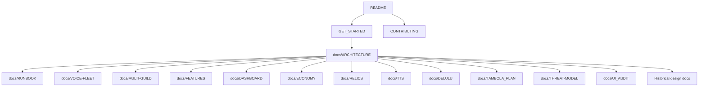

# Documentation

This index separates current documentation from historical design notes. Start with the project README and the getting-started guide if you are new to the repository.

## Current documentation

| Document | Purpose |
|---|---|
| [README.md](../README.md) | Project overview, features, technology, and contribution links |
| [GET_STARTED.md](../GET_STARTED.md) | First-run setup, Discord configuration, verification, local development |
| [ARCHITECTURE.md](ARCHITECTURE.md) | Process model, command lifecycle, boot sequence, persistence, deployment topology |
| [DEVELOPMENT.md](DEVELOPMENT.md) | Repository layout, command flow, extension recipes, tests, debugging |
| [RELEASE.md](RELEASE.md) | Branch and pull request expectations, pre-merge checks, deployment, verification, rollback |
| [RUNBOOK.md](RUNBOOK.md) | Deployment, updates, backups, health checks, troubleshooting |
| [MULTI-GUILD.md](MULTI-GUILD.md) | Server binding, per-guild state, guild-scoped control API, fleet routing |
| [FEATURES.md](FEATURES.md) | Per-guild feature catalog, storage, enforcement, and control API |
| [DASHBOARD.md](DASHBOARD.md) | Admin dashboard setup, Administrator gate, server and user settings, browser API, and security model |
| [VOICE-FLEET.md](VOICE-FLEET.md) | N-bot voice fleet: router, workers, setup, routing contract |
| [ECONOMY.md](ECONOMY.md) | Siela Coins, earning, spending, shop, premium, admin operations |
| [ECONOMY_V2.md](ECONOMY_V2.md) | Earning and AI-gating rationale, exchange model, balance targets |
| [RELICS.md](RELICS.md) | Relic card catalog, daily auctions, bidding, vaults, yield, trades |
| [TTS.md](TTS.md) | Standalone TTS, Tambola voice, synthesis backends, voice locks |
| [DELULU.md](DELULU.md) | LLM backend chain, model names, costs, refunds, fallbacks |
| [TAMBOLA_PLAN.md](TAMBOLA_PLAN.md) | Tambola rules, state, UI, and economy integration |
| [THREAT-MODEL.md](THREAT-MODEL.md) | Trust boundaries, controls, and residual risks |
| [UI_AUDIT.md](UI_AUDIT.md) | UI conventions, audit findings, and follow-ups |

## Historical design documents

These documents record earlier plans. They are useful for rationale but do not describe the deployed system.

| Document | Status |
|---|---|
| [PLAN.md](PLAN.md) | Historical draft. The translator service was never built, the runtime moved to Bun, the LLM moved to vLLM, and TTS moved to KittenTTS. |
| [ECONOMY_PLAN.md](ECONOMY_PLAN.md) | Historical economy design. Current behavior is in [ECONOMY.md](ECONOMY.md). |
| [CURRENCY_GATING.md](CURRENCY_GATING.md) | Historical gating proposal. Most listed paid features were not implemented. |

## Documentation conventions

- Prefer short declarative sentences and concrete file paths.
- Use Mermaid for architecture, state, and sequence diagrams.
- Mark planned behavior clearly. Do not describe an unimplemented feature as current.
- Update the relevant document in the same pull request as a behavior change.
- Keep commands copyable and avoid placeholders that fail validation.
