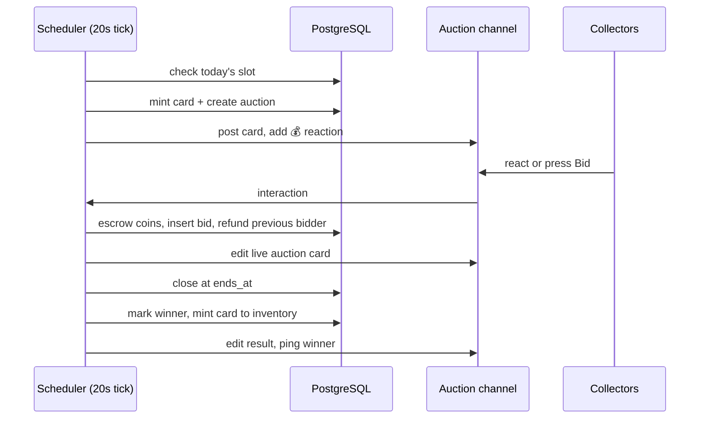

# Siela Relics

Siela Relics is a daily one-of-one trading-card auction and collection system built on Siela Coins (SC). One card drops per day, bidding runs from **4:00 PM to 5:00 PM IST**, and the highest bid at close keeps the card permanently.

The feature is implemented in:

- `packages/shared/src/relics/` — catalog, rarity tables, roll math, IST window helpers
- `packages/db/src/schema.ts` — `relic_*` tables
- `apps/bot/src/features/relics/` — art, auction service, UI
- `apps/bot/src/commands/social/relics.ts` — `/relics` command
- `docs/RELICS.md` — this document

## Design

### One card, one owner, one hour

Each auction mints a single card. Every card has:

- a **serial** (`#0001`, `#0002`, ...), unique forever
- a **unique art seed**, enforced by a database unique index
- procedurally generated art derived from its serial, seed, subject, palette, and foil
- a permanent mint record: winner, price, date, and acquisition source

A subject and finish can appear again on a later card, but the exact card cannot: the serial and art seed are unique. Subject and variant combinations are curated, so a "Doge, Keeper of the Void" can be a Standard print one month and a Prismatic print the next, and they remain distinct one-of-one cards.

Serial **#0001–#0010** are **Genesis** cards. They have a permanent `GENESIS` marker and earn double passive yield.

### Rarity

| Rarity | Weekday weight | Weekend weight | Yield/day | Stat range |
|---|---:|---:|---:|---|
| Common | 52% | 34% | 1 SC | 8–32 |
| Uncommon | 27% | 28% | 2 SC | 18–45 |
| Rare | 13% | 22% | 4 SC | 30–60 |
| Epic | 6% | 11% | 7 SC | 42–72 |
| Legendary | 1.8% | 4% | 12 SC | 55–85 |
| Mythic | 0.2% | 1% | 25 SC | 68–98 |

Saturday and Sunday use the weekend column, in IST. The rolls happen when the card is minted, not when the auction opens.

### Card anatomy

- **Stats**: POWER, CHAOS, LUCK, AURA, each 1–99.
- **Rating**: `0.35 × power + 0.25 × chaos + 0.20 × luck + 0.20 × aura`.
- **Finish**: Standard, Holo, Reverse Holo, Prismatic, Gilded, Obsidian, Misprint, or First Edition.
- **Foil treatment**: holo bands, prismatic rainbow, gold sheen, or obsidian shards on the generated art.
- **Lore**: one curated line for the subject.
- **Provenance**: mint date, mint price, acquisition source, current owner.

## Daily auction lifecycle

1. The scheduler checks every 20 seconds. It creates the daily auction only inside the configured window.
2. The card is minted at auction start but is not assigned an owner until settlement.
3. The auction message shows the art, lore, current bid, next bid, and close time. The bot adds a 💰 reaction.
4. At `ends_at`, the scheduler settles the auction. Settlement also runs on startup, so a restart cannot lose a result.
5. The winning bid is already in escrow. Settlement marks the bid `won`, writes the card to the winner's inventory, and edits the auction message into a result card.
6. If nobody bids, the auction is marked settled with no winner. The card stays unminted in the vault.

The daily slot is unique per guild (`<date>:daily`). Bonus auctions use `<date>:bonus:<timestamp>`, so an admin can run one without breaking the daily record.

## Bidding

- The first bid must be at least the starting bid (default 25 SC).
- Later bids must beat the current bid by at least the minimum increment (default 10 SC).
- A bid is deducted immediately and held in escrow.
- When someone outbids you, your escrow is refunded automatically in the same database transaction.
- You cannot raise your own leading bid.
- Bids are final. There is no retraction.
- The auction duration is fixed. There is no soft-close or anti-snipe extension.
- Bids are capped at 1,000,000 SC per bid.

### Three ways to bid

| Method | Result |
|---|---|
| React with 💰 | Bids the current next minimum. Reaction failures cannot be ephemeral in Discord, so the bot DMs the reason (for example, not enough SC). The reaction is removed so the member can retry. |
| **Bid N SC** button | Places the displayed next minimum. Success or failure is ephemeral. |
| **Custom bid** button | Opens a modal. Success or failure is ephemeral. |

The auction card also has a **My standing** button. It returns the member's balance, their last bid, and the next minimum privately.

## Vault, profile, and yield

- `/relics collection [user] [page]` shows a paginated vault with rarity counts, total rating, daily yield, and the featured card.
- `/relics card serial:<n>` shows the full card, stats, lore, owner, and provenance.
- `/relics showcase serial:<n>` sets the featured card shown on the profile and vault.
- `/relics profile [user]` shows rating, yield, auction wins, rarity counts, badges, and the featured card.
- `/relics top` ranks collectors by total collection rating.

### Passive yield

Every card generates SC per day while held. Yield accrues continuously and is claimed with `/relics collect`.

- Accrual is capped at **30 days** per claim.
- Claiming resets the accrual clock for cards that produced at least 1 SC.
- Genesis cards earn double.
- A card held through a trade keeps its accrual clock.
- Yield is written to the economy ledger as `relic_yield`.

## Trading

`/relics trade user:@member offer:<your serial> [request:<their serial>] [coins:<amount>]`

- The offer expires after 10 minutes.
- Both cards are reserved while the offer is pending. Neither can be featured or offered in another trade.
- Coins offered by the proposer are escrowed immediately.
- The partner accepts or declines with buttons. Only the named partner can accept.
- Accepting swaps both cards atomically, credits the coins, and clears any featured card that moved.
- Declining or expiring refunds the coins and unlocks both cards.
- Omitting `request` and `coins` makes the trade a gift.
- Prefix equivalent: `!relics trade @member 42 none` or `!relics trade @member 42 77 coins:250`.

Trades are stored in `relic_trades`; the pending state is also checked by the scheduler for expiry.

## Commands

| Command | Who | Purpose |
|---|---|---|
| `/relics auction` | Everyone | Show the live auction |
| `/relics bid [amount]` | Everyone | Bid, or show your standing and the next minimum |
| `/relics collection [user] [page]` | Everyone | Browse a vault |
| `/relics card serial:<n>` | Everyone | Inspect a card |
| `/relics showcase serial:<n>` | Owner | Feature a card |
| `/relics profile [user]` | Everyone | Collector profile |
| `/relics collect` | Everyone | Claim passive SC |
| `/relics top` | Everyone | Collection leaderboard |
| `/relics trade ...` | Everyone | Create a trade offer |
| `/relics rules` | Everyone | In-Discord rules |
| `/relics channel channel:<#channel> [ping:<@role>]` | Admin | Set the auction channel and enable drops |
| `/relics config` | Admin | Show configuration and next drop |
| `/relics disable` / `enable` | Admin | Pause or resume daily drops |
| `/relics start [minutes]` | Admin | Start a bonus auction now |
| `/relics end` | Admin | Settle the live auction immediately |
| `/relics cancel` | Admin | Cancel and refund the live auction |
| `/relics grant user:<@member> [rarity]` | Admin | Mint a card directly to a member |

Prefix, slash, and mention-prefix all work through the hybrid command framework.

## Setup

1. Deploy migrations `0013`–`0015` (the compose stack's one-shot `migrate` service handles them on restart). They add the relic tables, the one-live-auction invariant, the one-active-bid invariant, and settlement-announcement recovery.
2. Invite the bot with **View Channels**, **Send Messages**, **Attach Files**, **Read Message History**, **Add Reactions**, and optionally **Manage Messages** so it can remove a member's reaction after a reaction bid (needed for retry). Without Manage Messages, the bid still works and the member can use the buttons instead.
3. Run `/relics channel channel:#your-channel`. This sets the channel and enables daily auctions.
4. Optional: add a ping role with `/relics channel channel:#your-channel ping:@Relic Ping`.
5. Use `/relics start 5` to test a short auction, or wait for 4:00 PM IST.

The gateway now requests `GuildMessageReactions` so reaction bidding works. No privileged intent toggle is needed for reactions.

## Restart and failure behavior

- The scheduler settles any live auction whose `ends_at` has passed on startup.
- Pending trades are expired and refunded on startup.
- Settlement messages are retried for up to two days if the process or Discord was unavailable when the result was first created.
- If the auction message is deleted, settlement still completes; the bot reposts the result if it can still reach the channel.
- If the configured channel is missing or the bot cannot send there, the daily drop is skipped and the reason is logged. The next day gets a new slot.
- Active auctions live in PostgreSQL, not memory. A process restart does not cancel or duplicate them.
- Privacy deletion removes the member's vault, bids, profile, and trades. If another member had coins escrowed in a pending trade with the deleted member, those coins are refunded first.

## Data model

| Table | Purpose |
|---|---|
| `relic_settings` | Per-guild channel, enabled flag, window, bid defaults, ping role |
| `relic_cards` | The mint record: serial, subject, variant, rarity, stats, art seed, owner, provenance |
| `relic_auctions` | One row per drop: slot, channel, message, window, current bid, winner |
| `relic_bids` | Escrow ledger state: active, outbid, won, refunded, cancelled |
| `relic_inventory` | Current ownership, acquisition source, yield clock, trade lock |
| `relic_profiles` | Featured card and lifetime yield claimed |
| `relic_trades` | Pending and resolved player trades |

A card's serial is its `relic_cards.id`. The unique index on `(guild_id, seed)` prevents duplicate art. The unique index on `relic_inventory.card_id` prevents a card from existing in two inventories.

## Economy notes

Relic auctions are a coin sink. Bids leave circulation when a card is won; outbid bids return. Passive yield is a coin source; the values are tuned so a card pays back over weeks, not days. The starting balance (50 SC), daily reward (10–70 SC), and work reward (1–4 SC) remain unchanged.

## Known limits and roadmap

- Reaction failures are DMs, not ephemeral messages. Discord does not allow an ephemeral response to a raw reaction. Button and modal bids do return ephemeral results.
- Card battles, set bonuses, and a player-run marketplace are not implemented. Trades are direct swaps only.
- Subject artwork is procedural. No external image rights are involved.
- Auctions are one per guild per day by default. Admin bonus auctions are unlimited.
- There is no undo for a settled auction. Admin cancellation is only available while the auction is live.

## Verification

- `bun run typecheck`
- `bun run test` (shared relic logic: catalog integrity, rarity weights, IST windows, bids, yield, deterministic rolls)
- `bun run build`
- A scratch-Postgres integration pass covered: bid escrow, outbid refund, winning settlement, inventory mint, cancel refund, no-bid settlement, trade escrow, trade accept, trade decline/refund, yield claim, and message send/edit lifecycle.
