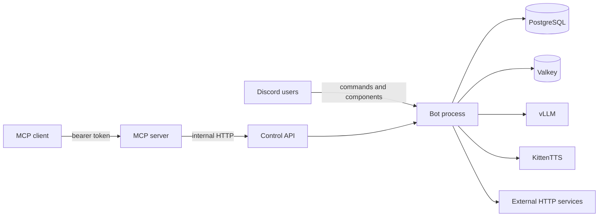

# Siela Bot Threat Model

This document summarizes the main trust boundaries and residual risks. It describes the current implementation, not the historical plan in `docs/PLAN.md`.

## Trust boundaries

The host, the Podman daemon, and the deployment `.env` are trusted. Discord users, MCP clients, model output, and external HTTP responses are untrusted.

| Threat | Control | Residual risk |
|---|---|---|
| Non-admin configuration changes | `adminOnly` command guard plus inline `isAdmin` checks. Admin means guild owner, `Manage Guild`, `BOT_OWNER_ID`, or `ADMIN_ROLE_IDS`. | Admin actions are not all audited. The `test` command uses a hardcoded user ID. |
| Auto-role privilege escalation | Reject `Administrator`, managed roles, `@everyone`, and roles above the bot. | A misconfigured role hierarchy can still grant more access than intended. |
| Temporary voice abuse | Channel-scoped owner permissions, no guild Kick or Ban, bot overwrite guard. | Role-level `Connect` allows can bypass the private-channel intent. |
| MCP token leak | One generated `MCP_TOKEN`. MCP is client-facing on the internal `mcp` network and reaches the control API on `control`. Destructive tools require `confirm: true`. | A token holder can call every MCP tool. Audit coverage is partial. The compose service also receives the shared deployment env file, so a compromised MCP container can read the Discord token and database URL. |
| Prompt injection through Delulu | User input goes to an LLM, never to SQL or a shell. Output is bounded JSON. | A model can produce unwanted text. The bot has no channel-level NSFW gate for `/delulu nsfw`. |
| Delulu NSFW misuse | NSFW costs 15 SC instead of 5 SC. Prompts constrain output. | Enforcement is prompt-level only. The command is not marked NSFW, so Discord does not enforce an age gate. |
| Economy ledger abuse | Daily and work cooldowns use atomic updates. Transfers and spends reject insufficient funds. Every balance change writes an immutable ledger row. | Only admin adjustments, premium purchases, and shop mutations write an audit row. Game and transfer activity does not. |
| vLLM exposure | OpenAI-compatible endpoint with no authentication, reachable only on the internal `edge` and `control` networks. | Any container on those networks can call the model. |
| KittenTTS exposure | Unauthenticated synthesis endpoints on the internal `data` network. | Any container on `data` can generate audio. |
| GPU device exposure | NVIDIA devices are passed only to the `llm` container. | A container escape in `llm` reaches the host GPU driver. |
| Avatar fetch SSRF | Welcome cards fetch the member avatar with a four-second timeout. | There is no private-IP or loopback block on that fetch path. Discord CDN URLs are expected, but the code does not enforce the host. |
| Music URL SSRF | Only `http` and `https` URLs are accepted. yt-dlp runs inside the bot container. | There is no verified private-IP or loopback block before yt-dlp runs. Treat untrusted music URLs as a residual risk. |
| Mention spam | `allowedMentions` is empty unless a welcome message explicitly enables user pings. | A misconfigured welcome template can still ping users. |
| Secret leakage | Generated `.env` has mode 600 and is ignored by Git. Pino redaction is enabled. | A secret committed to Git history remains in forks and clones after removal. |
| Data loss | PostgreSQL volume plus `pg_dump` backups. The runbook documents a restore drill. | There is no automated backup or point-in-time recovery. |
| Container compromise | Rootless Podman, non-root users, read-only root filesystems where configured, dropped capabilities, and `no-new-privileges`. | PostgreSQL, Valkey, vLLM, KittenTTS, and the migration container are not fully hardened. |

## Security assumptions

- The control API and MCP server are not exposed directly to the public internet.
- The host is patched and access to the Podman socket is restricted.
- Discord tokens and MCP tokens are rotated after exposure.
- The deployment uses a dedicated bot token and a dedicated PostgreSQL password.
- Event audio and other media are supplied by the operator and have appropriate rights.

## Reporting

See [SECURITY.md](../SECURITY.md) for the private reporting process.
