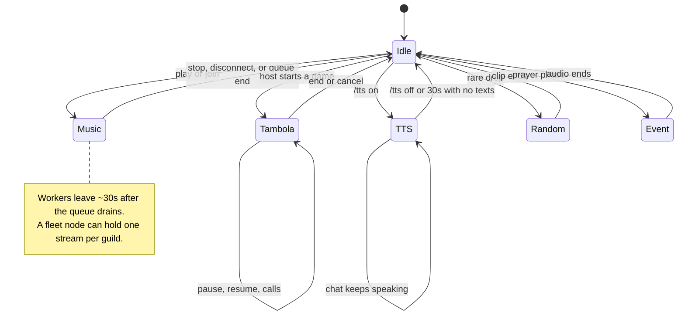

# TTS and Voice

Standalone `/tts` channel narration and the Tambola voice stack share one engine: `TambolaVoice` (`apps/bot/src/features/tambola/voice.ts`).

## Standalone `/tts`

- `/tts on` joins the caller's voice channel (needs Connect + Speak). `/tts off` leaves.
- `TtsService` (`apps/bot/src/features/tts.ts`) keeps one session per guild.
- While enabled, plain messages in the voice channel's own text chat are spoken. Messages starting with `/` or `!` are skipped (`apps/bot/src/bot.ts`).
- Each message is trimmed to 200 characters.
- Mentions are resolved before speaking: `<@id>` becomes the member's display name, `<#id>` the channel name, `<@&id>` the role name, custom emoji becomes its name, `@everyone`/`@here` become "everyone" / "everyone here". Unknown mentions fall back to "someone" / "a channel" / "a role".
- Links become "a link". A message holding only links is spoken as "{User} sent a link". Attachment-only messages become "{User} sent an image/file/...".
- The speaker's display name is prefixed as "{User} said, ..." only when the speaker changed since the previous spoken message; consecutive messages from the same person skip the name (same rule for "sent a link" / attachments).
- Cooldown: 3s on the command. No economy charge for TTS.

## Voice ownership

Only one feature can own the guild voice connection at a time. Music, Tambola, standalone TTS, random voice drops, and scheduled events coordinate through the music voice lock.

A TTS session binds to exactly one node until it ends. The commander takes the session when its voice is free, otherwise a free fleet node does, and speech forwards to that node. Auto-placement never moves a node that is connected to another channel; a node already in the requested channel takes the session, with the Rust worker mixing speech over its music. Session preempt skips TTS-active nodes so scheduled events never cut it off.

Tambola and standalone TTS stop music, preserve the queue, and lock the voice channel for the session. Tambola stops a fleet player bound to its own channel first. Music commands are rejected while the lock is active, and `/play` refuses the Tambola channel while a game is live. Random voice drops and scheduled events skip the channel while music, Tambola, or TTS is using voice.

## Tambola voice

Tambola creates its own `TambolaVoice` per game via `apps/bot/src/features/tambola/service.ts`. Same synthesis path, same failure behavior.

## Synthesis chain

Order in `TambolaVoice.speak()` / `synthesizeNow()`:

1. Remote streaming: `POST {TTS_SERVICE_URL}/synthesize-stream`, used when `TTS_SERVICE_URL` is set and `TTS_STREAM=true`. Audio streams directly into the Discord player. Response headers are bounded to 10s; the body itself is not cut mid-clip.
2. Remote buffered: `POST {TTS_SERVICE_URL}/synthesize`, written to the cache file, then played.
3. Local backend: only when `TTS_SERVICE_URL` is unset.
   - `TTS_BACKEND=edge` (default): `python3 -m edge_tts --voice en-IN-NeerjaNeural --rate=-5%`, MP3 output, 2 attempts, 30s timeout.
   - `TTS_BACKEND=kitten` / `kitten-mini`: daemon scripts via `TTS_PYTHON` + `KITTEN_TTS_SCRIPT` (defaults `/app/assets/tts/kitten_tts_daemon.py` / `kitten_tts_mini_daemon.py`), WAV output.
   - `TTS_VOICE` overrides the kitten voice (default `Bruno`, `Jasper` for kitten-mini). A blank value means the default.

## Primary TTS service (compose)

`services/tts/` (Rust, image `localhost/siela-tts:latest`): byte-parity port of
the Python KittenTTS pipeline (`ort` CPU session, libespeak-ng FFI, same
`/healthz`, `/synthesize`, `/synthesize-stream` contract). Idle RSS is ~10 MB
when the model is unloaded; it peaks around 160 MB while loaded. The old
implementation is kept at `deploy/podman/tts/` (`server.py` +
`Containerfile.tts`) as a rollback reference. Golden parity fixtures live in
gitignored `.local-tts/`; see `services/tts/README.md` for the verification
procedure.

- Model `KittenML/kitten-tts-nano-0.8` baked into the image, voice `Bruno`
  (`TTS_VOICE`), speed `1.0` (`TTS_SPEED`), 24 kHz WAV.
- The model loads lazily on the first synthesis, `/warmup`, or `/tts on`. It is
  dropped again on `/tts off` (and on the 30s idle timeout) when no TTS session
  or Tambola game still needs it, returning most of the memory to the OS. The
  ONNX Runtime environment stays alive across reloads because ORT allows only
  one per process.
- `GET /healthz` reports `{"status":"ok","loaded":<bool>}`.
- `POST /warmup` loads the model, `POST /unload` drops it.
- `GET /healthz`, `POST /synthesize` (buffered WAV), `POST /synthesize-stream`
  (chunked WAV).
- Bot env in `deploy/podman/compose.yaml`: `TTS_SERVICE_URL=http://tts:8000`,
  `TTS_STREAM=true`.

## Env vars

| Var | Default | Used by |
|---|---|---|
| `TTS_SERVICE_URL` | unset (compose: `http://tts:8000`) | bot, remote synthesis |
| `TTS_STREAM` | unset (compose: `true`) | bot, streaming vs buffered remote |
| `TTS_BACKEND` | `edge` | bot, local fallback only |
| `TTS_VOICE` | `Bruno` (kitten) / `Jasper` (kitten-mini) | bot + TTS service |
| `TTS_PYTHON` | `python3` | bot, local synthesis |
| `KITTEN_TTS_SCRIPT` | `/app/assets/tts/kitten_tts_daemon.py` (or `kitten_tts_mini_daemon.py`) | bot, kitten backends |
| `KITTEN_TTS_MODEL` | `KittenML/kitten-tts-nano-0.8` | TTS service |
| `TTS_SPEED` | `1.0` | TTS service |

## Cache

- Dir `/tmp/siela-tambola-tts` (compose bot uses a tmpfs `/tmp`).
- Key: SHA-1 of `engine + \0 + effective voice + \0 + rate + \0 + text`. Extension `.wav` for the remote service and kitten, `.mp3` for local Edge.
- Hit returns the cached file if non-empty. Pruned every 20 syntheses down to 300 newest files. Safe to delete anytime.

## Failure behavior

- Synthesis calls are serialized through one chain; playback interrupts the current clip.
- Any synthesis path counts failures; at 3 failures `TambolaVoice.disabled` is set and the game/session continues text-only. Tambola never blocks the game loop on TTS.
- `join()` fails soft (returns false) when permissions are missing, a voice connection already exists, or the connection times out (15s).

## Music voice lock

- One voice connection per guild. Enabling `/tts` disconnects music and calls `music.lockVoice(guildId)`; disabling calls `music.unlockVoice(guildId)` (`apps/bot/src/features/tts.ts`).
- Tambola does the same for the game duration (`apps/bot/src/features/tambola/service.ts`).
- While locked, music `play`/`join` rejects with "Tambola is using the voice channel..."; the lock auto-clears if nothing is actually using voice (`apps/bot/src/features/music.ts`).
- Random VC moments (`apps/bot/src/features/randomVc.ts`) and scheduled event audio/tests (`apps/bot/src/features/scheduledEvents.ts`) skip while the voice is locked or busy.
