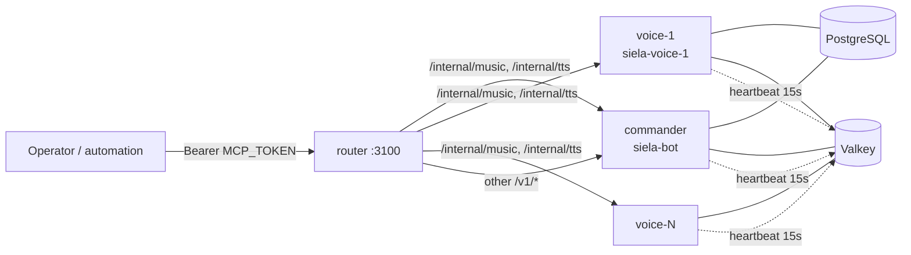
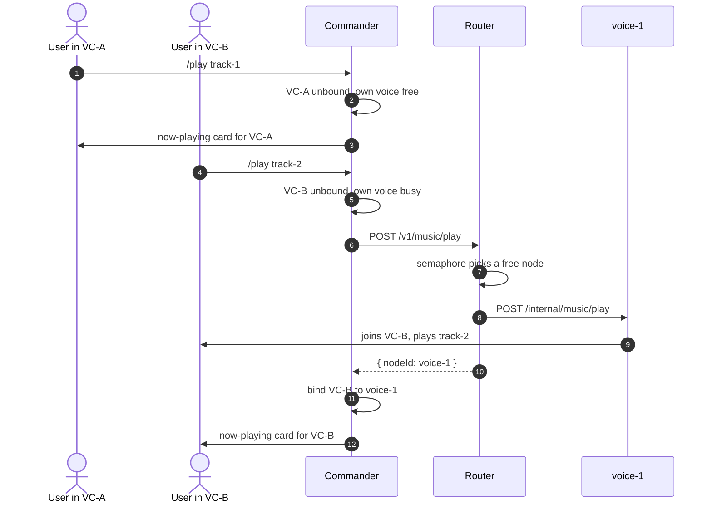
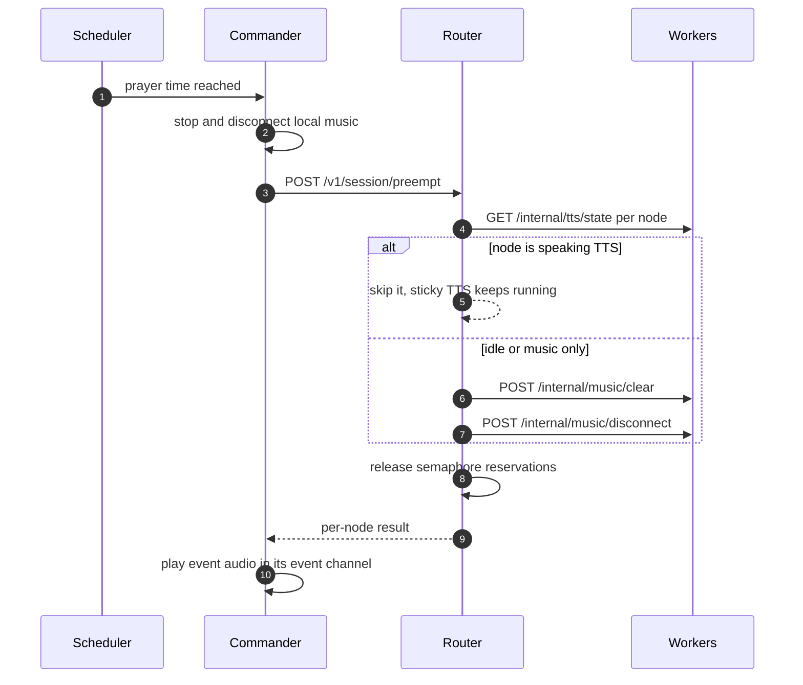

# Voice fleet (N bots, one control entrypoint)

Discord allows one voice connection per bot per guild. To play in N voice
channels at once, run N bot processes — one commander plus N-1 voice
workers — and drive them through the router as if they were one bot.

## Topology



- **Commander** (`NODE_ROLE=commander`, default): the existing bot. Owns
  slash/prefix commands, DB writes that matter, Tambola, scheduled events,
  the public control API `:3001`, and its own voice connection.
- **Voice workers** (`NODE_ROLE=voice`, `NODE_ID=voice-<i>`): same image,
  own `DISCORD_TOKEN`. They ignore text commands and interactions, skip
  schedulers, and serve only the internal worker API `:3101` plus health.

A Rust worker is also available at `apps/voice-worker`. It speaks the same
environment, internal API, health endpoints, and Valkey heartbeat, so the
router cannot tell it apart. It exists because the TypeScript worker holds
about 53 MB of private memory idle and keeps a decoder process alive for each
track, while the Rust worker measured 3 MB of private memory and 16 MB total
while playing a normal track, with no decoder process.

Select it when generating the overlay:

```bash
WORKER_RUNTIME=rust ./scripts/make-voice-overlay.sh 2
```

The default is still `WORKER_RUNTIME=bun`. Both runtimes can be mixed across
nodes, because each node registers itself through the same heartbeat key.

Discord requires the DAVE encryption protocol on voice connections, so any
voice client must support it. `@discordjs/voice` 0.19.2 ships `davey`, and the
Rust worker needs songbird 0.6 or newer for the same reason. songbird 0.4 is
rejected at the voice gateway with close code 4017.
- **Router** (`apps/router`, `siela-router`): stateless gateway. Music
  routes require `nodeId` and fan out to that node's `/internal/music/*`;
  every other `/v1/*` route proxies to the commander unchanged.

Each node keeps an independent music queue. Queues persist in Valkey under
`siela:music:queue:{node}:{guild}`, so workers sharing Valkey never collide.

## Setup

1. Create one Discord application per node (commander + N workers) and
   invite every bot to the guild with the same permissions.
2. Copy the per-node env and fill in each worker token. `MCP_TOKEN`,
   `DATABASE_URL`, and `GUILD_ID` must match the main `.env`:

   ```bash
   cp deploy/podman/.env.voice.example deploy/podman/.env.voice-1
   cp deploy/podman/.env.voice.example deploy/podman/.env.voice-2
   # ... one file per worker
   ```

3. Generate the worker overlay and add the router's node list to `.env`:

   ```bash
   ./scripts/make-voice-overlay.sh 2
   # add the printed NODES= line to deploy/podman/.env
   ```

4. Deploy:

   ```bash
   ./scripts/podman-stack.sh up -d --build
   ```

`scripts/podman-stack.sh` includes the generated overlay automatically when
`deploy/podman/compose.voice.generated.yaml` exists. To go back to one bot,
delete the overlay and the `.env.voice-*` files and restart.

## Session model

One guild is one session, and the session lives only in Valkey. Every node
(commander and workers) refreshes `siela:fleet:node:<nodeId>` every 15s with
a 45s TTL; the router reads the live set for nodes, state-all, preempt, and
auto-route. Crashed nodes expire out on their own, restarts re-register on
boot — clear up and re-initiate with no manual cleanup. Static `NODES` is
only the fallback when Valkey is unreachable.

Semaphore capacity is per guild: the router counts only nodes heartbeating
for that guild (`GUILD_ID` in the router env). A lone commander yields a
semaphore of one; each worker that comes online grows it. Playback, 429s,
and preempt all operate on that guild's session.

- Music plays per node (independent queues), routed by `nodeId` or
  auto-routed to a free node.
- Scheduled events (azan, anthem, chalisa, church, monastery, gurudwara)
  preempt the whole session: before event audio plays, the commander calls
  `POST /v1/session/preempt` on the router (`ROUTER_URL` in `.env`), which
  clears every node's queue, disconnects voice, and drops semaphore
  reservations. Set `ROUTER_URL=http://voice-router:3100` to enable it;
  without it, only the commander's own queue is stopped. Preempt is
  best-effort — event audio still plays if the router is unreachable.

## Routing contract

Point music automation at the router (`http://voice-router:3100` on the
control network), not at individual nodes:

- `GET /v1/music/nodes` — configured node IDs.
- `GET /v1/music/state-all` — per-node playback state (`ok: false` entries
  carry the node error instead of failing the whole call).
- `POST /v1/music/play` — `nodeId` is optional. Without it the router
  auto-routes to a free node (first idle; reservations close the race
  between concurrent requests) and returns `{ nodeId, result }`. When every
  node is playing or holding a track, it rejects with `429 all_nodes_busy`
  ("add more worker nodes for more concurrent streams"). With `nodeId`,
  the request goes straight there.
- `POST /v1/music/<other op>` with `{"nodeId": "voice-1", ...}` — `join`,
  `pause`, `resume`, `skip`, `stop`, `volume`, `seek`, `loop`, `shuffle`,
  `remove`, `clear`, `move`, `jump`, `autoplay`, `filters`, `disconnect`.
  `play` allows a 5-minute upstream timeout (large playlist resolves).
- Any other `/v1/*` — proxied to the commander as-is.

Discord `!music`/`/play` commands treat **every voice channel as its own
music instance**. Playing in VC-A then VC-B runs two simultaneous streams:
the commander takes a channel when its voice is free for it, otherwise the
track auto-routes to a free fleet node, and the VC→node binding sticks for
later plays in that channel. Each instance gets the full now-playing card,
and all interface — card buttons, `/nowplaying`, `/queue`, `/lyrics`, and
every control command (`pause`, `skip`, `stop`, `volume`, `loop`, …) —
follows the author's voice channel to the right node. Queues never merge
across channels; stop/disconnect ends only that VC's stream.



Session preempt runs before every scheduled event:



## Sticky TTS

TTS binds to exactly one node until `/tts off`:

- `/tts on` uses the commander when its voice is free, otherwise a free
  fleet node. The binding (node + channel) is recorded as the session.
- Chat in the TTS channel is spoken on the bound node; every other node
  stays silent. TTS never migrates mid-session.
- Session preempt skips TTS-active nodes, so scheduled events never cut
  sticky TTS off. Disabling TTS tells the owning worker to stand down.
- While TTS sits on a worker, the commander is unlocked and `/play` works
  locally again.
- Any TTS session ends itself after 30s with no texts to speak — workers
  never idle in voice forever. The music auto-leave never fires while TTS
  is active; TTS idle timeout is the only thing that clears it.

## Known limitations

- Tambola, scheduled prayer events, random VC drops, and activity/leveling
  awards run on the commander only. The commander's schedulers move whoever
  is in voice, regardless of which node plays there.
- Voice-busy checks (`isVoiceBusy`, music voice locks) are per-process, not
  per-fleet. Two nodes can be told to join channels at the same time; the
  last writer wins per channel.
- All nodes share one guild (`GUILD_ID`). Multi-guild fleets are out of scope.

## Troubleshooting

- `up -d` hangs after an image rebuild: `podman-compose` waits on the
  one-shot `migrate` container, which never reaches "running". The
  migrations themselves already exited 0 — start the long-lived services
  with `./scripts/podman-stack.sh up -d --no-deps` instead.
- `Error: ... depends on container ... not found in input list`: stale
  dependency metadata from an interrupted compose run. Remove the stuck
  `Created` container (`podman rm siela-router`) and run `up` again.

## Updates (watchtower)

The server runs the watchtower sidecar (overlay + `WATCHTOWER_ENABLED=true`),
so pushes to `main` auto-deploy after CI passes. Full deploys rebuild the
bot, TTS, **and router** images, run migrations, then recreate the whole
fleet (bot, TTS, router, generated voice workers — never the watchtower
itself, which would kill the deploy mid-run). Fast deploys
(bot/router-source-only changes) rebuild `apps/bot/dist` and
`apps/router/dist`, bind-mount them into the running `bot`/`router`
containers, and recreate just those two; voice worker code changes always
need a full deploy since workers run the image bundle. Rebuild the
watchtower image by hand after watchtower code changes — it deploys
everything except itself.
