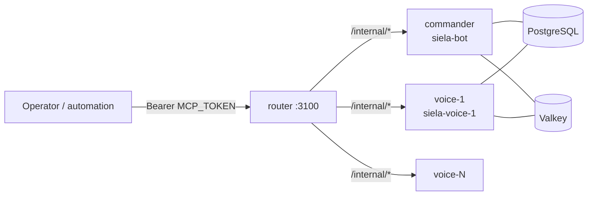

# Voice fleet (N bots, one control entrypoint)

Discord allows one voice connection per bot per guild. To play in N voice
channels at once, run N bot processes — one commander plus N-1 voice
workers — and drive them through the router as if they were one bot.

## Topology



- **Commander** (`NODE_ROLE=commander`, default): the existing bot. Owns
  slash/prefix commands, DB writes that matter, Tambola, scheduled events,
  the public control API `:3001`, and its own voice connection.
- **Voice workers** (`NODE_ROLE=voice`, `NODE_ID=voice-<i>`): same image,
  own `DISCORD_TOKEN`. They ignore text commands and interactions, skip
  schedulers, and serve only the internal worker API `:3101` plus health.
- **Router** (`apps/router`, `siela-router`): stateless gateway. Music
  routes require `nodeId` and fan out to that node's `/internal/music/*`;
  every other `/v1/*` route proxies to the commander unchanged.

Each node keeps an independent music queue. Queues persist in Valkey under
`siela:music:queue:{node}:{guild}`, so workers sharing Valkey never collide.

## Setup

1. Create one Discord application per node (commander + N workers) and
   invite every bot to the guild with the same permissions.
2. Copy the per-node env and fill in each worker token. `MCP_TOKEN`,
   `DATABASE_URL`, and `GUILD_ID` must match the main `.env`:

   ```bash
   cp deploy/podman/.env.voice.example deploy/podman/.env.voice-1
   cp deploy/podman/.env.voice.example deploy/podman/.env.voice-2
   # ... one file per worker
   ```

3. Generate the worker overlay and add the router's node list to `.env`:

   ```bash
   ./scripts/make-voice-overlay.sh 2
   # add the printed NODES= line to deploy/podman/.env
   ```

4. Deploy:

   ```bash
   ./scripts/podman-stack.sh up -d --build
   ```

`scripts/podman-stack.sh` includes the generated overlay automatically when
`deploy/podman/compose.voice.generated.yaml` exists. To go back to one bot,
delete the overlay and the `.env.voice-*` files and restart.

## Session model

One guild is one session, and the session lives only in Valkey. Every node
(commander and workers) refreshes `siela:fleet:node:<nodeId>` every 15s with
a 45s TTL; the router reads the live set for nodes, state-all, preempt, and
auto-route. Crashed nodes expire out on their own, restarts re-register on
boot — clear up and re-initiate with no manual cleanup. Static `NODES` is
only the fallback when Valkey is unreachable.

Semaphore capacity is per guild: the router counts only nodes heartbeating
for that guild (`GUILD_ID` in the router env). A lone commander yields a
semaphore of one; each worker that comes online grows it. Playback, 429s,
and preempt all operate on that guild's session.

- Music plays per node (independent queues), routed by `nodeId` or
  auto-routed to a free node.
- Scheduled events (azan, anthem, chalisa, church, monastery, gurudwara)
  preempt the whole session: before event audio plays, the commander calls
  `POST /v1/session/preempt` on the router (`ROUTER_URL` in `.env`), which
  clears every node's queue, disconnects voice, and drops semaphore
  reservations. Set `ROUTER_URL=http://voice-router:3100` to enable it;
  without it, only the commander's own queue is stopped. Preempt is
  best-effort — event audio still plays if the router is unreachable.

## Routing contract

Point music automation at the router (`http://voice-router:3100` on the
control network), not at individual nodes:

- `GET /v1/music/nodes` — configured node IDs.
- `GET /v1/music/state-all` — per-node playback state (`ok: false` entries
  carry the node error instead of failing the whole call).
- `POST /v1/music/play` — `nodeId` is optional. Without it the router
  auto-routes to a free node (first idle; reservations close the race
  between concurrent requests) and returns `{ nodeId, result }`. When every
  node is playing or holding a track, it rejects with `429 all_nodes_busy`
  ("add more worker nodes for more concurrent streams"). With `nodeId`,
  the request goes straight there.
- `POST /v1/music/<other op>` with `{"nodeId": "voice-1", ...}` — `join`,
  `pause`, `resume`, `skip`, `stop`, `volume`, `seek`, `loop`, `shuffle`,
  `remove`, `clear`, `move`, `jump`, `autoplay`, `filters`, `disconnect`.
  `play` allows a 5-minute upstream timeout (large playlist resolves).
- Any other `/v1/*` — proxied to the commander as-is.

Discord `!music`/`/music` commands normally drive the commander's queue in the
author's channel. If the commander's voice is locked (Tambola game, TTS
session) and `ROUTER_URL` is set, `/play` auto-routes to a free fleet node
instead of failing, replying with the full now-playing card for that node.
All interface — the card and its pause/skip/stop/loop/shuffle/filter/lyrics
buttons — is owned by the commander and forwarded through the router, so
there is exactly one place to read and control playback.

## Sticky TTS

TTS binds to exactly one node until `/tts off`:

- `/tts on` uses the commander when its voice is free, otherwise a free
  fleet node. The binding (node + channel) is recorded as the session.
- Chat in the TTS channel is spoken on the bound node; every other node
  stays silent. TTS never migrates mid-session.
- Session preempt skips TTS-active nodes, so scheduled events never cut
  sticky TTS off. Disabling TTS tells the owning worker to stand down.
- While TTS sits on a worker, the commander is unlocked and `/play` works
  locally again.

## Known limitations

- Tambola, scheduled prayer events, random VC drops, and activity/leveling
  awards run on the commander only. The commander's schedulers move whoever
  is in voice, regardless of which node plays there.
- Voice-busy checks (`isVoiceBusy`, music voice locks) are per-process, not
  per-fleet. Two nodes can be told to join channels at the same time; the
  last writer wins per channel.
- All nodes share one guild (`GUILD_ID`). Multi-guild fleets are out of scope.

## Troubleshooting

- `up -d` hangs after an image rebuild: `podman-compose` waits on the
  one-shot `migrate` container, which never reaches "running". The
  migrations themselves already exited 0 — start the long-lived services
  with `./scripts/podman-stack.sh up -d --no-deps` instead.
- `Error: ... depends on container ... not found in input list`: stale
  dependency metadata from an interrupted compose run. Remove the stuck
  `Created` container (`podman rm siela-router`) and run `up` again.
